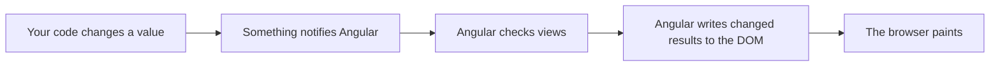

Your task board shows "Remaining tasks: 3". You click a button that completes a task, and the count drops to 2. Then you change that handler so the count drops one second later, the way it would after a server confirms the save. Now the count stays at 3. It only catches up when you click a button again.

The assignment is the same in both handlers, so why does the page update in one case and not the other? The answer comes from what Angular does between your code changing a value and the browser showing it. By the end of this article, you'll be able to look at a stale value on screen and say which step was missing.

The examples use Angular 22.2.1 in a new project. Two of its defaults matter here: the app doesn't load a library called Zone.js, and components use a checking strategy called `OnPush`. Both get explained along the way, and the [versions section](#angular-versions-and-defaults) at the end lists when each default arrived.

You'll need basic Angular components for this: a component class, its template, `{{ }}` interpolation, and `(click)` event bindings. The [behavior article's Angular task board](/dump/blog/frontend-evolution-behavior/) introduces them.

## Contents

1. [What happens between your code and the screen](#what-happens-between-your-code-and-the-screen)
2. [A timer that leaves the count stale](#a-timer-that-leaves-the-count-stale)
3. [Passing a changed task to a TaskRow](#passing-a-changed-task-to-a-taskrow)
4. [OnPush and Eager components](#onpush-and-eager-components)
5. [How signals tell Angular what changed](#how-signals-tell-angular-what-changed)
6. [Observables and AsyncPipe](#observables-and-asyncpipe)
7. [Marking a view with markForCheck](#marking-a-view-with-markforcheck)
8. [How Zone.js-based apps schedule checks](#how-zonejs-based-apps-schedule-checks)
9. [Debugging a stale value](#debugging-a-stale-value)
10. [Angular versions and defaults](#angular-versions-and-defaults)
11. [Why the count stayed stale](#why-the-count-stayed-stale)

## What happens between your code and the screen

Changing a JavaScript variable only changes a value in memory:

```ts
let remaining = 3;
remaining -= 1;
```

The number `2` now exists in memory, but the page still says 3. The page is drawn from the **DOM**, the browser's live tree of objects for the page's elements and text (the [DOM and events article](/dump/blog/html-dom-and-events/) covers it). Something has to copy the new value into the DOM.

In Angular, that something works per component. When Angular first displays a component, it creates a **view**: one rendered copy of the component's template, made of the DOM nodes it created plus the data Angular keeps to update them. Every expression in the template whose result goes into the page or into a child component is a **binding**. `{{ remaining }}` is a binding, and so is `[task]="task"`. For each binding, Angular records the result it used last time.

Views form a tree that mirrors your components:

```text
TaskPage view
  ├── TaskRow view (task 1)
  └── TaskRow view (task 2)
```

**Change detection** is how Angular brings those views up to date. It walks the tree from the top, and one walk is called a **pass**. For each view it checks during a pass, it runs every binding expression again and compares each result with the recorded one. Only results that differ get written into the existing DOM nodes, so a check that finds no differences writes nothing. Angular keeps the nodes it created and changes them in place instead of rebuilding the HTML.

Here's the whole path from your assignment to pixels:



The first arrow is the one that causes most stale screens. Angular doesn't watch your variables, so an assignment on its own notifies nobody. Something has to tell Angular "there may be work to do", and most of this article is about what counts as telling it.

The other arrows have details of their own:

- Several notifications that arrive close together share one check.
- Angular compares new binding results with the results it recorded, so it never needs to read the DOM back.
- Writing to the DOM doesn't draw anything yet. The browser paints after your JavaScript finishes running, so long-running code can delay what you see. The [JavaScript engines and runtimes article](/dump/blog/javascript-engines-and-runtimes/) explains when the browser gets that chance.

## A timer that leaves the count stale

Here's the opening scenario as a component. The `setTimeout` call stands in for a server that confirms the save one second later:

```ts
import { Component } from "@angular/core";

@Component({
  selector: "task-board",
  template: `
    <button type="button" (click)="completeNow()">Complete a task now</button>
    <button type="button" (click)="completeLater()">Complete a task in 1 second</button>
    <p>Remaining tasks: {{ remaining }}</p>
  `,
})
export class TaskBoard {
  remaining = 3;

  completeNow(): void {
    this.remaining -= 1;
  }

  completeLater(): void {
    setTimeout(() => {
      this.remaining -= 1;
    }, 1000);
  }
}
```

Notice that `remaining` is an ordinary class field and both handlers subtract 1 from it. Start from a fresh page and try this sequence:

| Step                                                  | `remaining` in memory | Page shows |
| ----------------------------------------------------- | --------------------- | ---------- |
| Page loads                                            | `3`                   | 3          |
| Click **Complete a task in 1 second**, wait 2 seconds | `2`                   | 3          |
| Click **Complete a task now**                         | `1`                   | 1          |

The count skips straight from 3 to 1. The value was already 2 in memory, and the second click made Angular look again.

### Why the click works

Angular wraps every listener you write in a template, such as `(click)`. When the event fires, the wrapper marks the component's view as **dirty**, a flag that means "check this view in the next pass". It also marks every view above it, so the pass can reach it from the top. Then it schedules a check and calls your handler. The check runs shortly after your handler returns, so it sees whatever the handler changed.

So clicking **Complete a task in 1 second** did notify Angular. But that check ran right after the click, a full second before the timer changed `remaining`, so it found nothing new. When the timer callback runs, nothing notifies Angular, and the page keeps showing 3 until the next click.

### Why older Angular apps never had this problem

If you've worked on an Angular app created before version 21, timers like this one probably updated the page fine. Those apps load **Zone.js**, a library that wraps browser APIs such as `setTimeout`, promises, and event listeners, and they configure Angular to use it. Angular then hears about callbacks that run inside its zone, including a timer started from a click handler, and runs a check after each one. Their components were also checked on every pass by default. The timer callback finishing was enough.

New apps don't use Zone.js for change detection, so you supply the notification yourself. The [Zone.js section](#how-zonejs-based-apps-schedule-checks) has the details.

### Fixing the count with a signal

A **signal** is a value holder from Angular that knows who reads it. You read it by calling it, `remaining()`, and change it with `.set(...)` or `.update(...)`. The [values article](/dump/blog/values-references-and-identity/#connect-the-model-to-angular) introduces them. Here's the board with `remaining` as a signal:

```ts
import { Component, signal } from "@angular/core";

@Component({
  selector: "task-board",
  template: `
    <button type="button" (click)="completeNow()">Complete a task now</button>
    <button type="button" (click)="completeLater()">Complete a task in 1 second</button>
    <p>Remaining tasks: {{ remaining() }}</p>
  `,
})
export class TaskBoard {
  readonly remaining = signal(3);

  completeNow(): void {
    this.remaining.update((count) => count - 1);
  }

  completeLater(): void {
    setTimeout(() => {
      this.remaining.update((count) => count - 1);
    }, 1000);
  }
}
```

Now the timer's change shows up after one second. While Angular evaluated the template, it noticed the read of `remaining()` and recorded that this view depends on that signal. When the timer writes a new value, the signal marks the view dirty and schedules a check. The write itself is the notification.

## Passing a changed task to a TaskRow

The second common stale screen involves a parent passing an object to a child. This example uses the `Task` shape from the [component composition article](/dump/blog/angular-component-composition/). Save it in `task.ts`:

```ts
export interface Task {
  id: number;
  title: string;
  done: boolean;
}
```

The row here is stripped down to the title, so the example stays about updates. Save it in `task-row.ts`:

```ts
import { Component, input } from "@angular/core";
import type { Task } from "./task";

@Component({
  selector: "task-row",
  template: `<p>{{ task().title }}</p>`,
})
export class TaskRow {
  readonly task = input.required<Task>();
}
```

The page keeps the tasks in a signal and offers two ways to rename the first task:

```ts
import { Component, signal } from "@angular/core";
import type { Task } from "./task";
import { TaskRow } from "./task-row";

@Component({
  selector: "task-page",
  imports: [TaskRow],
  template: `
    <button type="button" (click)="renameByChangingObject()">Rename by changing the object</button>
    <button type="button" (click)="renameWithNewObject()">Rename with a new object</button>
    @for (task of tasks(); track task.id) {
      <task-row [task]="task" />
    }
  `,
})
export class TaskPage {
  readonly tasks = signal<Task[]>([
    { id: 1, title: "Read the DOM article", done: false },
    { id: 2, title: "Review the CSS layout", done: false },
  ]);

  renameByChangingObject(): void {
    this.tasks()[0].title = "Read the values article";
  }

  renameWithNewObject(): void {
    this.tasks.update((tasks) => {
      const renamed: Task[] = [];

      for (const task of tasks) {
        if (task.id !== 1) {
          renamed.push(task);
          continue;
        }

        renamed.push({ ...task, title: "Read the values article" });
      }

      return renamed;
    });
  }
}
```

Notice the difference between the two methods. The first one changes the `title` property inside the existing task object. The second one builds a new array with a new object for task 1 and leaves task 2's object as it was.

Try each button on a fresh page:

| Button                              | First task in memory      | First row shows           |
| ----------------------------------- | ------------------------- | ------------------------- |
| **Rename by changing the object**   | "Read the values article" | "Read the DOM article"    |
| **Rename with a new object**        | "Read the values article" | "Read the values article" |

Here's what happens after **Rename by changing the object**. The click marks `TaskPage`'s view dirty, so Angular checks it. That check reaches the `[task]="task"` binding for the first row and evaluates it. Before Angular hands a value to a child's input, it compares it with the value it passed last time. It uses `Object.is()` for that comparison, which for objects works like `===`: is this the same object in memory? The [values and identity article](/dump/blog/values-references-and-identity/) explains that kind of equality in detail.

It's the same object, just with a changed property, so Angular doesn't pass a new input. Nothing marked the row dirty, so Angular skips it, and the row keeps showing the old title.

After **Rename with a new object**, the binding produces a different object. Angular passes the new input, marks the row dirty, and checks it, so the row shows the new title.

This can look like Angular forbids changing objects in place. It allows it, but the change doesn't count as a new input. If something else later makes Angular check the row, such as a click on a button inside the row, the row reads `task().title` again and shows whatever the object holds at that moment.

## OnPush and Eager components

The row in the last section was skipped. That means Angular didn't run its bindings at all, so the DOM kept the old text. Angular can skip a component like that because of its **change detection strategy**, a per-component setting with two values.

`OnPush`, the default since Angular 22, lets Angular skip a view unless something has marked it dirty. These are the things that do:

- a template-bound input receives a new value, as compared with `Object.is()`;
- an event listener in the view's template, or in a component inside it, runs;
- a signal its template reads gets a new value;
- code calls `markForCheck()` for it, which the [`AsyncPipe` section](#observables-and-asyncpipe) shows.

`Eager` means Angular checks the view every time a pass reaches it, whether or not anything marked it. You opt into it per component:

```ts
import { ChangeDetectionStrategy, Component, input } from "@angular/core";
import type { Task } from "./task";

@Component({
  selector: "task-row",
  changeDetection: ChangeDetectionStrategy.Eager,
  template: `<p>{{ task().title }}</p>`,
})
export class TaskRow {
  readonly task = input.required<Task>();
}
```

With this row, **Rename by changing the object** updates the title right away. The click makes Angular check `TaskPage`, the pass continues into the row, and an `Eager` row runs its bindings and reads the changed title.

That sounds convenient, but `Eager` only decides whether a reached view gets checked. It doesn't create notifications, so the timer from the first example would still leave an `Eager` board stale in an app without Zone.js. Its cost is that every pass re-runs the bindings of every `Eager` view it reaches, so the `OnPush` default is usually the better fit. Replace objects instead of changing them in place, and the inputs do the notifying.

Before Angular 22, the eager strategy was called `Default`. That name still works, but it's a deprecated alias for `Eager`.

Two more details explain what you see in larger component trees:

- Checking a parent doesn't force its `OnPush` children to refresh. Each child gets checked only if it's dirty, which is exactly what happened to the row.
- When a signal read only by a child's template changes, Angular walks through the child's ancestors to reach it without re-running the ancestors' bindings. A click or `markForCheck()` marks the ancestors dirty as well, so those passes check the ancestors too.

## How signals tell Angular what changed

The timer fix worked because the template read a signal. Angular tracks signal reads inside a **reactive context**, which is code that Angular runs while recording which signals it reads. Rendering a template is a reactive context, and so are `computed()` and `effect()`.

Signal reads elsewhere create no dependency. If a click handler or a `setTimeout` callback reads a signal, nothing gets recorded, and that code won't run again when the signal changes. Tracking is also synchronous: in an `async` function, reads after an `await` aren't tracked.

### Deriving the count with computed

On a real task board, the remaining count comes from the tasks rather than living in its own field. `computed()` creates a read-only signal from a calculation:

```ts
import { Component, computed, signal } from "@angular/core";
import type { Task } from "./task";

@Component({
  selector: "task-board",
  template: `
    <button type="button" (click)="completeLater(1)">Complete the first task in 1 second</button>
    <p>Remaining tasks: {{ remaining() }}</p>
  `,
})
export class TaskBoard {
  readonly tasks = signal<Task[]>([
    { id: 1, title: "Read the DOM article", done: false },
    { id: 2, title: "Review the CSS layout", done: false },
    { id: 3, title: "Try the change detection examples", done: false },
  ]);

  readonly remaining = computed(() => {
    let count = 0;

    for (const task of this.tasks()) {
      if (!task.done) {
        count += 1;
      }
    }

    return count;
  });

  completeLater(id: number): void {
    setTimeout(() => {
      this.tasks.update((tasks) => {
        const updated: Task[] = [];

        for (const task of tasks) {
          if (task.id !== id) {
            updated.push(task);
            continue;
          }

          updated.push({ ...task, done: true });
        }

        return updated;
      });
    }, 1000);
  }
}
```

The page shows 3, and one second after the click it shows 2. Follow the chain: the template reads `remaining()`, and `remaining` reads `tasks()`. The timer writes a new array to `tasks`, which marks `remaining` as out of date. Because the template depends on `remaining`, its view is marked dirty too, and the next check reads the recalculated count.

A `computed()` value is lazy and cached. Its calculation runs the first time something reads it, and later reads reuse the result until a signal it read changes. It also tracks only the signals it actually read during its last run, so a signal behind an `if` that didn't run isn't a dependency yet.

For a value derived from other signals, use `computed()`. An `effect()` that copies values into another writable signal does the same job with more ways to get out of sync. Effects are for side effects such as logging or calling a non-Angular library.

### Changing an object inside a signal

Signals use the same `Object.is()` comparison as inputs. A write only notifies anyone when the new value is a different value:

```ts
import { signal } from "@angular/core";
import type { Task } from "./task";

const task = signal<Task>({ id: 1, title: "Read the DOM article", done: false });

task().done = true; // Changes the object, but tells no one.
task.set(task()); // Same object, so the signal treats it as unchanged.

task.update((current) => ({ ...current, done: true })); // New object: readers are notified.
```

This is the input problem again. A signal holds a reference to the object, so changing a property inside it isn't a signal write. That's why the examples above build new arrays and objects with `update()`. A signal can be given a custom `equal` function that changes which writes count as changes, but the default is `Object.is()`.

## Observables and AsyncPipe

This section uses RxJS, the library Angular uses for streams of values. An **observable** is an object that delivers values over time to whatever subscribes to it. Angular's `HttpClient`, for example, returns one for each request. A `$` at the end of a name, as in `tasks$`, is a common convention that marks an observable.

An observable delivering a value doesn't notify Angular by itself. In a template, `AsyncPipe` does that for you:

```ts
import { AsyncPipe } from "@angular/common";
import { Component } from "@angular/core";
import { delay, of } from "rxjs";
import type { Task } from "./task";
import { TaskRow } from "./task-row";

const startingTasks: Task[] = [
  { id: 1, title: "Read the DOM article", done: false },
  { id: 2, title: "Review the CSS layout", done: false },
];

@Component({
  selector: "task-list",
  imports: [AsyncPipe, TaskRow],
  template: `
    @if (tasks$ | async; as tasks) {
      @for (task of tasks; track task.id) {
        <task-row [task]="task" />
      }
    } @else {
      <p>Loading tasks…</p>
    }
  `,
})
export class TaskList {
  readonly tasks$ = of(startingTasks).pipe(delay(1000));
}
```

`of(startingTasks)` creates an observable that delivers the array once, and `delay(1000)` holds it back for one second, standing in for a server response. The page shows "Loading tasks…" and then the two rows.

`tasks$ | async` subscribes to the observable the first time Angular checks the view. Until a value arrives, it returns `null`, so the `@else` branch shows. When the array arrives, the pipe stores it and calls `markForCheck()` on the view, which marks it dirty and schedules a check. When the view is destroyed, the pipe unsubscribes. `AsyncPipe` accepts promises too.

If you subscribe in the class yourself and assign the result to a plain field, nothing notifies Angular, so the page keeps showing "Loading tasks…" just like the timer example. You'd also have to unsubscribe yourself when the component is destroyed. For observables used in component code, `toSignal()` from `@angular/core/rxjs-interop` subscribes for you and gives you a signal instead:

```ts
readonly tasks = toSignal(of(startingTasks).pipe(delay(1000)));
```

The template then reads `tasks()`, which is `undefined` until the array arrives. Call `toSignal()` in a field initializer like this one, not inside a method, because it needs the component's injection context to unsubscribe when the component is destroyed. The [dependency injection article](/dump/blog/angular-dependency-injection/) explains injection contexts.

## Marking a view with markForCheck

Sometimes you can't use a signal right away, for example in an older component that keeps plain fields. You can still notify Angular yourself. Here's the first `TaskBoard` with its plain `remaining` field, plus one line in the timer callback:

```ts
import { ChangeDetectorRef, Component, inject } from "@angular/core";

@Component({
  selector: "task-board",
  template: `
    <button type="button" (click)="completeLater()">Complete a task in 1 second</button>
    <p>Remaining tasks: {{ remaining }}</p>
  `,
})
export class TaskBoard {
  private readonly changeDetector = inject(ChangeDetectorRef);
  remaining = 3;

  completeLater(): void {
    setTimeout(() => {
      this.remaining -= 1;
      this.changeDetector.markForCheck();
    }, 1000);
  }
}
```

The count now updates after one second. `ChangeDetectorRef` is Angular's handle on this component's view, and `markForCheck()` marks the view and its ancestors dirty and schedules a check. That's the same thing a click listener does for you. Notice that `inject()` runs in a field initializer, because `inject()` only works while Angular is creating the component, not later inside the timer callback.

`ChangeDetectorRef` also has `detectChanges()`, and the two names are easy to mix up:

| Method            | What it does                                              |
| ----------------- | --------------------------------------------------------- |
| `markForCheck()`  | Marks the view dirty so the next scheduled pass checks it |
| `detectChanges()` | Checks this view and its children immediately             |

For a stale value, `markForCheck()` is usually what you want. It's tempting to treat `detectChanges()` as a stronger version, but it does a different job: it runs a check on the spot, outside Angular's normal scheduling. Angular's documentation pairs it with `detach()`, which removes a view from normal passes so that you decide exactly when it refreshes. A detached view stays unchecked during normal passes, even when it's marked dirty.

## How Zone.js-based apps schedule checks

Apps configured for Zone.js-based change detection schedule checks differently from the examples above. Zone.js wraps the browser's asynchronous APIs, such as timers, promises, and event listeners, and remembers which zone scheduled each callback. Angular runs your event handlers and component code inside its own zone, called the Angular zone, so a timer or promise scheduled from that code also runs its callback there. When work in the Angular zone finishes, Angular runs a change detection pass.

Loading the Zone.js library isn't enough on its own. An Angular 21 or later app stays zoneless, even when another library loads Zone.js, unless its providers include `provideZoneChangeDetection()`.

That's why the plain-field timer worked in older apps. The timer callback finished inside the Angular zone, Angular ran a pass, and the `Default` strategy that those apps used checked every component the pass reached.

Zone.js only tells Angular that some callback in its zone finished, though. It doesn't know whether anything changed, so apps can run passes that find nothing new. It also doesn't change how `OnPush` works. An `OnPush` component that nothing marked dirty is still skipped during a zone-triggered pass, so an `OnPush` component with a plain field and a timer stays stale even with Zone.js.

For work that runs very often, such as a `mousemove` handler, zone-based apps can call `NgZone.runOutsideAngular()` so that callback doesn't trigger passes. In an app without Zone.js, there's no zone to leave or enter, and `NgZone.run()` doesn't supply a notification.

Signals, `AsyncPipe`, and `markForCheck()` work in zone-based apps too. So moving an app off Zone.js doesn't require rewriting every field as a signal. It means making sure every update path supplies one of those notifications. Reactive forms need attention during that move: programmatic changes such as `setValue()` update the form, but they don't schedule a check on their own. Read form values the template needs through a signal, or mark the view when the form changes.

## Debugging a stale value

When the page shows an old value, follow it through the same steps as the diagram at the top:

1. **Did the value really change?** Log it or inspect it, and make sure you're looking at the same component or service instance the template uses.
2. **What notified Angular?** Name it: a template listener, a write to a signal the template reads, `AsyncPipe`, a new input value, or `markForCheck()`. In an app without Zone.js, a timer or a promise finishing doesn't count.
3. **Is the view allowed to be checked?** For an `OnPush` component, check whether its input actually got a new object or whether code changed the old one in place.
4. **Does the template read the signal?** A signal read in a click handler or a service doesn't make the template depend on it. Changing an object inside a signal doesn't notify anyone either.
5. **Is the view still attached and alive?** A detached view or a destroyed component doesn't take part in normal passes.
6. **Did the binding's result change?** A check that produces the same result writes nothing to the DOM.
7. **Is the browser getting a chance to paint?** If a long-running piece of JavaScript blocks the main thread, the DOM can already hold the new value while the screen still shows the old one.

Tests can hide step 2. If a test calls `fixture.detectChanges()` after every assignment, it forces a check that the real app never gets, so the test passes while the page stays stale. Angular's `TestBed` runs without Zone.js by default, and `await fixture.whenStable()` waits for Angular's own scheduled checks, which exercises the same notification path as the app.

## Angular versions and defaults

Older articles and codebases often say "default change detection" for two separate things: Zone.js scheduling, and checking every component on every pass. Newer Angular versions changed those defaults separately:

| Version     | Change                                                                                                               |
| ----------- | -------------------------------------------------------------------------------------------------------------------- |
| Angular v20 | Apps can drop Zone.js with `provideZonelessChangeDetection()`                                                        |
| Angular v21 | New apps run without Zone.js by default                                                                              |
| Angular v22 | `OnPush` is the default strategy, `Eager` names the check-every-pass strategy, and `Default` is its deprecated alias |

So when you read older code or answers online, ask which of the two they mean. Both still exist, and they combine: a zone-based app can use `OnPush` components, and an app without Zone.js can use `Eager` ones.

## Why the count stayed stale

The opening board had one assignment in two handlers. The click handler worked because Angular's listener wrapper marked the view dirty and scheduled a check that ran after the handler. The timer callback ran a second later with nothing to notify Angular, so the new value sat in memory until the next click.

Every fix in this article supplies a notification in a different way: a signal write, a new input object, `AsyncPipe`, or `markForCheck()`. When a value on screen is stale, ask what told Angular to look, and whether the view holding it was allowed to be checked.

## Sources and further reading

- [Angular: zoneless defaults and notification requirements](https://angular.dev/guide/zoneless)
- [Angular: skipping component subtrees](https://angular.dev/best-practices/skipping-subtrees)
- [Angular: signals, reactive contexts, and equality](https://angular.dev/guide/signals)
- [Angular: AsyncPipe](https://angular.dev/api/common/AsyncPipe)
- [Angular: ChangeDetectorRef](https://angular.dev/api/core/ChangeDetectorRef)
- [Angular: RxJS interop with signals](https://angular.dev/ecosystem/rxjs-interop)
- [Angular v22.2.1: OnPush default, Eager, and the deprecated Default alias](https://github.com/angular/angular/blob/fb7711f87d293ba1a282f21d0e9c1ef651c1b343/packages/core/src/change_detection/constants.ts)
