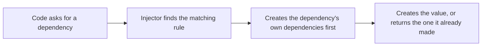
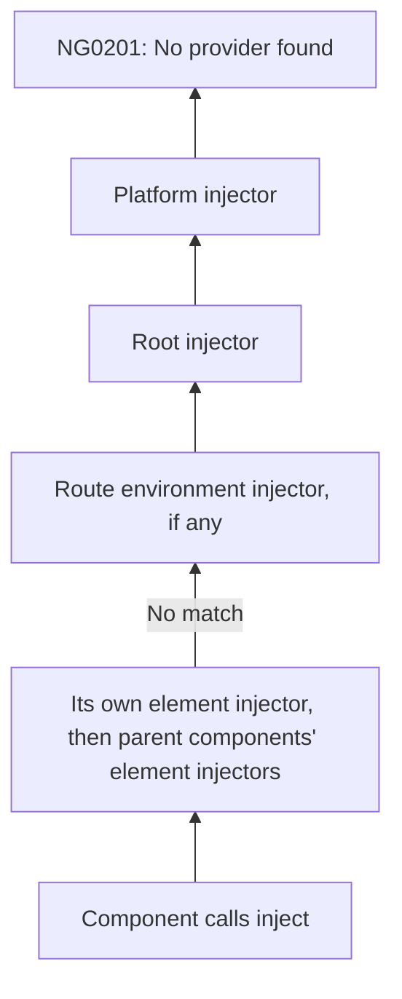

An archive page needs to load tasks from a different server address, so it overrides the `API_URL` value in its own `providers`. The page itself now sees `/archive-api`. But the `TaskApi` service the page asks Angular for still sends requests to `/api`. Meanwhile, two task panels on the same board each keep their own selected task, even though both inject the same service class.

Both behaviors follow a small set of rules about who creates an object and where it gets its own dependencies. This article builds those rules from the ground up: it starts with a plain TypeScript class that needs a logger and an address, and it carries that same `TaskApi` into Angular until the archive page's override makes sense.

You'll need TypeScript classes and basic Angular components to follow along; [Splitting a task page into Angular components](/dump/blog/angular-component-composition/) covers the components and the `Task` shape used here. The Angular examples use Angular 22.2.1 with standalone components and signals.

## Contents

1. [Using a dependency versus creating it](#using-a-dependency-versus-creating-it)
2. [Wiring by hand and with an injector](#wiring-by-hand-and-with-an-injector)
3. [Where inject() can run](#where-inject-can-run)
4. [Tokens and providers](#tokens-and-providers)
5. [Injector hierarchies and shared instances](#injector-hierarchies-and-shared-instances)
6. [Overriding a service's configuration](#overriding-a-services-configuration)
7. [Queries use the same element injectors](#queries-use-the-same-element-injectors)
8. [Going further: viewProviders and resolution modifiers](#going-further-viewproviders-and-resolution-modifiers)
9. [Debugging checklist](#debugging-checklist)

## Using a dependency versus creating it

Here's a task API that writes a log line each time it loads tasks. A real version would also call `fetch`, but logging is enough to follow the dependencies:

```ts
class Logger {
  log(message: string): void {
    console.log(message);
  }
}

class TaskApi {
  private readonly logger = new Logger();
  private readonly apiUrl = "/api";

  loadTasks(): void {
    this.logger.log(`Loading tasks from ${this.apiUrl}/tasks`);
  }
}
```

`TaskApi` uses a logger and an address, but it also picks them: it creates its own `Logger` and hard-codes `/api`. So if a test wants to capture the log lines, or the archive page wants another address, someone has to edit `TaskApi`.

A common first fix is a shared logger that everyone reuses:

```ts
let sharedLogger: Logger | undefined;

function getLogger(): Logger {
  if (sharedLogger === undefined) {
    sharedLogger = new Logger();
  }
  return sharedLogger;
}
```

This is a **singleton**: a single shared instance, created the first time someone asks for it. It stops every class from creating its own logger, but `TaskApi` would still call `getLogger()` itself, so it still decides where its logger comes from.

The other option is to have `TaskApi` receive what it needs when it's created:

```ts
interface LogSink {
  log(message: string): void;
}

class TaskApi {
  constructor(
    private readonly logger: LogSink,
    private readonly apiUrl: string,
  ) {}

  loadTasks(): void {
    this.logger.log(`Loading tasks from ${this.apiUrl}/tasks`);
  }
}

const api = new TaskApi(console, "/api");
api.loadTasks(); // logs "Loading tasks from /api/tasks"
```

What to notice:

- `private readonly logger: LogSink` inside the constructor's parameter list is TypeScript shorthand. It declares a `logger` field and assigns the argument to it, so you don't have to write `this.logger = logger` yourself.
- Passing `console` works because TypeScript checks the shape of a value, not its class name. That's called **structural typing**. `console` has a `log(message)` method, so it fits `LogSink`.
- `TaskApi` can't exist without its logger and address. No caller has to remember to set them before calling `loadTasks()`.

A test can now pass a fake logger that records messages, without touching `TaskApi`:

```ts
const messages: string[] = [];
const api = new TaskApi(
  {
    log(message) {
      messages.push(message);
    },
  },
  "/test-api",
);

api.loadTasks();
console.log(messages); // ["Loading tasks from /test-api/tasks"]
```

That's dependency injection. There are no decorators and no framework here: `TaskApi` stopped choosing its own logger and address, and whoever creates it now makes that choice. Everything Angular adds automates this one idea.

## Wiring by hand and with an injector

In a small program you create the objects yourself and pass them in:

```ts
const logger = new Logger();
const taskApi = new TaskApi(logger, "/api");
const archiveApi = new TaskApi(logger, "/archive-api");
```

Both APIs share one logger, and each has its own address. You decided all of that in three lines.

A real app has hundreds of these objects, and many depend on each other. Some code still has to decide how each one is created, which ones are shared, and which ones get special configuration. A **dependency injection container** does that wiring for you, following rules you register up front.

Angular's containers are called **injectors**. When code asks an injector for something, the injector finds the matching rule, creates the value (first creating anything that value itself depends on), and keeps it so later requests get the same one.



You still choose what's shared and what's configured differently. The injector gives those choices one place to live instead of spreading them across every class.

## Where inject() can run

In Angular, a class asks for a dependency by calling `inject()`. Here's the task API as an Angular service. It still uses `/api` directly; the next section turns the address into something injectable too.

Save `logger.ts`:

```ts
import { Injectable } from "@angular/core";

@Injectable({ providedIn: "root" })
export class Logger {
  log(message: string): void {
    console.log(message);
  }
}
```

Save `task-api.ts`:

```ts
import { Injectable, inject } from "@angular/core";
import { Logger } from "./logger";

@Injectable({ providedIn: "root" })
export class TaskApi {
  private readonly logger = inject(Logger);
  readonly apiUrl = "/api";

  loadTasks(): void {
    this.logger.log(`Loading tasks from ${this.apiUrl}/tasks`);
  }
}
```

`@Injectable(...)` is a **decorator**: a function written with `@` above a class that attaches extra information to it. Angular's compiler reads that information to learn how to create `TaskApi`. `providedIn: "root"` registers the class with the application's root injector, the one every part of the app can reach. The next section looks at registration more closely.

A component asks for the service the same way:

```ts
import { Component, inject } from "@angular/core";
import { TaskApi } from "./task-api";

@Component({
  selector: "task-page",
  template: `<button type="button" (click)="reload()">Reload tasks</button>`,
})
export class TaskPage {
  private readonly api = inject(TaskApi);

  reload(): void {
    this.api.loadTasks();
  }
}
```

Clicking the button logs `Loading tasks from /api/tasks`.

Notice that `inject(TaskApi)` sits in a field initializer, and `reload()` only uses the stored field. That placement matters, because `inject()` takes no injector argument. So how does it know which injector to ask?

Here's the mechanism. When Angular is about to create a component or service, it saves which injector is doing the creating in a hidden variable. Then it runs the class's constructor and field initializers, and when they finish it puts the previous value back. `inject()` reads that variable. The stretch of code that runs while the variable is set is called an **injection context**.

A click handler runs later, after creation has finished and the variable is empty:

```ts
reload(): void {
  const api = inject(TaskApi); // runs on click, after TaskPage was created
  api.loadTasks();
}
```

Clicking now throws:

```text
NG0203: The `TaskApi` token injection failed. `inject()` function must be called from an injection context such as a constructor, a factory function, a field initializer, or a function used with `runInInjectionContext`.
```

The same goes for lifecycle methods such as `ngOnInit()`, timers, and any code after an `await`: they all run after creation. So `inject()` works in:

- constructors and field initializers of classes that Angular creates;
- provider factory functions, which you'll see in the next section;
- framework callbacks that Angular runs in an injection context, such as functional router guards;
- any function called synchronously from one of those places.

The pattern is the one `TaskPage` uses: ask for dependencies while the class is created, store them in fields, and use the fields later. For the rare code that needs an injection context at another time, `runInInjectionContext(injector, callback)` sets the variable to the injector you pass and runs the callback. It's just as synchronous, so the context ends at the callback's first `await`.

## Tokens and providers

When `TaskPage` calls `inject(TaskApi)`, the class `TaskApi` is the lookup key. Angular calls that key a **token**. The rule that says how to produce the value for a token is a **provider**.

`providedIn: "root"` is one way to register a provider: it tells the root injector "when someone asks for `TaskApi`, create one with `new TaskApi()`". Registering doesn't create anything yet. The root injector creates `TaskApi` the first time something asks for it, then keeps that one instance.

Registering this way also helps **tree-shaking**, the build step that drops code nothing uses. If no code ever injects a root-provided service, the build can leave it out of your bundle.

### Values and interfaces need an InjectionToken

The address `/api` is a string, and there's no class to use as its key. Interfaces don't work as keys either: TypeScript erases them when it compiles to JavaScript, so at runtime there's no `LogSink` left for Angular to look up.

For these, you create a token object with `InjectionToken`. Here's the final `task-api.ts`, with the address moved into a token:

```ts
import { Injectable, InjectionToken, inject } from "@angular/core";
import { Logger } from "./logger";

export const API_URL = new InjectionToken<string>("api.url", {
  providedIn: "root",
  factory: () => "/api",
});

@Injectable({ providedIn: "root" })
export class TaskApi {
  private readonly logger = inject(Logger);
  readonly apiUrl = inject(API_URL);

  loadTasks(): void {
    this.logger.log(`Loading tasks from ${this.apiUrl}/tasks`);
  }
}
```

What to notice:

- `<string>` tells TypeScript what `inject(API_URL)` returns.
- `providedIn: "root"` with a `factory` gives the token a default provider in the root injector, so every app gets `/api` unless something overrides it.
- The `"api.url"` text only appears in error messages. The token's identity is the object itself: two separate `new InjectionToken<string>("api.url")` calls create two different tokens. Export one and import it everywhere.

### Provider recipes

You can also write providers yourself, as objects in a `providers` array. That array can live in the configuration passed to `bootstrapApplication`, on a route, or in a component's `@Component` options. Where you put it decides which injector holds it, which the next section covers.

These examples use a second logger:

```ts
import { Injectable } from "@angular/core";
import { Logger } from "./logger";

@Injectable()
export class TimestampLogger extends Logger {
  override log(message: string): void {
    console.log(`${new Date().toISOString()} ${message}`);
  }
}
```

`@Injectable()` without `providedIn` makes the class creatable by Angular but doesn't register it anywhere. It only works once it appears in a `providers` array.

| Provider                                            | What the injector does when asked for the token                 |
| --------------------------------------------------- | --------------------------------------------------------------- |
| `Logger`                                            | Short for `{ provide: Logger, useClass: Logger }`               |
| `{ provide: Logger, useClass: TimestampLogger }`    | Creates a `TimestampLogger` and hands it out as the `Logger`     |
| `{ provide: API_URL, useValue: "/archive-api" }`    | Returns that exact value                                        |
| `{ provide: API_URL, useFactory: apiUrlFactory }`   | Calls the function once and returns its result                  |
| `{ provide: Logger, useExisting: TimestampLogger }` | Looks up `TimestampLogger` and returns that same object         |

A factory is a plain function that picks the value. It runs in an injection context, so it could also call `inject()` for anything it needs; this one only checks whether the app runs in development mode:

```ts
import { isDevMode } from "@angular/core";

function apiUrlFactory(): string {
  if (isDevMode()) {
    return "http://localhost:3000/api";
  }
  return "/api";
}
```

The factory runs once. The injector stores the result and hands that same value to everyone who asks it afterward. `useValue` works the same way: every consumer gets the very same object, not a copy.

### useClass creates, useExisting points

These two arrays look almost identical:

```ts
const separate = [TimestampLogger, { provide: Logger, useClass: TimestampLogger }];
const shared = [TimestampLogger, { provide: Logger, useExisting: TimestampLogger }];
```

With `separate`, asking for `TimestampLogger` and asking for `Logger` gives you two different `TimestampLogger` objects, because each registration creates its own. With `shared`, the `Logger` registration points at the `TimestampLogger` registration, so both tokens return the same object. That difference matters as soon as the object holds state, such as a list of buffered log lines.

## Injector hierarchies and shared instances

Angular doesn't have one injector. It has two connected trees of them:

- **Environment injectors** hold app-wide providers. The root injector is one. Routes with their own `providers` get child environment injectors under it.
- **Element injectors** belong to elements in templates. A component or directive that has a `providers` array gives its element its own injector with those providers. The element injector also holds the component and directive instances on that element.

When a component calls `inject()`, Angular first checks its own element injector. Then it moves up through the element injectors of the elements it sits inside, continuing from each template into the parent component that uses it. If none of them has a provider for the token, it moves on to the environment injectors: the route's, then the root, then the platform injector that Angular creates once per page. If nothing matches, you get error NG0201, "No provider found".



The first provider found wins. That's how a component's `providers` can override something registered in the root.

### One instance per injector

A root-provided service like `TaskApi` has one instance per application, because the root injector creates it once. That's the same idea as the `getLogger()` singleton earlier, except the injector manages it.

A component that lists a service in its own `providers` gets an instance for each copy of that component. Here's a selection state that each task panel keeps for itself:

```ts
import { Injectable, signal } from "@angular/core";

@Injectable()
export class TaskSelection {
  readonly selectedId = signal<number | undefined>(undefined);
}
```

```ts
import { Component, inject, input } from "@angular/core";
import { TaskSelection } from "./task-selection";

@Component({
  selector: "task-panel",
  providers: [TaskSelection],
  template: `
    <h2>{{ title() }}</h2>
    <button type="button" (click)="selection.selectedId.set(1)">Select task 1</button>
    <p>Selected: {{ selection.selectedId() ?? "none" }}</p>
  `,
})
export class TaskPanel {
  readonly title = input.required<string>();
  readonly selection = inject(TaskSelection);
}
```

Render `<task-panel title="Today" />` and `<task-panel title="Later" />` side by side, and each panel gets its own `TaskSelection`. Clicking Select in Today leaves Later at `none`. Any component inside a panel that injects `TaskSelection` finds that panel's instance first, so it shares state with its own panel only.

When Angular destroys a panel, it destroys that panel's `TaskSelection` too. A service that holds resources such as timers or subscriptions should release them in a `DestroyRef.onDestroy` callback.

That answers the second opening surprise: two components injecting the same class share an instance when the same injector provides it, and get separate ones when each component's own injector does.

## Overriding a service's configuration

Now back to the archive page. It overrides `API_URL` and asks for both the token and the service:

```ts
import { Component, inject } from "@angular/core";
import { API_URL, TaskApi } from "./task-api";

@Component({
  selector: "archive-page",
  providers: [{ provide: API_URL, useValue: "/archive-api" }],
  template: `
    <p>Direct token: {{ directUrl }}</p>
    <p>TaskApi uses: {{ api.apiUrl }}</p>
  `,
})
export class ArchivePage {
  readonly directUrl = inject(API_URL);
  readonly api = inject(TaskApi);
}
```

The page renders:

```text
Direct token: /archive-api
TaskApi uses: /api
```

Why? Follow who creates what:

1. `inject(API_URL)` in `ArchivePage` starts at the page's element injector, which has the override. So `directUrl` is `/archive-api`.
2. `inject(TaskApi)` also starts at the page's element injector. It has no `TaskApi` provider, so the search continues up to the root injector, which has one.
3. The root injector creates `TaskApi`. While it does, the root injector is the current injector, so the `inject(API_URL)` inside `TaskApi` asks the root and gets `/api`.

It doesn't matter that the archive page asked first; the result is the same even when it's the very first code to request `TaskApi`. A component's `providers` only affect what that component's own injector, and the injectors below it, create.

To get a `TaskApi` that uses the archive address, let the page's injector create one:

```ts
providers: [TaskApi, { provide: API_URL, useValue: "/archive-api" }],
```

Now the page's injector has both providers. It creates its own `TaskApi`, and that `TaskApi`'s `inject(API_URL)` finds the override in the same injector. Both lines show `/archive-api`. Every other page still gets the root `TaskApi` with `/api`.

## Queries use the same element injectors

`inject()` looks upward from a component. A **query**, such as `viewChildren`, looks the other way: it asks Angular to find things in the component's template and hand them to the component. Queries run on the same element injectors.

Here's how a query matches. For each element in the template it searches, Angular asks that element's injector whether it holds the token you passed: a component or directive class on the element, or a provider in the element's `providers`. This is the same lookup `inject()` performs at each step, but a query checks only that one element and doesn't move up to parents. When an element matches, Angular reads the token's value from that element's injector.

### Querying by a provider token

Each task panel provides its own `TaskSelection`, so a board can find every panel's selection by that token and reset them all:

```ts
import { Component, viewChildren } from "@angular/core";
import { TaskPanel } from "./task-panel";
import { TaskSelection } from "./task-selection";

@Component({
  selector: "task-board",
  imports: [TaskPanel],
  template: `
    <task-panel title="Today" />
    <task-panel title="Later" />
    <button type="button" (click)="clearSelections()">Clear selections</button>
  `,
})
export class TaskBoard {
  private readonly selections = viewChildren(TaskSelection);

  clearSelections(): void {
    for (const selection of this.selections()) {
      selection.selectedId.set(undefined);
    }
  }
}
```

What to notice:

- `viewChildren` returns a signal. Calling `this.selections()` gives an array with one `TaskSelection` per panel, in template order.
- They're the exact objects each panel received from its own `inject(TaskSelection)`. The query didn't create anything; it read what the panels' element injectors already hold.
- `TaskBoard` never mentions how panels store their selection internally. It only needs the token.

The `read` option separates "which elements match" from "which value to read from them":

```ts
readonly selections = viewChildren(TaskPanel, { read: TaskSelection });
```

This matches the elements that have a `TaskPanel` component, then asks each of those element injectors for `TaskSelection`. The result is the same two objects. `read` is also how you get `ElementRef`, the wrapper around the underlying DOM element, from a matched element.

Queries stay inside one template. `viewChildren` in `TaskBoard` finds the `task-panel` elements in the board's template, but not the buttons inside each panel's own template.

### Providing a component under a token

A component can also put itself into its element injector under a token, so queries can find it without knowing its class. This example uses **projected content**: markup a caller writes between a component's tags, which the component displays wherever its template has `<ng-content />`:

```html
<!-- the caller's template -->
<task-list>
  <task-item [task]="first" />
  <task-item [task]="second" />
</task-list>

<!-- task-list's own template -->
<p>{{ items().length }} tasks</p>
<ng-content />
```

The two `task-item` elements belong to the caller's template, and `task-list` shows them where `<ng-content />` sits. To query projected content, a component uses `contentChildren` instead of `viewChildren`.

Here's a token for anything that represents a listed task:

```ts
import { InjectionToken } from "@angular/core";
import type { Task } from "./task";

export interface ListedTask {
  task(): Task;
}

export const LISTED_TASK = new InjectionToken<ListedTask>("listed.task");
```

The task item registers itself under that token with `useExisting`:

```ts
import { Component, forwardRef, inject, input } from "@angular/core";
import { LISTED_TASK, type ListedTask } from "./listed-task";
import type { Task } from "./task";
import { TaskSelection } from "./task-selection";

@Component({
  selector: "task-item",
  providers: [{ provide: LISTED_TASK, useExisting: forwardRef(() => TaskItem) }],
  template: `<button type="button" (click)="select()">{{ task().title }}</button>`,
})
export class TaskItem implements ListedTask {
  readonly task = input.required<Task>();
  private readonly selection = inject(TaskSelection);

  select(): void {
    this.selection.selectedId.set(this.task().id);
  }
}
```

And the list counts whatever registers under the token:

```ts
import { Component, contentChildren } from "@angular/core";
import { LISTED_TASK } from "./listed-task";
import { TaskSelection } from "./task-selection";

@Component({
  selector: "task-list",
  providers: [TaskSelection],
  template: `
    <p>{{ items().length }} tasks</p>
    <ng-content />
  `,
})
export class TaskList {
  readonly items = contentChildren(LISTED_TASK);
}
```

With the two items from the caller's template, the list shows `2 tasks`. What to notice:

- `useExisting` points the token at the `TaskItem` instance already on that element, so the query gets the component itself, not a second copy.
- `forwardRef(() => TaskItem)` is needed because the decorator's options are evaluated before the `TaskItem` class exists. Writing `useExisting: TaskItem` there fails with TypeScript error TS2449, "Class 'TaskItem' used before its declaration". `forwardRef` wraps the reference in a function, and Angular calls that function later, once the class is defined.
- `TaskList` doesn't import `TaskItem`. Any component that provides `LISTED_TASK` would be counted.
- The item injects `TaskSelection` and finds the list's instance. Both directions run through element injectors: the item looks up to the list with `inject()`, and the list looks down to the items with a query.
- `contentChildren` finds only direct children by default. Pass `{ descendants: true }` to also match elements nested deeper inside the projected content.

## Going further: viewProviders and resolution modifiers

You can skip this section on a first read. It covers two tools for narrowing where a lookup can go.

### viewProviders

A component's `providers` are visible to its own template and to projected content. That's why the projected task items above can inject the list's `TaskSelection`. `viewProviders` registers providers that only the component's own template can see.

If `TaskList` used `viewProviders: [TaskSelection]`, each projected `task-item` would fail with NG0201, because the items belong to the caller's template. Queries don't match `viewProviders` either. Use them when a component needs private state that shouldn't leak into content its caller supplies.

### Resolution modifiers

`inject()` accepts options that change a single lookup:

| Option               | Effect                                                                                                      |
| -------------------- | ----------------------------------------------------------------------------------------------------------- |
| `{ optional: true }` | Returns `null` instead of throwing when nothing provides the token                                          |
| `{ self: true }`     | Only checks the current element injector                                                                     |
| `{ skipSelf: true }` | Skips the current element injector and starts at its parent                                                 |
| `{ host: true }`     | Stops at the component whose template contains this element, and never falls back to environment injectors |

For example, a task item that should also work outside a list could write `inject(TaskSelection, { optional: true })` and handle `null`.

## Debugging checklist

Back to the two surprises from the start. The archive page's override didn't reach `TaskApi` because the root injector created `TaskApi` and answered its `inject(API_URL)` call (item 4). The two panels kept separate selections because each panel's own `providers` created a `TaskSelection` (item 5).

When injection does something unexpected, walk through these:

1. **Is it the same token object?** Interfaces don't exist at runtime, and two `InjectionToken`s with the same description are still different tokens.
2. **Did `inject()` run during creation?** NG0203 means it ran outside an injection context, such as in a click handler or after an `await`.
3. **Where is the provider registered?** Check `providedIn`, app configuration, routes, and component `providers`. `@Injectable()` alone registers nothing.
4. **Which injector creates the object?** A service gets its own dependencies from the injector that creates it, not from the component that asked for it.
5. **Is a second instance being created?** A component's own `providers` and each `useClass` registration create new instances; `useExisting` points at one that already exists.
6. **Can the lookup reach the provider?** Projected content, `viewProviders`, and resolution modifiers all change which injectors a lookup visits.
7. **Is a query searching the right template?** `viewChildren` searches the component's template, `contentChildren` searches projected content, and neither looks inside child components' templates.

To test injection behavior, create the component or service through the injector setup you actually use, then check what it renders or which instance it received. Constructing every object by hand in a test skips the very provider configuration you meant to check.

## Sources and further reading

- [Angular: dependency injection overview](https://angular.dev/guide/di)
- [Angular: defining dependency providers](https://angular.dev/guide/di/defining-dependency-providers)
- [Angular: injection context](https://angular.dev/guide/di/dependency-injection-context)
- [Angular: hierarchical injectors, visibility, and resolution modifiers](https://angular.dev/guide/di/hierarchical-dependency-injection)
- [Angular: component queries](https://angular.dev/guide/components/queries)
- [Angular: runInInjectionContext](https://angular.dev/api/core/runInInjectionContext)
- [Angular: forwardRef](https://angular.dev/api/core/forwardRef)
