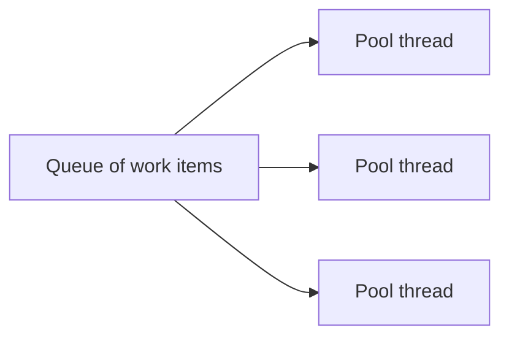

The task board has a summary endpoint. It asks another service how many tasks are overdue, which takes half a second, and someone wrote it like this because the handler "wasn't async":

```csharp
app.MapGet("/tasks/summary", (SummaryClient summaries) =>
{
    var overdue = summaries.FetchOverdueCountAsync().Result;
    return $"{overdue} overdue tasks\n";
});
```

It works fine when you try it. Then 200 clients call it at the same time, and every one of them waits more than two seconds instead of half a second. Worse, `GET /tasks/1`, which waits for nothing at all, takes two seconds too. Meanwhile the server has started 78 threads.

Change one line, `.Result` to `await`, and all 200 requests finish in about 0.58 seconds, `/tasks/1` answers in a few milliseconds, and the server uses 17 threads. Fewer threads served the same requests more than four times faster. By the end of this article you'll know why, and you'll be able to spot code that has the same problem.

You'll need to have written `await something` in C#; this article explains what happens underneath, not the syntax. You'll also need [From bytes to your handler](/dump/blog/aspnet-core-request-pipeline/) for `HttpContext` and how handler parameters are filled in, and [Who creates your services](/dump/blog/aspnet-core-dependency-injection/) for singletons shared between requests. If you know JavaScript's event loop from [JavaScript engines and runtimes](/dump/blog/javascript-engines-and-runtimes/), you'll see where .NET differs, but you don't need it.

## Contents

1. [Set up the example](#set-up-the-example)
2. [What a thread is, and what blocking costs](#what-a-thread-is-and-what-blocking-costs)
3. [The thread pool](#the-thread-pool)
4. [Tasks and continuations](#tasks-and-continuations)
5. [What await does](#what-await-does)
6. [Which thread continues after await](#which-thread-continues-after-await)
7. [Blocking on async code starves the pool](#blocking-on-async-code-starves-the-pool)
8. [Task.Run doesn't free a thread](#taskrun-doesnt-free-a-thread)
9. [async void can crash the server](#async-void-can-crash-the-server)
10. [Stopping work when the client leaves](#stopping-work-when-the-client-leaves)
11. [Running independent waits at the same time](#running-independent-waits-at-the-same-time)
12. [Back to the slow summary](#back-to-the-slow-summary)

## Set up the example

The examples use the .NET 10 SDK (10.0.402, with ASP.NET Core 10.0.13) and `curl`. The numbers in this article come from one Linux laptop with 16 logical processors, running the server with `dotnet run` as below. Your numbers will be different, but the proportions between them should hold. Running work after the response has been sent, parallel number crunching, and desktop or Blazor apps are outside this article's scope.

Create the API and a small load-testing program next to it:

```bash
dotnet new web -o TaskBoard
dotnet new console -o LoadTest
```

In `TaskBoard`, the summary client stands in for a call to a database or another service. It waits half a second and returns a number:

```csharp
public class SummaryClient
{
    public async Task<int> FetchOverdueCountAsync(CancellationToken cancellationToken = default)
    {
        await Task.Delay(500, cancellationToken);
        return 3;
    }
}
```

`TaskStore` is the singleton from the dependency injection article, holding one task, and `GET /tasks/{id:int}` returns a task as before. Register both services:

```csharp
var builder = WebApplication.CreateBuilder(args);
builder.Services.AddSingleton<TaskStore>();
builder.Services.AddSingleton<SummaryClient>();

var app = builder.Build();
```

To see what the server is doing, add a monitor that prints how many threads the thread pool has and how much work is waiting for one. The next sections explain both numbers. It only prints when something changes:

```csharp
public static class PoolMonitor
{
    public static void Start()
    {
        var thread = new Thread(() =>
        {
            var lastThreads = -1;
            var lastQueued = -1L;
            while (true)
            {
                var threads = ThreadPool.ThreadCount;
                var queued = ThreadPool.PendingWorkItemCount;
                if (threads != lastThreads || queued != lastQueued)
                {
                    Console.WriteLine($"pool: {threads} threads, {queued} queued");
                    lastThreads = threads;
                    lastQueued = queued;
                }

                Thread.Sleep(500);
            }
        });
        thread.IsBackground = true;
        thread.Start();
    }
}
```

Call `PoolMonitor.Start();` right after `builder.Build()`. The monitor creates its own thread on purpose, for a reason you'll see in the thread pool section.

`LoadTest` sends many requests at once and reports how long they took. Optionally, it also times one request to a second URL while the load is running.

<details>
<summary>The complete <code>LoadTest/Program.cs</code></summary>

```csharp
using System.Diagnostics;

var url = args[0];
var count = int.Parse(args[1]);

using var client = new HttpClient();

var total = Stopwatch.StartNew();
var requests = new List<Task<double>>();
for (var i = 0; i < count; i++)
{
    requests.Add(TimeRequestAsync(client, url));
}

var probe = Task.FromResult(0.0);
if (args.Length > 2)
{
    probe = ProbeAfterAMomentAsync(client, args[2]);
}

var durations = await Task.WhenAll(requests);
total.Stop();
Array.Sort(durations);

Console.WriteLine($"{count} requests in {total.ElapsedMilliseconds} ms");
Console.WriteLine($"fastest {durations[0]:F0} ms, median {durations[count / 2]:F0} ms, slowest {durations[^1]:F0} ms");
if (args.Length > 2)
{
    Console.WriteLine($"{args[2]} during the load: {await probe:F0} ms");
}

static async Task<double> TimeRequestAsync(HttpClient client, string url)
{
    var timer = Stopwatch.StartNew();
    using var response = await client.GetAsync(url);
    response.EnsureSuccessStatusCode();
    return timer.Elapsed.TotalMilliseconds;
}

static async Task<double> ProbeAfterAMomentAsync(HttpClient client, string url)
{
    await Task.Delay(200);
    return await TimeRequestAsync(client, url);
}
```

</details>

Start the API with `dotnet run --urls http://localhost:5000` in `TaskBoard`, and send load from `LoadTest`:

```bash
dotnet run -- http://localhost:5000/tasks/summary 200 http://localhost:5000/tasks/1
```

Restart the API before every measurement. The thread pool keeps the threads it creates for about 20 seconds after they're needed, so a second run against the same server starts with a head start, and its numbers mean something different.

## What a thread is, and what blocking costs

A **thread** is one sequence of instructions the processor works through, with its own call stack recording which method called which. A program can have many threads, and the operating system switches the processor between them.

The simplest way to wait in .NET is `Thread.Sleep`:

```csharp
app.MapGet("/tasks/summary", () =>
{
    Thread.Sleep(500);
    return "3 overdue tasks\n";
});
```

For those 500 milliseconds, the thread running this handler does nothing else. It can't pick up another request, because it's still in the middle of this one. That's what **blocking** means: the thread is held, waiting, and unavailable.

It's tempting to think a waiting thread costs nothing, since it isn't using the processor. That's true about the processor. But a server only has a limited number of threads ready to take new work, and every blocked thread is one fewer. The next section shows what happens when they run out.

If you know JavaScript, this is where .NET differs. JavaScript gives your code one main thread and has no way to block it while waiting for the network, so waiting is always done with callbacks or `await`. .NET has many threads, and code *can* block one. That makes the choice between blocking and awaiting yours to get right.

## The thread pool

Creating a thread is relatively expensive, so ASP.NET Core doesn't create one per request. It borrows threads from the **thread pool**: a set of threads the .NET runtime keeps around and reuses. There's one pool per process. You can check that request code runs on one with `Thread.CurrentThread.IsThreadPoolThread`, which is `true` inside a handler.

Work for the pool waits in a queue. Each piece of work, such as "run the code for this request", is called a **work item**. Whenever a pool thread is free, it takes the next work item from the queue and runs it.



The pool decides how many threads to have. It creates threads immediately up to a minimum, which by default is the number of logical processors: 16 on the machine used here. Beyond that, it adds threads slowly and on purpose. Too many threads waste memory and time switching between them, so the pool only adds one when work has been stuck in the queue for a while, and keeps adjusting to whatever count gets the most work done.

Now run the `Thread.Sleep` version with 200 requests:

```text
200 requests in 6060 ms
fastest 1051 ms, median 5556 ms, slowest 6048 ms
http://localhost:5000/tasks/1 during the load: 5356 ms
```

And the monitor:

```text
pool: 16 threads, 24 queued
pool: 17 threads, 20 queued
pool: 17 threads, 152 queued
pool: 17 threads, 148 queued
pool: 17 threads, 134 queued
pool: 17 threads, 117 queued
pool: 17 threads, 100 queued
...
pool: 17 threads, 0 queued
```

What to notice:

- The pool stayed at about 17 threads. Every half second, those 17 threads each finished one request, and the queue shrank by about 17.
- 200 requests at 17 per half second is about 6 seconds, which is what the requests took.
- `/tasks/1` took 5.4 seconds, although it waits for nothing. Its work item sat in the same queue behind the sleeping requests.

This is called **thread pool starvation**: work waits in the queue because every pool thread is busy, and here, busy doing nothing but waiting. It's also why `PoolMonitor` uses its own thread instead of a pool thread: on the pool, it would have been stuck in the queue too.

`ThreadPool.SetMinThreads` can raise the minimum, and you'll find it suggested as a fix. Microsoft's documentation warns that raising it can hurt performance, and it doesn't fix the cause. The threads are still blocked; you just have more of them.

## Tasks and continuations

The fix for blocking is not to hold a thread while waiting. To do that, the code needs a way to say "run the rest of this later, when the wait is over". In .NET, that's what a `Task` is for.

A **`Task`** is an object that represents work that finishes later. It records whether the work is still running, completed, failed, or was canceled. A `Task<int>` also holds the `int` result once there is one. And it keeps a list of code to run when it finishes.

`Task.Delay(500)` returns a task that completes after half a second. It doesn't use a thread to wait: it sets a timer, and when the timer fires, the task is marked completed. Many people picture a task as a thread, but most tasks that represent waiting, for a timer, the network, or a disk, use no thread at all while they wait.

Code that runs when a task finishes is called a **continuation**. You can attach one by hand with `ContinueWith`. This console program does it, and prints which thread each part runs on:

```csharp
Console.WriteLine($"main starts on thread {Environment.CurrentManagedThreadId}");

var byHand = FetchOverdueCountByHand();
Console.WriteLine($"FetchOverdueCountByHand returned; completed: {byHand.IsCompleted}");
Console.WriteLine($"result: {await byHand}");

static Task<int> FetchOverdueCountByHand()
{
    Console.WriteLine($"by hand: starts on thread {Environment.CurrentManagedThreadId}");
    var delay = Task.Delay(500);
    return delay.ContinueWith(_ =>
    {
        Console.WriteLine($"by hand: continues on thread {Environment.CurrentManagedThreadId}");
        return 3;
    });
}
```

```text
main starts on thread 1
by hand: starts on thread 1
FetchOverdueCountByHand returned; completed: False
by hand: continues on thread 7
result: 3
```

What to notice:

- `FetchOverdueCountByHand` returned immediately, with a task that wasn't completed yet. Thread 1 wasn't held for the half second.
- The continuation ran later, on a different thread, 7, borrowed from the pool when the timer fired.
- `ContinueWith` itself returns a task, which completes with `3` once the continuation has run.

That's the whole trick. It works, but writing every wait this way gets out of hand quickly: each wait nests another callback, loops become recursion, and errors have to be passed along by hand.

## What await does

`await` makes the compiler write those continuations for you. Here's the same method with it:

```csharp
static async Task<int> FetchOverdueCountAsync()
{
    Console.WriteLine($"with await: starts on thread {Environment.CurrentManagedThreadId}");
    await Task.Delay(500);
    Console.WriteLine($"with await: continues on thread {Environment.CurrentManagedThreadId}");
    return 3;
}
```

```text
main starts on thread 1
with await: starts on thread 1
FetchOverdueCountAsync returned; completed: False
with await: continues on thread 5
result: 3
```

The same shape: the method returns early with an unfinished task, and the rest runs later on a pool thread. Step by step, an `async` method does this:

1. It runs normally, on the caller's thread, until it reaches an `await` on a task that isn't finished yet.
2. It returns an unfinished `Task` to its caller. The caller can carry on, or await that task in turn.
3. It registers the rest of the method as a continuation of the awaited task.
4. When the awaited task finishes, a pool thread runs the rest of the method, from just after the `await`.
5. When the method reaches `return`, its own task completes with that value. If it throws instead, its task fails with that exception, and whoever awaits it gets the exception.

If the awaited task has already finished by the time the method reaches the `await`, there's no pause: the method simply continues.

To make step 3 possible, the compiler turns the method into a small object that remembers where it was, called a **state machine**. You never write it yourself, but seeing a simplified version makes the mechanism concrete.

<details>
<summary>A simplified, hand-written version of what the compiler generates</summary>

```csharp
using System.Runtime.CompilerServices;

public class FetchOverdueCountStateMachine
{
    private int state;
    private TaskAwaiter delayAwaiter;
    private readonly TaskCompletionSource<int> completion = new();

    public Task<int> Start()
    {
        MoveNext();
        return completion.Task;
    }

    private void MoveNext()
    {
        if (state == 0)
        {
            Console.WriteLine($"state machine: starts on thread {Environment.CurrentManagedThreadId}");
            delayAwaiter = Task.Delay(500).GetAwaiter();
            if (!delayAwaiter.IsCompleted)
            {
                state = 1;
                delayAwaiter.OnCompleted(MoveNext);
                return;
            }
        }

        delayAwaiter.GetResult();
        Console.WriteLine($"state machine: continues on thread {Environment.CurrentManagedThreadId}");
        completion.SetResult(3);
    }
}
```

`state` records how far the method got. The first call to `MoveNext` runs up to the wait, registers `MoveNext` itself as the continuation, and returns. When the delay finishes, `MoveNext` runs again, sees `state == 1`, and picks up after the wait. The real generated code has the same shape, plus exception handling and some optimizations.

</details>

Two common beliefs don't survive this:

- **"`await` creates a new thread."** It doesn't. It returns, and the rest of the method later runs on whichever pool thread is free.
- **"`async` makes code faster, or run in parallel."** It doesn't. The `async` keyword only lets the method use `await` and wraps its result in a task. An `async` method with no `await` in it runs entirely on the caller's thread, and the compiler warns you about it. What `async` gives you is waiting without holding a thread.

## Which thread continues after await

Add an endpoint that records its thread before and after an `await`:

```csharp
app.MapGet("/where", async () =>
{
    var before = Environment.CurrentManagedThreadId;
    await Task.Delay(100);
    var after = Environment.CurrentManagedThreadId;
    var hasContext = SynchronizationContext.Current is not null;
    return $"before {before}, after {after}, pool thread: {Thread.CurrentThread.IsThreadPoolThread}, synchronization context: {hasContext}\n";
});
```

One request on its own:

```text
before 10, after 10, pool thread: True, synchronization context: False
```

Thirty at once:

```text
before 12, after 9, pool thread: True, synchronization context: False
before 9, after 12, pool thread: True, synchronization context: False
before 12, after 7, pool thread: True, synchronization context: False
before 7, after 7, pool thread: True, synchronization context: False
...
```

A request can start on one thread and finish on another. After an `await`, the rest of the handler runs on whichever pool thread is free, sometimes the same one, often not. That's why the dependency injection article said a scoped service belongs to the request, not to a thread.

That `synchronization context: False` matters too. A **synchronization context** is a way to send continuations back to one particular place, such as the single thread that's allowed to touch a desktop app's window. Desktop apps have one, and so did the older ASP.NET on .NET Framework. ASP.NET Core doesn't. Three things follow:

- **Don't depend on thread identity.** Anything stored per thread, such as `[ThreadStatic]` fields, can change under you after an `await`.
- **`ConfigureAwait(false)` changes nothing in your app code.** It tells an `await` not to go back to the synchronization context, and there isn't one. Libraries use it because they might also run inside a desktop app.
- **The famous `.Result` deadlock doesn't happen here.** In apps with a synchronization context, blocking on a task can deadlock outright. In ASP.NET Core you get something quieter: the thread pool starvation from the opening.

Different requests still run at the same time, on different threads. So a singleton's state still needs protecting, as `TaskStore` does with its `lock`. One rule to add: you can't `await` inside a `lock` block. The compiler refuses with `CS1996: Cannot await in the body of a lock statement`, because a lock belongs to a thread, and the code after an `await` may run on a different one. Microsoft's guidance is to avoid locks on busy code paths; a short lock around an in-memory list, with no waiting inside, is fine.

## Blocking on async code starves the pool

Back to the opening. A common belief is that `.Result` is fine as long as the call is quick. Here's what it does under load.

`.Result`, `.Wait()`, and `.GetAwaiter().GetResult()` all do the same thing to the calling thread: they block it until the task finishes. The only difference is how exceptions come out: `.Result` and `.Wait()` wrap them in an `AggregateException`, and `GetResult()` doesn't.

Each line in this table is the same 200 requests against a freshly started server, with `/tasks/1` timed during the load:

| `/tasks/summary` waits with | 200 requests took | Most pool threads | `/tasks/1` during the load |
|---|---|---|---|
| `await` | 0.58 s | 17 | 5 ms |
| `.Result` | 2.7 to 2.8 s | 76 to 78 | 2.0 to 2.1 s |
| `.GetAwaiter().GetResult()` | 2.8 s | 77 to 78 | 2.0 to 2.1 s |
| `Thread.Sleep` | 6.1 s | 17 | 5.4 s |

The monitor shows how differently `.Result` behaves from `Thread.Sleep`:

```text
pool: 40 threads, 9 queued
pool: 54 threads, 158 queued
pool: 64 threads, 118 queued
pool: 70 threads, 82 queued
pool: 76 threads, 0 queued
```

Two things are going on:

- **The pool grows much faster.** The runtime notices threads that are blocked waiting for a task, and adds threads faster for them than it does for `Thread.Sleep`. That's why `.Result` finished in under 3 seconds instead of 6.
- **Blocking makes the wait itself slower.** The task `.Result` is waiting for comes from `FetchOverdueCountAsync`, and the rest of that method, the part after its own `await`, has to run on a pool thread before the task can complete. With every pool thread blocked in a `.Result`, those continuations sit in the queue too. Even the fastest request took over 2 seconds for a half-second wait.

The fix is to `await` instead, and that changes the method signatures above it. A method that awaits has to be `async` and return a `Task`, so its caller has to await it, and so on up to the handler. This is called **async all the way down**:

```csharp
app.MapGet("/tasks/summary", async (SummaryClient summaries) =>
{
    var overdue = await summaries.FetchOverdueCountAsync();
    return $"{overdue} overdue tasks\n";
});
```

In ASP.NET Core, the top of that chain is always ready: a handler can return a `Task`, and the framework awaits it. There's no place in request code where blocking is needed.

## Task.Run doesn't free a thread

A common reaction to "don't block" is to wrap the blocking call in `Task.Run`, which queues a piece of code to run on a pool thread, and await that:

```csharp
app.MapGet("/tasks/summary", async () =>
{
    await Task.Run(() => Thread.Sleep(500));
    return "3 overdue tasks\n";
});
```

```text
200 requests in 6562 ms
fastest 1054 ms, median 6052 ms, slowest 6551 ms
http://localhost:5000/tasks/1 during the load: 5852 ms
```

That's no better than plain `Thread.Sleep`, and a little worse. The handler's thread is freed, but `Task.Run` hands the sleep to another pool thread, which is now blocked instead. Some thread from the same pool is still held for every waiting request.

It helps to tell two kinds of work apart:

- **I/O-bound** work waits on something outside your program: the network, a database, a disk, a timer. The right tool is an `async` API that returns a task, so no thread waits.
- **CPU-bound** work keeps the processor busy computing, such as hashing or resizing an image. It needs a thread for its whole duration, whatever you do.

For CPU-bound work in a request, `Task.Run` doesn't help either. An endpoint that spends about 30 ms hashing, called 200 times at once:

| The handler | 200 requests took |
|---|---|
| Calls the hashing code directly | 2.24 to 2.25 s |
| Awaits `Task.Run` around it | 2.08 to 2.23 s |

The same work needs the same processors, and `Task.Run` just moves it from one pool thread to another. Microsoft's ASP.NET Core best practices say not to call `Task.Run` and immediately await it.

You'll find advice elsewhere to put CPU-bound work in `Task.Run`. That advice is for desktop apps, where one special thread draws the window, and keeping that thread free keeps the app responsive. A server has no such thread: request code already runs on the pool.

## async void can crash the server

`TaskStore` gets one more method, `Complete(id)`, which marks a task as done and returns `false` if there's no such task. After completing a task, the board notifies anyone watching it. Someone wrote the notification as fire and forget, so the response doesn't wait for it:

```csharp
app.MapPost("/tasks/{id:int}/complete", (int id, TaskStore store) =>
{
    if (!store.Complete(id))
    {
        return Results.NotFound();
    }

    NotifyWatchers(id);
    return Results.Ok();
});

static async void NotifyWatchers(int id)
{
    await Task.Delay(100);
    throw new InvalidOperationException($"The watcher service is down, so nobody heard about task {id}.");
}
```

The belief behind it is that `async void` is a fine way to fire and forget. Here's what happens when the watcher service fails:

```bash
curl -i -X POST http://localhost:5000/tasks/1/complete
curl -i http://localhost:5000/tasks/1
```

The first request gets `200 OK`. The server's console then shows:

```text
Unhandled exception. System.InvalidOperationException: The watcher service is down, so nobody heard about task 1.
```

and the process exits. The second `curl` can't connect: the whole API is down.

An `async void` method has no task to hold its exception. So when the code after the `await` throws, the exception is thrown directly on the pool thread that was running it, with nothing above it to catch it. An unhandled exception on a pool thread ends the process.

Discarding a task instead, `_ = NotifyWatchersAsync(id);` with `NotifyWatchersAsync` returning `Task`, doesn't crash. But the exception goes nowhere: no log line, no error, and the notification silently never happens. The work can also still be running after the request has finished and its scoped services have been disposed.

The fix is to return a `Task` and await it:

```csharp
app.MapPost("/tasks/{id:int}/complete", async (int id, TaskStore store) =>
{
    if (!store.Complete(id))
    {
        return Results.NotFound();
    }

    await NotifyWatchersAsync(id);
    return Results.Ok();
});

static async Task NotifyWatchersAsync(int id)
{
    await Task.Delay(100);
    throw new InvalidOperationException($"The watcher service is down, so nobody heard about task {id}.");
}
```

Now the failure reaches the request: the client gets `500 Internal Server Error`, the exception is logged, and the server keeps running. Whether a failed notification should fail the request is a separate decision; at least now it's visible and the server survives it.

`async void` exists for event handlers in desktop apps, whose signature has to return `void`. In a web API there's no reason to write it. An `async` lambda passed to `MapPost` is fine: it returns a `Task`, and ASP.NET Core awaits it.

## Stopping work when the client leaves

Some requests take a long time. If the client gives up, its browser tab closed or a timeout reached, the server can stop too, but only if the code is told.

A **`CancellationToken`** is a small object you pass down through method calls, which reports when the work should stop. Cancellation is cooperative: nothing is interrupted from outside. Code stops only at the points where it checks the token or passes it to something that does.

ASP.NET Core gives you one for free. A handler parameter of type `CancellationToken` receives `HttpContext.RequestAborted`, which fires when the client disconnects. Here's a slow report that takes ten seconds and passes the token to every wait:

```csharp
app.MapGet("/tasks/report", async (CancellationToken cancellationToken) =>
{
    try
    {
        for (var step = 1; step <= 10; step++)
        {
            await Task.Delay(1000, cancellationToken);
            Console.WriteLine($"report: step {step} done");
        }

        return "report ready\n";
    }
    catch (OperationCanceledException)
    {
        Console.WriteLine("report: cancelled");
        throw;
    }
});
```

To see what ASP.NET Core records for each request, add one log category under `Logging:LogLevel` in `appsettings.json`:

```json
"Microsoft.AspNetCore.Hosting.Diagnostics": "Information"
```

Then ask for the report, but give up after 2.5 seconds:

```bash
curl --max-time 2.5 http://localhost:5000/tasks/report
```

```text
Request starting HTTP/1.1 GET http://localhost:5000/tasks/report - - -
report: step 1 done
report: step 2 done
report: cancelled
Request finished HTTP/1.1 GET http://localhost:5000/tasks/report - 499 - text/plain;+charset=utf-8 2501.7202ms
```

When `curl` disconnected, the token fired, `Task.Delay` threw an `OperationCanceledException`, and the loop stopped after two steps. ASP.NET Core records the request as `499`, a status meaning the client closed the request, and doesn't treat it as an error.

Now remove the token from the handler and from `Task.Delay`, and do the same:

```text
Request starting HTTP/1.1 GET http://localhost:5000/tasks/report - - -
report: step 1 done
report: step 2 done
report: step 3 done
...
report: step 10 done
Request finished HTTP/1.1 GET http://localhost:5000/tasks/report - 200 - text/plain;+charset=utf-8 10006.7846ms
```

The server did all ten seconds of work for a client that had left after two and a half, and even logged it as `200`.

The rules are short:

- Pass the token to every method that accepts one. Database and HTTP client methods all take one.
- Let `OperationCanceledException` propagate. Catching it to log, as above, is fine if you rethrow.
- In a long loop of pure computation, call `cancellationToken.ThrowIfCancellationRequested()` now and then, since nothing else will check.
- For work that changes data, decide whether it should really stop halfway just because the client left.

## Running independent waits at the same time

A dashboard needs two numbers, each from a half-second call. The obvious version awaits one, then the other:

```csharp
app.MapGet("/tasks/dashboard", async (SummaryClient summaries, CancellationToken cancellationToken) =>
{
    var overdue = await summaries.FetchOverdueCountAsync(cancellationToken);
    var dueToday = await summaries.FetchDueTodayCountAsync(cancellationToken);
    return $"{overdue} overdue, {dueToday} due today\n";
});
```

`FetchDueTodayCountAsync` is a second method on `SummaryClient`, built like the first. A common belief is that awaiting two calls runs them in parallel. It doesn't: each `await` waits for its task before the next line starts the second call.

```bash
curl -w 'took %{time_total} s\n' http://localhost:5000/tasks/dashboard
```

```text
3 overdue, 2 due today
took 1.007214 s
```

The two calls don't depend on each other, so start both first, then wait for both with `Task.WhenAll`:

```csharp
app.MapGet("/tasks/dashboard", async (SummaryClient summaries, CancellationToken cancellationToken) =>
{
    var overdueTask = summaries.FetchOverdueCountAsync(cancellationToken);
    var dueTodayTask = summaries.FetchDueTodayCountAsync(cancellationToken);
    await Task.WhenAll(overdueTask, dueTodayTask);

    var overdue = await overdueTask;
    var dueToday = await dueTodayTask;
    return $"{overdue} overdue, {dueToday} due today\n";
});
```

```text
3 overdue, 2 due today
took 0.500885 s
```

Calling an `async` method starts it and gives you its task right away, so both waits are now in progress at once. `Task.WhenAll` returns a task that completes when all of them have. The two `await`s after it don't pause, because both tasks have already finished; they just read the results. No thread is held during either wait.

If several of the tasks fail, `await Task.WhenAll(...)` throws the first exception; the `Exception` property of the task `WhenAll` returned holds all of them.

Only do this when the calls are really independent, and watch what they share:

- **`HttpContext` isn't thread-safe.** Two branches running at once mustn't both read or write it. Copy what you need into local variables first.
- **A unit of work can't run two operations at once.** `TaskChanges` from the dependency injection article, or EF Core's `DbContext`, expects one operation at a time. Each concurrent branch needs its own, or the calls have to stay sequential.

`LoadTest` has used this pattern from the start. It starts 200 requests, then awaits them all with `Task.WhenAll`. That's how one small console program keeps 200 requests in flight without needing 200 threads.

## Back to the slow summary

In the opening, `.Result` made 200 half-second requests take over two seconds each and slowed down an endpoint that waits for nothing. Now each part has an explanation:

- Each `.Result` held a pool thread for the whole wait.
- The pool started with 16 threads and added more gradually, so most requests, including `/tasks/1`, sat in the queue.
- The continuations that would have completed those waits sat in the same queue, so even the waits themselves took longer.

With `await`, each request gave its thread back to the pool at the `await` and picked up a free one when the half second was over. About 17 threads were enough for all 200 requests, because none of them was ever held while waiting. Fewer threads served faster because none were wasted.

When an endpoint is slow only under load, check these four things:

1. **Does every wait use `await`?**
2. **Is there any `.Result`, `.Wait()`, `.GetAwaiter().GetResult()`, or `Thread.Sleep` in request code?**
3. **Is there any `async void`, or a task that's started and never awaited?**
4. **Is the request's `CancellationToken` passed down to the calls that accept it?**

## Check your understanding

1. **Under load, why does a `.Result` in one endpoint slow down a different endpoint that doesn't wait for anything?** The blocked requests hold pool threads, so new work items, including the other endpoint's requests, wait in the pool's queue until a thread is free.
2. **A handler logs thread 7 before an `await` and thread 12 after it. Is that a bug?** No. After an `await`, the rest of the method runs on whichever pool thread is free. ASP.NET Core has no synchronization context to bring it back to the first one.
3. **Does `await Task.Run(() => BlockingCall())` fix a blocking call in a handler?** No. It frees the handler's thread but blocks another pool thread instead, so the pool is just as starved. The fix is an `async` version of the call, awaited.
4. **Two independent half-second calls, awaited one after the other, take one second. How do you get half a second, and what has to be true for that to be safe?** Start both tasks, then `await Task.WhenAll(...)`. The calls must not depend on each other, and must not share something that only supports one operation at a time, such as `HttpContext` or a unit of work.

## Sources and further reading

- [ASP.NET Core best practices](https://learn.microsoft.com/en-us/aspnet/core/fundamentals/best-practices?view=aspnetcore-10.0): avoiding blocking calls, `Task.Run`, `HttpContext` across threads, and `async void`.
- [Asynchronous programming with async and await](https://learn.microsoft.com/en-us/dotnet/csharp/asynchronous-programming/): what `await` does, compared with continuations.
- [Async return types](https://learn.microsoft.com/en-us/dotnet/csharp/asynchronous-programming/async-return-types): `Task`, `Task<T>`, and `async void`.
- [The managed thread pool](https://learn.microsoft.com/en-us/dotnet/standard/threading/the-managed-thread-pool) and [debugging thread pool starvation](https://learn.microsoft.com/en-us/dotnet/core/diagnostics/debug-threadpool-starvation).
- [Cancellation in managed threads](https://learn.microsoft.com/en-us/dotnet/standard/threading/cancellation-in-managed-threads).
- [ConfigureAwait FAQ](https://devblogs.microsoft.com/dotnet/configureawait-faq/) on the .NET Blog: synchronization contexts, and why ASP.NET Core doesn't have one.
