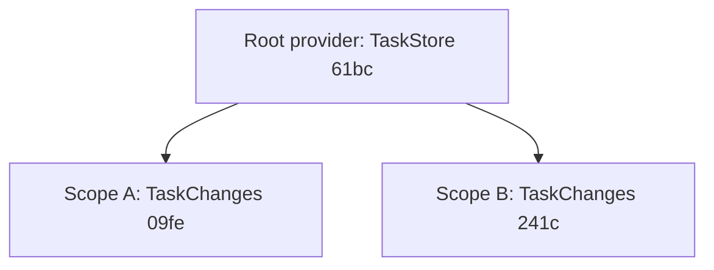

You add a task through the API and get `201 Created` with id `1`. You immediately ask for task `1` and get `404 Not Found`:

```bash
curl -X POST -H 'Content-Type: application/json' -d '{"title":"Learn lifetimes"}' http://localhost:5000/tasks
curl -i http://localhost:5000/tasks/1
```

```text
{"id":1,"title":"Learn lifetimes","done":false}
HTTP/1.1 404 Not Found
Content-Length: 0
...
```

There's no exception and no warning. Both handlers look correct, and they use the same `TaskStore` class to save and find tasks. The bug is a single word in one registration line, and by the end of this article you'll know which word and why it causes this.

The topic is **dependency injection**: how the objects your code needs get created, who shares them, and who cleans them up. It's one of the first things ASP.NET Core does with your code, and getting it wrong rarely fails loudly.

You'll need C# classes, constructors, and generic methods such as `List<T>`. You should also know how a request travels through ASP.NET Core: [From bytes to your handler](/dump/blog/aspnet-core-request-pipeline/) covers `HttpContext`, middleware, and how handler parameters get their values. If you've read the [Angular dependency injection article](/dump/blog/angular-dependency-injection/), much of this will feel familiar, but you don't need it. Asynchronous code, EF Core, configuration options, and background services are outside this article's scope.

## Contents

1. [Set up the example](#set-up-the-example)
2. [Using a dependency versus creating it](#using-a-dependency-versus-creating-it)
3. [Wiring by hand](#wiring-by-hand)
4. [A container that does the wiring](#a-container-that-does-the-wiring)
5. [Scopes and the three lifetimes](#scopes-and-the-three-lifetimes)
6. [One scope per request](#one-scope-per-request)
7. [Choosing a lifetime](#choosing-a-lifetime)
8. [Who disposes what](#who-disposes-what)
9. [How each kind of code gets its services](#how-each-kind-of-code-gets-its-services)
10. [Captive dependencies and scope validation](#captive-dependencies-and-scope-validation)
11. [Asking the container directly](#asking-the-container-directly)
12. [Back to the disappearing task](#back-to-the-disappearing-task)

## Set up the example

The examples use the .NET 10 SDK (10.0.402, with ASP.NET Core 10.0.13) and `curl`. Create a project:

```bash
dotnet new web -o TaskBoard
cd TaskBoard
```

Run it with `dotnet run --urls http://localhost:5000`. That uses the `Development` environment from `Properties/launchSettings.json`. Some behavior in this article differs in `Production`; to see it, run `dotnet run --no-launch-profile --urls http://localhost:5000` instead.

Each class in the examples gets a short random `Id`, the first four characters of a `Guid`, so the console output shows exactly which instance did what. The ids in your output will differ from the ones shown here.

## Using a dependency versus creating it

The task board has two classes that matter here. `TaskStore` holds every task in memory and hands out ids. `TaskChanges` collects the changes one request wants to make and applies them to the store when you call `Commit()`. That's called a **unit of work**: a request gathers its changes, then saves them in one step. EF Core's `DbContext` plays the same role for a database.

Start with `TaskItem.cs`:

```csharp
public record TaskItem(int Id, string Title, bool Done);

public record CreateTaskRequest(string Title);
```

And `TaskStore.cs`:

```csharp
public class TaskStore
{
    private readonly List<TaskItem> tasks = [];

    public string Id { get; } = Guid.NewGuid().ToString()[..4];

    public TaskItem Add(string title)
    {
        var task = new TaskItem(tasks.Count + 1, title, false);
        tasks.Add(task);
        return task;
    }

    public TaskItem? Find(int id)
    {
        return tasks.Find(task => task.Id == id);
    }
}
```

`TaskChanges` needs a `TaskStore` to commit to. The most obvious way to get one is to create it:

```csharp
public class TaskChanges
{
    private readonly TaskStore store = new TaskStore();

    // ...
}
```

That compiles, and it's wrong. Every `TaskChanges` creates its own empty store, so tasks committed through one are invisible to everything else. Nothing outside the class can decide which store it uses, either.

The fix is to ask for the store instead of creating it:

```csharp
public class TaskChanges(TaskStore store) : IDisposable
{
    private readonly List<string> newTitles = [];

    public string Id { get; } = Guid.NewGuid().ToString()[..4];

    public void Add(string title)
    {
        newTitles.Add(title);
    }

    public List<TaskItem> Commit()
    {
        var created = new List<TaskItem>();
        foreach (var title in newTitles)
        {
            created.Add(store.Add(title));
        }

        newTitles.Clear();
        return created;
    }

    public void Dispose()
    {
        Console.WriteLine($"TaskChanges {Id} disposed");
    }
}
```

The `(TaskStore store)` after the class name is a **primary constructor**, available since C# 12. It means "this class has a constructor that takes a `TaskStore`", and `store` can be used anywhere in the class body. It's a shorter way to write a constructor that saves its parameter in a field.

What to notice: `TaskChanges` uses a store but no longer decides which one. Whoever creates `TaskChanges` passes the store in. That's all **dependency injection** means: a class receives the objects it depends on instead of creating them. No framework is involved yet.

`TaskChanges` also implements `IDisposable`, the .NET interface for objects that need cleanup when you're done with them. Its one method, `Dispose`, is where a real unit of work would release a database connection. Here it just prints a line, so you can see when it runs.

The third class, `TitleNormalizer.cs`, trims whitespace from titles:

```csharp
public class TitleNormalizer
{
    public string Id { get; } = Guid.NewGuid().ToString()[..4];

    public string Normalize(string title)
    {
        return title.Trim();
    }
}
```

## Wiring by hand

Someone has to create these objects and pass them in. Do it yourself first, in `Program.cs`:

```csharp
var builder = WebApplication.CreateBuilder(args);
var app = builder.Build();

var store = new TaskStore();

app.MapPost("/tasks", (CreateTaskRequest request) =>
{
    using var changes = new TaskChanges(store);
    var normalizer = new TitleNormalizer();
    changes.Add(normalizer.Normalize(request.Title));
    var task = changes.Commit()[0];
    return Results.Created($"/tasks/{task.Id}", task);
});

app.MapGet("/tasks/{id}", (int id) =>
{
    var task = store.Find(id);
    if (task is null)
    {
        return Results.NotFound();
    }

    return Results.Ok(task);
});

app.Run();
```

`using var` declares a variable whose `Dispose` method runs automatically when the enclosing block ends, here at the end of the handler. Run the two `curl` commands from the opening, and this time the task is found.

What to notice is the three decisions you just made without naming them:

- `TaskStore` is created **once for the whole app**, before any request arrives, so every request shares it.
- `TaskChanges` is created **once per request** and cleaned up when the request's work is done.
- `TitleNormalizer` is created **fresh every time** something needs one.

You also wrote the cleanup yourself, with `using`. In a small app that's fine. In a real one, with dozens of classes depending on each other, writing every `new` by hand gets tedious, and it's easy to get one of those three decisions wrong.

## A container that does the wiring

A **dependency injection container** is a library that creates objects for you, following rules you give it up front. .NET ships one in `Microsoft.Extensions.DependencyInjection`, and ASP.NET Core uses it. To see it without a web server in the way, create a separate project next to `TaskBoard` and copy `TaskItem.cs`, `TaskStore.cs`, `TaskChanges.cs`, and `TitleNormalizer.cs` into it:

```bash
dotnet new web -o ContainerByHand
```

Replace its `Program.cs`:

```csharp
var services = new ServiceCollection();
services.AddSingleton<TaskStore>();
services.AddScoped<TaskChanges>();
services.AddTransient<TitleNormalizer>();

using var provider = services.BuildServiceProvider();
```

Three steps happen here:

1. **Registration.** Each `Add...` call adds a description to a list: which type you'll ask for, which class to create for it, and how long an instance should live. The list is an `IServiceCollection`. Nothing is created yet.
2. **Building.** `BuildServiceProvider()` turns the list into an `IServiceProvider`, the object you ask for instances.
3. **Resolution.** When you ask with `provider.GetRequiredService<TaskChanges>()`, the provider finds the description for `TaskChanges` and looks at its constructor. It sees a `TaskStore` parameter, resolves that first, then creates `TaskChanges` with it. If a class has several constructors, the provider picks the one with the most parameters it can supply.

The objects the container creates are called **services**. That's just the container's word for them; any class can be one.

Forget a registration, and resolution fails with an `InvalidOperationException` whose message names both classes. Without `AddSingleton<TaskStore>()`, asking for `TaskChanges` gives:

```text
Unable to resolve service for type 'TaskStore' while attempting to activate 'TaskChanges'.
```

The registrations above use concrete classes directly: you ask for a `TaskStore`, you get a `TaskStore`. You can also register a class under an interface it implements, as in `services.AddSingleton<ITaskStore, TaskStore>()`, and then ask for `ITaskStore`. Both are ordinary uses of the container.

If you know Angular's dependency injection, the pieces map like this:

| .NET | Angular |
|---|---|
| The type you ask for, such as `TaskStore` | Token |
| A registration, such as `AddSingleton<TaskStore>()` | Provider |
| `IServiceProvider` | Injector |

## Scopes and the three lifetimes

`AddSingleton`, `AddScoped`, and `AddTransient` are the three decisions from the by-hand version, given names. To see them work, you need one more idea: the scope.

A **scope** is a short-lived area inside the provider. It has two jobs: it caches the scoped services created inside it, and it remembers the disposable services it created so it can dispose them when it ends. You create one with `provider.CreateScope()` and end it by disposing it.

Each lifetime is defined by where the provider keeps the instance:

| Lifetime | Where the instance is kept | So you get |
|---|---|---|
| Singleton | In the root provider | One instance for the whole app |
| Scoped | In the scope | One instance per scope |
| Transient | Nowhere | A new instance every time you ask |

Ask for each service twice, in two scopes:

```csharp
foreach (var name in new[] { "A", "B" })
{
    using var scope = provider.CreateScope();
    var scoped = scope.ServiceProvider;

    Console.WriteLine($"scope {name}:");
    Console.WriteLine($"  TaskStore       {scoped.GetRequiredService<TaskStore>().Id} {scoped.GetRequiredService<TaskStore>().Id}");
    Console.WriteLine($"  TaskChanges     {scoped.GetRequiredService<TaskChanges>().Id} {scoped.GetRequiredService<TaskChanges>().Id}");
    Console.WriteLine($"  TitleNormalizer {scoped.GetRequiredService<TitleNormalizer>().Id} {scoped.GetRequiredService<TitleNormalizer>().Id}");
}
```

```text
scope A:
  TaskStore       61bc 61bc
  TaskChanges     09fe 09fe
  TitleNormalizer 534a e740
TaskChanges 09fe disposed
scope B:
  TaskStore       61bc 61bc
  TaskChanges     241c 241c
  TitleNormalizer f8fb 3980
TaskChanges 241c disposed
```

What to notice:

- `TaskStore` is `61bc` everywhere. Asking inside a scope still returns the root's single instance.
- `TaskChanges` is the same twice within a scope, and different between scopes.
- `TitleNormalizer` is different every single time.
- Each scope disposed its own `TaskChanges` when the `foreach` iteration ended and `using var scope` disposed the scope.

Scopes don't nest. Every scope hangs directly off the root provider, and two scopes share nothing except singletons:



That's a real difference from Angular, where injectors form a tree that follows your components.

## One scope per request

Now back to the web app. Each piece from the scratch project has a counterpart there:

| Scratch project | ASP.NET Core |
|---|---|
| `new ServiceCollection()` | `builder.Services` |
| `services.BuildServiceProvider()` | `builder.Build()` |
| The root `provider` | `app.Services` |
| `provider.CreateScope()` | Done for you, once per request |
| The scope's `ServiceProvider` | `HttpContext.RequestServices` |

ASP.NET Core creates the request's scope the first time something asks for a service during that request, and disposes it after the response has been sent. Handler parameters, controllers, and middleware that asks while handling a request all get their services from that request's scope.

Replace `TaskBoard/Program.cs` with the container version:

```csharp
var builder = WebApplication.CreateBuilder(args);

builder.Services.AddSingleton<TaskStore>();
builder.Services.AddScoped<TaskChanges>();
builder.Services.AddTransient<TitleNormalizer>();

var app = builder.Build();
```

Add a middleware that asks the request's scope for a `TaskChanges` and logs which one it got, before and after the rest of the pipeline:

```csharp
app.Use(async (context, next) =>
{
    var changes = context.RequestServices.GetRequiredService<TaskChanges>();
    Console.WriteLine($"{context.Request.Method} {context.Request.Path}: middleware got TaskChanges {changes.Id}");
    await next(context);
    Console.WriteLine($"{context.Request.Method} {context.Request.Path}: response finished");
});
```

Then a temporary endpoint that asks for two of each service. Handler parameters whose type is registered in `builder.Services` come from the request's scope:

```csharp
app.MapGet("/lifetimes", (
    TaskStore store1, TaskStore store2,
    TaskChanges changes1, TaskChanges changes2,
    TitleNormalizer normalizer1, TitleNormalizer normalizer2) =>
{
    return $"""
        TaskStore:       {store1.Id} {store2.Id}
        TaskChanges:     {changes1.Id} {changes2.Id}
        TitleNormalizer: {normalizer1.Id} {normalizer2.Id}

        """;
});
```

Call it twice:

```bash
curl http://localhost:5000/lifetimes
curl http://localhost:5000/lifetimes
```

```text
TaskStore:       ce08 ce08
TaskChanges:     ea24 ea24
TitleNormalizer: d52b 0759

TaskStore:       ce08 ce08
TaskChanges:     27e4 27e4
TitleNormalizer: 2e08 2b59
```

And the console:

```text
GET /lifetimes: middleware got TaskChanges ea24
GET /lifetimes: response finished
TaskChanges ea24 disposed
GET /lifetimes: middleware got TaskChanges 27e4
GET /lifetimes: response finished
TaskChanges 27e4 disposed
```

What to notice:

- The middleware and the handler got the same `TaskChanges` within a request: `ea24` in the first, `27e4` in the second. Same scope, same instance.
- The singleton `TaskStore` is `ce08` in both requests.
- Each request's `TaskChanges` was disposed after the response finished.

A common belief is that scoped means "one per thread". The scope belongs to the request, through its `HttpContext`. A request can continue on a different thread after an `await`, and it keeps the same scope. Two requests that happen to run on the same thread still get different scopes.

Now the opening makes sense. If `TaskStore` is registered with `AddScoped`, each request gets a brand-new, empty store, and that store is thrown away at the end of the request. `POST /tasks` saved the task into a store that disappeared, and `GET /tasks/1` looked in a different, empty one.

## Choosing a lifetime

Pick the lifetime from what the object holds:

| Lifetime | Use it for | Task board example |
|---|---|---|
| Singleton | State the whole app shares, or something expensive to create | `TaskStore`: every request must see the same tasks |
| Scoped | State that belongs to one request | `TaskChanges`; EF Core registers `DbContext` as scoped by default |
| Transient | Small objects with no state worth keeping | `TitleNormalizer` |

Microsoft's guidelines reserve singletons for services with their own state that's expensive to create or meant to be shared. A class with no state at all doesn't need to be a singleton.

### A singleton is shared by requests running at the same time

ASP.NET Core handles many requests at once, so two requests can call the same singleton at the same moment. `TaskStore.Add` reads `tasks.Count` and then adds to the list. If two `POST /tasks` requests interleave, this can happen:

```text
Request A                              Request B
reads tasks.Count → 1
                                       reads tasks.Count → 1
creates task with id 2
                                       creates task with id 2
tasks.Add(task)                        tasks.Add(task)
```

Both tasks get id `2`. Worse, `List<T>` isn't built for two threads changing it at once, so its internal state can break. This race doesn't happen on every run, which is what makes it dangerous: a test that sends one request at a time never sees it.

The smallest fix is a lock, so only one request at a time runs the code inside it:

```csharp
public class TaskStore
{
    private readonly List<TaskItem> tasks = [];
    private readonly Lock gate = new();

    public string Id { get; } = Guid.NewGuid().ToString()[..4];

    public TaskItem Add(string title)
    {
        lock (gate)
        {
            var task = new TaskItem(tasks.Count + 1, title, false);
            tasks.Add(task);
            return task;
        }
    }

    public TaskItem? Find(int id)
    {
        lock (gate)
        {
            return tasks.Find(task => task.Id == id);
        }
    }
}
```

`Lock` is a type made for this purpose, added in .NET 9. While one request is inside a `lock (gate)` block, another request that reaches either block waits.

The container is thread-safe when it creates and hands out services. It does nothing to make the services themselves safe. A singleton with state needs its own protection.

## Who disposes what

The container disposes the services it created, and only those. It does it at a fixed moment for each lifetime:

| Lifetime | Disposed when |
|---|---|
| Scoped | The scope ends; in a web app, after the response is sent |
| Transient | The scope that created it ends |
| Singleton | The app shuts down |

Within one scope, services are disposed in the reverse order they were created.

You saw this in the `/lifetimes` output: `TaskChanges ea24 disposed` appeared after `response finished`. Here's the full real app, which uses the services in its endpoints:

```csharp
using (var scope = app.Services.CreateScope())
{
    var changes = scope.ServiceProvider.GetRequiredService<TaskChanges>();
    changes.Add("Read the DOM");
    changes.Commit();
}

app.MapGet("/tasks/{id}", (int id, TaskStore store) =>
{
    var task = store.Find(id);
    if (task is null)
    {
        return Results.NotFound();
    }

    return Results.Ok(task);
});

app.MapPost("/tasks", (CreateTaskRequest request, TaskChanges changes, TitleNormalizer normalizer) =>
{
    changes.Add(normalizer.Normalize(request.Title));
    var created = changes.Commit();
    var task = created[0];
    return Results.Created($"/tasks/{task.Id}", task);
});
```

The `using` block at the top seeds one task at startup. There's no request yet, so it creates a scope by hand; [Captive dependencies and scope validation](#captive-dependencies-and-scope-validation) explains why it has to.

```bash
curl -X POST -H 'Content-Type: application/json' -d '{"title":"  Learn lifetimes  "}' http://localhost:5000/tasks
curl http://localhost:5000/tasks/2
```

```text
{"id":2,"title":"Learn lifetimes","done":false}
{"id":2,"title":"Learn lifetimes","done":false}
```

The handler never calls `Dispose`, and it shouldn't. Two rules follow from how the container works:

- **Don't dispose services you received.** The container will dispose them, and something else in the same scope may still be using them.
- **The container doesn't dispose instances you created.** If you register an existing object, as in `builder.Services.AddSingleton(new TaskStore())`, the container hands it out but never disposes it, because it didn't create it.

## How each kind of code gets its services

Every kind of code in ASP.NET Core gets services from a provider. What matters is whether the code is created once or once per request:

| Code | Where its services come from |
|---|---|
| Minimal API handler parameters | The request's scope, on every call |
| `app.Use` lambdas and lambda endpoint filters | `context.RequestServices`, on every call |
| An endpoint filter class added with `AddEndpointFilter<T>()` | Created on every call from the request's scope |
| A middleware class | **Created once at startup**; its `InvokeAsync` parameters come from the request's scope |
| Controllers | Created on every request from the request's scope |

The middleware row is the one that catches people. The `app.Use` lambda from earlier can also be written as a class:

```csharp
public class ChangesLogger(RequestDelegate next)
{
    public async Task InvokeAsync(HttpContext context, TaskChanges changes)
    {
        Console.WriteLine($"{context.Request.Method} {context.Request.Path}: middleware got TaskChanges {changes.Id}");
        await next(context);
        Console.WriteLine($"{context.Request.Method} {context.Request.Path}: response finished");
    }
}
```

```csharp
app.UseMiddleware<ChangesLogger>();
```

ASP.NET Core creates `ChangesLogger` once, when it builds the pipeline at startup. Its constructor runs before any request exists, so anything the constructor asks for comes from the root provider. `InvokeAsync` runs for every request, and its extra parameters come from that request's scope. So a scoped service like `TaskChanges` belongs in `InvokeAsync`, never in the constructor. The next section shows what happens if you put it there.

A middleware class can also implement the `IMiddleware` interface instead. Then you register it as a service yourself, and ASP.NET Core resolves it from the request's scope on every request, constructor included.

Controllers are created fresh for every request, so constructor injection works with any lifetime:

```csharp
public class TasksController(TaskStore store) : ControllerBase
{
    // ...
}
```

## Captive dependencies and scope validation

People often treat transient as the safe choice, because "it's always new". It isn't always new. A transient service created for a singleton's constructor is created once, and then it lives exactly as long as the singleton holding it, which is the whole life of the app. The lifetime that matters is the one of whatever holds onto the object. The startup checks below don't flag this case, because they only look at scoped services.

When a longer-lived service holds a shorter-lived one, the shorter-lived one is called a **captive dependency**. It's captured: it can't be replaced or disposed on schedule, because its holder keeps it alive.

Here's one. A singleton imports tasks, and uses `TaskChanges` to do it:

```csharp
public class TaskImporter(TaskChanges changes)
{
    public string Import(string title)
    {
        changes.Add(title);
        changes.Commit();
        return changes.Id;
    }
}
```

```csharp
builder.Services.AddSingleton<TaskImporter>();
```

```csharp
app.MapPost("/import", (TaskImporter importer) =>
{
    return $"imported with TaskChanges {importer.Import("Imported task")}\n";
});
```

### In Development, the app refuses to start

Run it in `Development`, and `builder.Build()` throws before the app starts listening:

```text
Unhandled exception. System.AggregateException: Some services are not able to be constructed (Error while validating the service descriptor 'ServiceType: TaskImporter Lifetime: Singleton ImplementationType: TaskImporter': Cannot consume scoped service 'TaskChanges' from singleton 'TaskImporter'.)
```

Read it from the end: a singleton, `TaskImporter`, asks for a scoped service, `TaskChanges`. In `Development`, `WebApplication.CreateBuilder` turns on two checks:

- **`ValidateOnBuild`** checks every registration at startup, so a problem like this fails immediately instead of on the first request.
- **`ValidateScopes`** forbids singletons from depending on scoped services, and forbids resolving a scoped service from the root provider.

### In Production, nothing complains

Run the same code in `Production`, and it starts. Call `/import` twice:

```text
imported with TaskChanges 5104
imported with TaskChanges 5104
```

Every request uses the same `TaskChanges`. It was created once, from the root provider, the first time `TaskImporter` was created, and it's only disposed when the app shuts down. With a real database unit of work, that's one connection and one set of tracked changes shared by every request at once.

So the checks catch the mistake on your machine, and only there. If you want them in every environment, turn them on explicitly:

```csharp
builder.Host.UseDefaultServiceProvider(options =>
{
    options.ValidateScopes = true;
    options.ValidateOnBuild = true;
});
```

They can't see everything. A service registered with a factory lambda, such as `AddSingleton(provider => ...)`, isn't checked until the lambda actually runs.

### Resolving a scoped service outside a request

The second check explains the `using` block that seeds a task at startup. Without it:

```csharp
var changes = app.Services.GetRequiredService<TaskChanges>();
```

In `Development`, this throws:

```text
Unhandled exception. System.InvalidOperationException: Cannot resolve scoped service 'TaskChanges' from root provider.
```

At startup there's no request, so there's no request scope. Asking the root provider for a scoped service would create one that lives until shutdown, the same captive problem in another form. In `Production`, that's exactly what happens, silently. Creating a scope with `app.Services.CreateScope()` gives the service a scope to belong to, and disposing the scope cleans it up.

The middleware constructor from the previous section fails the same way. Move `TaskChanges` from `InvokeAsync` into the constructor, and in `Development` the app fails at startup with the same message. In `Production`, it starts, and every request logs the same `TaskChanges`:

```text
GET /tasks/1: middleware got TaskChanges 082e
GET /tasks/1: middleware got TaskChanges 082e
```

### Three fixes, simplest first

1. **Make the holder shorter-lived.** If `TaskImporter` is registered with `AddScoped`, it gets a fresh `TaskChanges` per request. This is usually right.
2. **Make the dependency longer-lived,** but only if it's genuinely safe to share across every request at once. A unit of work isn't.
3. **Create a scope for each piece of work.** A singleton that really must stay a singleton can ask for `IServiceScopeFactory` and create a scope each time it does a unit of work:

```csharp
public class TaskImporter(IServiceScopeFactory scopes)
{
    public string Import(string title)
    {
        using var scope = scopes.CreateScope();
        var changes = scope.ServiceProvider.GetRequiredService<TaskChanges>();
        changes.Add(title);
        changes.Commit();
        return changes.Id;
    }
}
```

## Asking the container directly

Since `IServiceProvider` is itself available as a service, it's tempting to inject it everywhere and ask for whatever you need, when you need it. That pattern is called a **service locator**, and it causes three problems:

- **Hidden dependencies.** The constructor no longer lists what the class needs, so neither readers nor the container can see it.
- **No startup checks.** `ValidateOnBuild` only checks constructors. A service you look up later can't be checked until it's looked up.
- **The wrong provider.** A singleton receives the root provider, because the root created it. Anything it resolves comes from the root.

The last one causes a leak that's easy to miss. Here's a singleton that creates a transient, disposable export file each time it exports:

```csharp
public class ExportFile : IDisposable
{
    public string Id { get; } = Guid.NewGuid().ToString()[..4];

    public void Dispose()
    {
        Console.WriteLine($"ExportFile {Id} disposed");
    }
}
```

```csharp
public class TaskExporter(IServiceProvider services)
{
    public string Export()
    {
        var file = services.GetRequiredService<ExportFile>();
        return file.Id;
    }
}
```

```csharp
builder.Services.AddSingleton<TaskExporter>();
builder.Services.AddTransient<ExportFile>();

// ...

app.MapGet("/export", (TaskExporter exporter) =>
{
    return $"exported with file {exporter.Export()}\n";
});
```

Call `/export` three times. Each response names a new file, `d640`, `0f9d`, `2806`, but no `disposed` line appears. Stop the app with Ctrl+C, and they all appear at once:

```text
ExportFile 2806 disposed
ExportFile 0f9d disposed
ExportFile d640 disposed
```

The container did what it promises: it disposed the transients it created, when the scope that created them ended. That scope was the root, so it ended at shutdown. Every export in between kept another file alive. In a long-running server, that's a memory leak, or a leak of whatever a real export file holds, such as an open file handle.

The fixes depend on what the object is. Something the class can create itself, like this file, should be created with `new` and disposed with `using`. Something that needs services of its own should get a scope from `IServiceScopeFactory`, as in the last fix of the previous section.

Asking a provider directly is the right tool in a few places: in `app.Use` lambdas and lambda filters, which have no constructor, in factory lambdas passed to `Add...` methods, and when creating scopes for work that happens outside a request, such as a background job that runs every minute. Everywhere else, put what you need in the constructor or the handler's parameters.

<details>
<summary>The complete <code>Program.cs</code></summary>

```csharp
var builder = WebApplication.CreateBuilder(args);

builder.Services.AddSingleton<TaskStore>();
builder.Services.AddScoped<TaskChanges>();
builder.Services.AddTransient<TitleNormalizer>();
builder.Services.AddSingleton<TaskExporter>();
builder.Services.AddTransient<ExportFile>();

var app = builder.Build();

using (var scope = app.Services.CreateScope())
{
    var changes = scope.ServiceProvider.GetRequiredService<TaskChanges>();
    changes.Add("Read the DOM");
    changes.Commit();
}

app.UseMiddleware<ChangesLogger>();

app.MapGet("/lifetimes", (
    TaskStore store1, TaskStore store2,
    TaskChanges changes1, TaskChanges changes2,
    TitleNormalizer normalizer1, TitleNormalizer normalizer2) =>
{
    return $"""
        TaskStore:       {store1.Id} {store2.Id}
        TaskChanges:     {changes1.Id} {changes2.Id}
        TitleNormalizer: {normalizer1.Id} {normalizer2.Id}

        """;
});

app.MapGet("/tasks/{id}", (int id, TaskStore store) =>
{
    var task = store.Find(id);
    if (task is null)
    {
        return Results.NotFound();
    }

    return Results.Ok(task);
});

app.MapPost("/tasks", (CreateTaskRequest request, TaskChanges changes, TitleNormalizer normalizer) =>
{
    changes.Add(normalizer.Normalize(request.Title));
    var created = changes.Commit();
    var task = created[0];
    return Results.Created($"/tasks/{task.Id}", task);
});

app.MapGet("/export", (TaskExporter exporter) =>
{
    return $"exported with file {exporter.Export()}\n";
});

app.Run();
```

</details>

## Back to the disappearing task

The opening's app registered the store like this:

```csharp
builder.Services.AddScoped<TaskStore>();
```

The word was `AddScoped`. Every request got its own empty `TaskStore`, saved into it or searched it, and threw it away when the response was sent. Changing it to `AddSingleton` gives every request the same store, and the task stays found.

When an object seems to forget things, or to remember things it shouldn't, these four questions usually find the cause:

1. **Which provider created this object?** A request's scope, or the root provider?
2. **Is something created once holding something shorter-lived?** Look at singletons and middleware constructors.
3. **Is validation on?** In `Development` it is; in `Production` the same mistake runs silently.
4. **Who disposes this object, and when?** If the answer is "the root provider, at shutdown", check that it wasn't meant to be cleaned up sooner.

## Check your understanding

1. **`TaskStore` is a singleton, `TaskChanges` is scoped, and `TitleNormalizer` is transient. A handler takes two of each, and it's called twice. How many instances of each exist?** One `TaskStore`, two `TaskChanges` (one per request), and four `TitleNormalizer`s (one per parameter, per request).
2. **A singleton `TaskImporter` takes a scoped `TaskChanges` in its constructor. What happens in `Development`, and in `Production`?** In `Development`, scope validation makes `builder.Build()` throw "Cannot consume scoped service". In `Production`, the app starts, and one `TaskChanges` is shared by every request until shutdown. Fix it by making `TaskImporter` scoped, or by giving it `IServiceScopeFactory` and creating a scope per import.
3. **A middleware class needs `TaskChanges`. Where does the parameter go, and why?** In `InvokeAsync`. The middleware class is created once at startup, so its constructor parameters come from the root provider. `InvokeAsync` parameters come from each request's scope.
4. **A singleton resolves a transient `IDisposable` from its injected `IServiceProvider` on every call. When is each instance disposed?** At shutdown. The singleton's provider is the root, so the root tracks every instance it creates and disposes them only when the app stops.

## Sources and further reading

- [Dependency injection in ASP.NET Core](https://learn.microsoft.com/en-us/aspnet/core/fundamentals/dependency-injection?view=aspnetcore-10.0): one scope per request, disposal, and services in middleware.
- [.NET dependency injection overview](https://learn.microsoft.com/en-us/dotnet/core/extensions/dependency-injection/overview): registration, building, resolution, and constructor selection.
- [Service lifetimes](https://learn.microsoft.com/en-us/dotnet/core/extensions/dependency-injection/service-lifetimes) and [dependency injection guidelines](https://learn.microsoft.com/en-us/dotnet/core/extensions/dependency-injection/guidelines): lifetimes, disposal rules, thread safety, and captive dependencies.
- [Write custom middleware](https://learn.microsoft.com/en-us/aspnet/core/fundamentals/middleware/write?view=aspnetcore-10.0) and [factory-based middleware](https://learn.microsoft.com/en-us/aspnet/core/fundamentals/middleware/extensibility?view=aspnetcore-10.0): why scoped services go in `InvokeAsync`, and `IMiddleware`.
- [Generic host: scope validation](https://learn.microsoft.com/en-us/aspnet/core/fundamentals/host/generic-host?view=aspnetcore-10.0): what `Development` turns on.
- [Dependency injection into controllers](https://learn.microsoft.com/en-us/aspnet/core/mvc/controllers/dependency-injection?view=aspnetcore-10.0).
