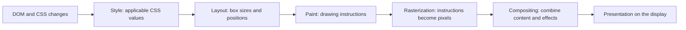

You expand a task's details, mark it complete, or open its editor. The JavaScript might change only one attribute. The browser still has to work out what that change means for the visible page, and that work is where many rendering performance problems come from.

This article follows a small task list from a changed DOM value to pixels on the screen. You'll need to recognize an HTML element, a CSS declaration such as `color: red;`, and a JavaScript function. The [DOM and events article](/dump/blog/html-dom-and-events/) introduces those pieces, and [CSS layout fundamentals](/dump/blog/css-layout-fundamentals/) explains how boxes take up space. The rendering work itself is explained here step by step.

The runnable page needs only a browser. The recording steps use the Performance panel in a Chromium-based browser such as Chrome or Edge, and the Angular example uses Angular 22.2.1 with TypeScript 6.0.3.

## Contents

1. [Three changes to one task list](#three-changes-to-one-task-list)
2. [The DOM changes first, pixels come later](#the-dom-changes-first-pixels-come-later)
3. [From changed values to pixels](#from-changed-values-to-pixels)
4. [Follow three changes to the same row](#follow-three-changes-to-the-same-row)
5. [Why moving with transform can cost less](#why-moving-with-transform-can-cost-less)
6. [When reading a size makes the browser work](#when-reading-a-size-makes-the-browser-work)
7. [Record one interaction before optimizing it](#record-one-interaction-before-optimizing-it)
8. [Why a slow handler makes animation stutter](#why-a-slow-handler-makes-animation-stutter)
9. [Layers and the compositor thread](#layers-and-the-compositor-thread)
10. [Connect the browser work back to Angular](#connect-the-browser-work-back-to-angular)
11. [What to do with this](#what-to-do-with-this)

## Three changes to one task list

Here are three small things a task list does:

- **Expand a row:** a hidden paragraph becomes visible. The row gets taller, so every row below it moves down.
- **Slide in an editor:** the editor panel moves a short distance into its final position as it appears.
- **Measure a row:** right after revealing the paragraph, the code asks for the row's new height.

Each one raises a question:

1. Why can a small DOM change still cause a slow visual update?
2. Why does moving the editor with `transform` usually cost less than moving it with `top` or `left`?
3. Why can a line that only _reads_ a height make the browser do work?

Counting how many lines of JavaScript run doesn't answer any of them. You need to follow what the change makes out of date, what the browser has to recompute, and what it can reuse.

## The DOM changes first, pixels come later

An **event handler** is a function the browser calls when something happens, such as a click. Suppose the handler for the expand button runs this line:

```js
details.hidden = false;
```

The DOM changes immediately: if the next line reads `details.hidden`, it gets `false`. But nothing new is on the screen yet. The browser finishes running your JavaScript first. Later, at its next chance to update the screen (usually lined up with the display's refresh), it works out what the changed DOM means visually and draws the result. If your handler made several changes, the browser can handle them all in that one update.

Frameworks such as Angular add one step at the front. Your code changes application data, and Angular then writes the matching values into the DOM. After that, the browser does exactly the same rendering work as it would for hand-written JavaScript.

So there are separate milestones:

1. Your event handler changes data or the DOM.
2. A framework, if you use one, updates the DOM to match the data.
3. The browser works out styles, sizes, positions, and drawing for the changed page.
4. The display shows the new pixels.

Finishing step 1 or 2 means the browser _can_ start the rest of the work, not that the user sees the result.

This applies however the HTML first arrived. Static files, server-rendered HTML, and HTML built by client-side JavaScript all end up as DOM and CSS that the browser has to turn into pixels. [HTML delivery methods](/dump/blog/html-rendering-methods/) and [Angular change detection](/dump/blog/angular-change-detection/) cover how the HTML and the framework updates arrive.

## From changed values to pixels

Take the details paragraph again. Before it can appear, the browser answers a series of increasingly concrete questions: which CSS values apply, where the boxes go, what to draw, and which pixels to combine.

Here's a simplified diagram of that work. A given update doesn't always need every step:



### Style: which values apply?

The browser matches CSS rules to elements and works out which declarations win, including values inherited from parent elements. For example, the task title might now get the "completed" color, and the details paragraph no longer gets `display: none` from the `hidden` attribute.

This step is called **style calculation**, or **style recalculation**. Some values can't be finished yet: a `width: 50%` can't become a pixel width until the browser knows how wide the parent is, and that's decided in the next step.

### Layout: how big, and where?

The browser calculates every box's size and position from the styles, the content, and the available space. Text wrapping affects height, and a taller row changes where the rows below it go.

This step is **layout**, which some tools call **reflow**. It's only about geometry, not colors. And because boxes affect each other, one changed element can mean recalculating its parent, its children, and its neighbors too.

### Paint: what should be drawn?

Next, the browser writes down drawing instructions in the order they need to happen. For one task row, that list might read: "rounded rectangle at (10, 20), 200 × 40, dark grey; text 'Task 1' at (16, 32), light grey." This step is **paint**, and the recorded list of instructions is a **display list**. Paint doesn't produce any pixels yet. It only describes what the pixels should look like.

### Rasterization: turn drawing instructions into pixels

**Rasterization** works through those drawing instructions and decides the color of every actual pixel. It's done in smaller pieces called **tiles**, and text and images can need extra work along the way.

The browser can keep rasterized pixels and reuse them. That reuse depends on the **raster scale**: the size the content was rasterized at. If something rasterized at normal size gets `transform: scale(2)`, its existing pixels are too coarse for the bigger size and would look blurry, so the browser may rasterize it again at the larger scale.

### Compositing: combine the rendered pieces

Finally, the browser takes the rasterized pieces and combines them, applying their positions, clipping, transparency, and some other effects, to build the image the display shows. This is **compositing**. Because it works with pixels that already exist, it can move or fade a piece without painting or rasterizing it again.

Real engines split this work into more steps than these five. Chromium's [RenderingNG architecture](https://developer.chrome.com/docs/chromium/renderingng-architecture) describes extra stages such as pre-paint, layerization, commit, and activation. The five steps here are a learning model that's accurate enough to reason about performance.

The important part is that browsers keep the results of each step and track what a change made out of date. So they can skip steps that aren't needed and redo only the affected part of the page.

## Follow three changes to the same row

Which work a change needs depends on what actually becomes different on the page:

| Change in this task list                       | What becomes different                 | Work to expect                                                       |
| ---------------------------------------------- | -------------------------------------- | -------------------------------------------------------------------- |
| Reveal a details paragraph                     | Row height and later rows' positions   | Style, layout, and drawing the affected content again                |
| Change only the title's color                  | Appearance, not its text or dimensions | Style and repainting the title; normally no layout for a color alone |
| Animate the editor's `transform` and `opacity` | Drawn position and transparency        | Setup and drawing once, then possibly only compositing per step      |

Be careful with names. A font-size change looks like a styling tweak, but bigger text can wrap differently and change the row's height. A class that sounds like a color might also set a border width. Utility-class frameworks such as Tailwind work the same way: a utility class is ordinary CSS, so a color utility and a height utility ask the browser for different work. Check what a change actually sets.

## Why moving with transform can cost less

Here's the practical rule: to move, fade, or scale something on screen, animate `transform` and `opacity` instead of `top`, `left`, `width`, or `height`.

Changing `top` or `height` changes geometry, so each step of the animation can need layout and paint again. A `transform` changes where the browser _draws_ a box that's already laid out, and `opacity` changes how transparent it is. So the browser can often keep the content it already painted and rasterized, and only composite it at a new position or transparency for each step.

The one caveat is "often". The browser decides case by case, and things such as scaling to a new raster scale or revealing new content can still bring work back. If an animation stutters, record it with the steps later in this article instead of assuming.

The rest of this section explains what a transform changes on the page, which matters as soon as you use one.

### What a transform changes and what it leaves alone

Start with two rows, A followed by B. In **normal flow**, the default arrangement, each block takes up space and B starts where A's space ends. The browser first decides A's size and position, then where B goes.

Changing A's `height` changes its layout size, so B moves down. A transform only changes how A is drawn: A keeps its original space, so B stays where it was.

Here's a concrete comparison. A starts at 200 × 40 CSS pixels, with B right below it and no margins or gaps. A **CSS pixel** is the unit CSS uses for page layout; on high-density screens, one CSS pixel covers several physical pixels. The example uses `transform-origin: top left`, so scaling grows from A's top-left corner instead of from its center.

| Change to A                   | Space A takes in normal flow | How A is drawn                   | Top of B, measured from A's top |
| ----------------------------- | ---------------------------- | -------------------------------- | ------------------------------- |
| No change                     | 200 × 40 CSS px              | 200 × 40 CSS px                  | 40 CSS px                       |
| `height: 80px`                | 200 × 80 CSS px              | 200 × 80 CSS px                  | 80 CSS px                       |
| `width: 400px`                | 400 × 40 CSS px              | 400 × 40 CSS px                  | 40 CSS px; height is fixed here |
| `transform: translateY(24px)` | 200 × 40 CSS px              | Same size, drawn 24 CSS px lower | 40 CSS px                       |
| `transform: scale(2)`         | 200 × 40 CSS px              | 400 × 80 CSS px                  | 40 CSS px                       |
| `transform: scale(0.5)`       | 200 × 40 CSS px              | 100 × 20 CSS px                  | 40 CSS px                       |

What to notice:

- **With `scale(2)`, A is drawn over B's space instead of pushing B down.** A transformed box can overlap its neighbors, and it can make a container overflow, so clipping or scrollbars may change.
- **With `scale(0.5)`, B doesn't move up** to fill the space that now looks empty.
- **Scaling isn't the same as giving text more room.** A wider box lets text wrap into fewer lines. Scaling enlarges the lines that were already laid out.

### `top` and `left` move positioned boxes

`top` and `left` only work on elements with a `position` other than the default `static`, and what they do depends on that mode. `position: relative; top: 24px` draws the box 24 pixels lower while keeping its original space, so B doesn't move. `position: absolute` takes the box out of normal flow entirely, so other boxes ignore its size. [CSS layout fundamentals](/dump/blog/css-layout-fundamentals/) covers these modes in its positioning section.

So "the neighbors didn't move" doesn't tell you whether layout ran. Animating `top` or `left` still asks the browser to recalculate the box's position for every step, and a `transform` animation often doesn't.

A common belief is that CSS animations are always cheap and JavaScript animations are always expensive. What matters is which property changes. A CSS animation of `height` still asks for layout on every step, and JavaScript that updates a `transform` doesn't.

## When reading a size makes the browser work

Suppose the browser has already laid out a collapsed row and knows its height. Now your handler reveals the details and immediately reads `row.offsetHeight`:

1. The write makes the stored layout out of date.
2. The read asks for the **current** height, not the height from the last time the screen updated.
3. To return a correct answer, the browser has to run style and layout right now, before your JavaScript continues.

This is **forced synchronous layout**: a read forces the browser to do layout work immediately instead of at its next screen update. Reading a size isn't expensive by itself. If the layout is already up to date, the browser just returns the stored value. The problem comes from writing, then reading, then writing again in a loop.

`offsetHeight` returns a whole number of CSS pixels for the element's height, including padding and borders but not margins, and it ignores transforms. `getBoundingClientRect()` returns a rectangle measured from the **viewport**, the visible area of the page, includes the effect of transforms, and can contain fractions. They answer different questions, but either one can force layout.

### Two ways to expand and measure every row

The demo page has 24 task rows. Both of its buttons reveal every details paragraph and then need every row's **expanded** height. The only difference is the order of the reads and writes.

The first version reads each height right after revealing that row's details:

```js
function expandInterleaved() {
  const heights = [];

  for (const row of rows) {
    row.details.hidden = false;
    heights.push(row.element.offsetHeight);
  }

  return heights;
}
```

What to notice: every `offsetHeight` read follows a write that made layout out of date, so the browser has to run layout 24 times, once per row. It's deliberately inefficient teaching code.

The second version does all the writes first, then all the reads:

```js
function expandBatched() {
  for (const row of rows) {
    row.details.hidden = false;
  }

  const heights = [];

  for (const row of rows) {
    heights.push(row.element.offsetHeight);
  }

  return heights;
}
```

What to notice: the first read still forces layout, because the new heights don't exist yet. But that one layout covers all 24 changes, so the other 23 reads reuse it.

The page also wraps each button's work in **User Timing** marks. `performance.mark()` records a named timestamp, and `performance.measure()` records a named interval between two marks. They show up in the browser's Performance panel, so you can find the expansion in a recording. They show when the code ran, not when its pixels appeared.

### Try the full page

Save the three files below as `index.html`, `rendering.css`, and `rendering.js` in one folder, then open `index.html` in a Chromium-based browser. There's no build step. Besides the two expand buttons, the page has a completion checkbox and an editor for each task, used later in this article, and a theme switcher. The editor slides in with a short `transform` and `opacity` animation, which is turned off when the operating system asks for reduced motion.

<details>
<summary>The complete <code>index.html</code></summary>

```html
<!doctype html>
<html lang="en" data-theme="dark">
  <head>
    <meta charset="utf-8" />
    <meta name="viewport" content="width=device-width, initial-scale=1" />
    <title>Task rendering comparison</title>
    <link rel="stylesheet" href="./rendering.css" />
    <script src="./rendering.js" defer></script>
  </head>
  <body>
    <main class="page">
      <h1>Task rendering comparison</h1>
      <p>Expand details and measure the new row heights. Reload before comparing runs.</p>
      <label for="theme">Theme</label>
      <select id="theme">
        <option value="dark">Dark</option>
        <option value="light">Light</option>
      </select>
      <div class="controls">
        <button id="interleaved" type="button">Expand: interleaved (inefficient)</button>
        <button id="batched" type="button">Expand: batched</button>
        <button id="collapse" type="button">Collapse details</button>
      </div>
      <p id="measurement" role="status">No expanded heights measured yet.</p>
      <section id="editor" class="editor" aria-labelledby="editor-heading" hidden>
        <h2 id="editor-heading">Edit task title</h2>
        <form id="editor-form">
          <label for="editor-title">Title</label>
          <input id="editor-title" name="title" required />
          <div class="controls">
            <button type="submit">Save title</button>
            <button id="close-editor" type="button">Cancel</button>
          </div>
        </form>
      </section>
      <ul id="tasks" class="task-list" role="list"></ul>
      <template id="task-template">
        <li class="task-row">
          <div class="task-line">
            <span class="task-title"></span>
            <label class="completion">
              <input type="checkbox" />
              Done <span class="completion-name visually-hidden"></span>
            </label>
            <button class="edit" type="button">Edit</button>
          </div>
          <p class="task-details" hidden>
            Check the task's expected result, record what changed, and explain the next step.
          </p>
        </li>
      </template>
    </main>
  </body>
</html>
```

</details>

<details>
<summary>The complete <code>rendering.css</code></summary>

```css
:root {
  color-scheme: dark;
  --page: #111417;
  --surface: #181d21;
  --text: #f3efe8;
  --muted: #b8b0a5;
  --accent: #ff9b6d;
  --line: rgba(203, 221, 230, 0.18);
}

:root[data-theme="light"] {
  color-scheme: light;
  --page: #f4efe8;
  --surface: #fbf7f2;
  --text: #201916;
  --muted: #66564d;
  --accent: #a34d2d;
  --line: rgba(71, 52, 39, 0.2);
}

* {
  box-sizing: border-box;
}

[hidden] {
  display: none !important;
}

body {
  margin: 0;
  background: var(--page);
  color: var(--text);
  font:
    1.1875rem/1.5 system-ui,
    sans-serif;
}

.page {
  width: min(100% - 2rem, 48rem);
  margin: 2rem auto;
}

h1 {
  font-size: 1.75rem;
}

h2 {
  font-size: 1.25rem;
}

button,
input,
select {
  max-width: 100%;
  font: inherit;
  color: inherit;
  accent-color: var(--accent);
}

button,
input:not([type="checkbox"]),
select {
  border: 1px solid var(--muted);
  border-radius: 0.3rem;
  background: var(--surface);
  padding: 0.4rem 0.6rem;
}

button {
  cursor: pointer;
  white-space: normal;
}

:focus-visible {
  outline: 2px solid var(--accent);
  outline-offset: 3px;
}

.controls,
.task-line {
  display: flex;
  flex-wrap: wrap;
  align-items: center;
  gap: 0.75rem;
}

.controls {
  margin-block: 1rem;
}

.task-list {
  display: grid;
  gap: 0.75rem;
  padding: 0;
  list-style: none;
}

.task-row,
.editor {
  padding: 1rem;
  border: 1px solid var(--line);
  border-radius: 0.4rem;
  background: var(--surface);
}

.task-title {
  flex: 1 1 14rem;
  min-width: 0;
}

.task-title,
#measurement {
  overflow-wrap: anywhere;
}

.completion {
  display: inline-flex;
  align-items: center;
  gap: 0.4rem;
}

.is-done .task-title {
  color: var(--accent);
}

.task-details {
  margin: 1rem 0 0;
  color: var(--muted);
}

#editor-title {
  display: block;
  width: 100%;
}

.editor:not([hidden]) {
  animation: editor-enter 180ms ease-out;
}

@keyframes editor-enter {
  from {
    transform: translateY(0.5rem);
    opacity: 0;
  }
  to {
    transform: translateY(0);
    opacity: 1;
  }
}

@media (prefers-reduced-motion: reduce) {
  .editor:not([hidden]) {
    animation: none;
  }
}

.visually-hidden {
  position: absolute;
  width: 1px;
  height: 1px;
  padding: 0;
  margin: -1px;
  overflow: hidden;
  clip-path: inset(50%);
  white-space: nowrap;
}
```

</details>

<details>
<summary>The complete <code>rendering.js</code></summary>

`template.content.firstElementChild.cloneNode(true)` copies the row markup from the `<template>` element. A `<template>` holds HTML that the browser parses but doesn't display, so the script can stamp out 24 copies of the same row.

```js
const list = document.querySelector("#tasks");
const template = document.querySelector("#task-template");
const measurement = document.querySelector("#measurement");
const editor = document.querySelector("#editor");
const editorTitle = document.querySelector("#editor-title");
const rows = [];
let editingRow = null;

for (let index = 0; index < 24; index += 1) {
  const element = template.content.firstElementChild.cloneNode(true);
  const title = element.querySelector(".task-title");
  const completionName = element.querySelector(".completion-name");
  const editButton = element.querySelector(".edit");
  const checkbox = element.querySelector('input[type="checkbox"]');
  const details = element.querySelector(".task-details");
  const text = `Task ${index + 1}: inspect the expanded row`;

  title.textContent = text;
  completionName.textContent = text;
  editButton.setAttribute("aria-label", `Edit ${text}`);

  const row = { element, title, completionName, editButton, details };
  rows.push(row);
  list.append(element);

  checkbox.addEventListener("change", () => {
    element.classList.toggle("is-done", checkbox.checked);
  });

  editButton.addEventListener("click", () => {
    editingRow = row;
    editorTitle.value = title.textContent;
    editor.hidden = false;
    editorTitle.focus();
  });
}

// Deliberately inefficient: each height read follows a write that makes layout out of date.
function expandInterleaved() {
  const heights = [];

  for (const row of rows) {
    row.details.hidden = false;
    heights.push(row.element.offsetHeight);
  }

  return heights;
}

// Batched: reveal every row first, then read every expanded height.
function expandBatched() {
  for (const row of rows) {
    row.details.hidden = false;
  }

  const heights = [];

  for (const row of rows) {
    heights.push(row.element.offsetHeight);
  }

  return heights;
}

function expandAndReport(expand, name) {
  performance.mark(`${name}:start`);
  const heights = expand();
  performance.mark(`${name}:end`);
  performance.measure(name, `${name}:start`, `${name}:end`);

  let total = 0;

  for (const height of heights) {
    total += height;
  }

  measurement.textContent = `${heights.length} expanded rows. Heights (CSS px): ${heights.join(", ")}. Sum of row heights: ${total} CSS px (excluding list gaps).`;
}

document.querySelector("#interleaved").addEventListener("click", () => {
  expandAndReport(expandInterleaved, "expand-interleaved");
});

document.querySelector("#batched").addEventListener("click", () => {
  expandAndReport(expandBatched, "expand-batched");
});

document.querySelector("#collapse").addEventListener("click", () => {
  for (const row of rows) {
    row.details.hidden = true;
  }

  measurement.textContent = "Details collapsed. No expanded heights measured yet.";
});

function closeEditor() {
  editor.hidden = true;
  editingRow.editButton.focus();
  editingRow = null;
}

document.querySelector("#editor-form").addEventListener("submit", (event) => {
  event.preventDefault();
  const text = editorTitle.value;
  editingRow.title.textContent = text;
  editingRow.completionName.textContent = text;
  editingRow.editButton.setAttribute("aria-label", `Edit ${text}`);
  closeEditor();
});

document.querySelector("#close-editor").addEventListener("click", closeEditor);

document.querySelector("#theme").addEventListener("change", (event) => {
  document.documentElement.dataset.theme = event.target.value;
});
```

</details>

The status line reports the sum of the row heights. It leaves out the gaps between rows, so it isn't the height of the whole list. The User Timing marks surround only the expansion and the reads, not the status-text update that follows.

### Why this batching keeps the same result

An optimization has to measure the same thing as the code it replaces. In both versions, each height is read after that row's details are visible. In this layout, revealing another row can move a row down the page but doesn't change its height. So revealing everything first gives the same 24 heights.

That reasoning depends on the layout. If you measured positions instead of heights, if rows shared an equal-height grid, or if one row's change could change another row's available width, reordering might change the answers. Batching is only safe when it doesn't change which state you measure.

The general rule:

- If you need the **old** geometry, read it before making the changes.
- If you need the **new** geometry, make all the changes first and accept the one layout that the first read forces.

A loop that alternates read, write, read, write and forces layout each time is called **layout thrashing**.

## Record one interaction before optimizing it

Use the demo page to confirm that the interleaved version really forces layout once per row. Record one interaction at a time, so other work doesn't mix in.

1. Reload the page so it starts with 24 collapsed rows, the editor closed, and nothing marked done. Keep the same window size, zoom, and theme for both runs.
2. Open DevTools, select the **Performance** panel, and click the record button.
3. Click **Expand: interleaved (inefficient)** once, then stop the recording.
4. Find `expand-interleaved` in the **Timings** track. Below it, in the **Main** track, you'll see the click handler with many small **Recalculate Style** and **Layout** entries nested inside it. Entry names can vary slightly between browser versions.
5. Click one of the Layout entries and look at its stack trace in the details pane at the bottom. It points to the `offsetHeight` read in `expandInterleaved`. The **Insights** sidebar may also flag it as a forced reflow.
6. Reload the page and repeat with **Expand: batched**. Check that the status line shows the same heights as before.

Recorded in Chromium 152 with a 960 × 800 CSS-pixel viewport, the work inside the two expansion marks looked like this:

| Inside the expansion marks                             | Interleaved             | Batched            |
| ------------------------------------------------------ | ----------------------- | ------------------ |
| Style updates (`UpdateLayoutTree` in the raw trace)    | 24                      | 1                  |
| Layout events                                          | 24                      | 1                  |
| Measured expanded row heights                          | 24 values of 122 CSS px | The same 24 values |
| Sum of row heights, excluding gaps                     | 2928 CSS px             | 2928 CSS px        |

Your heights and timings will differ with your fonts, window size, and machine, but the pattern to look for is the same: one layout per row for the interleaved version, one layout in total for the batched one. Each recording also shows one more Layout after the marks. That's the browser laying out the updated status text, and it isn't part of the comparison.

Fix the cause the recording shows, then record the same interaction again. Be careful that a faster version still does the same job: a test gets faster if you remove the details text or measure a different state, but the product doesn't get any better.

## Why a slow handler makes animation stutter

A display refreshing at 60 Hz, 60 times per second, shows a new image roughly every 16.7 ms. At 120 Hz, it's roughly every 8.3 ms. If the browser wants a new image ready for the next refresh, everything needed to produce it has to fit in that interval. That includes your JavaScript and the browser's own style, layout, and paint work.

A **thread** is a sequence of work that runs one step at a time. Each page has a **main thread**, which runs your JavaScript, handles events, and does most of the style, layout, and paint work. While a JavaScript function is running, that thread can't do anything else, including rendering.

The browser does use other threads for some rendering work. But any update that needs the main thread has to wait until your JavaScript finishes.

### One busy handler can delay several updates

Imagine a 60 Hz display and a handler that starts at time zero and keeps the main thread busy for 55 ms of computation. An animation on the page needs a new position from JavaScript at every refresh. This timeline is an illustration, not a measurement:

```text
0 ms       Handler starts.
16.7 ms    Still busy: no new position from JavaScript.
33.3 ms    Still busy: no new position from JavaScript.
50.0 ms    Still busy: no new position from JavaScript.
55 ms      Handler ends; the remaining rendering work can start.
66.7 ms    Next refresh the update can aim for.
```

The display keeps showing the last image during those refreshes, so the animation freezes in place. When it updates again, a time-based animation jumps ahead to catch up with the time that passed. Uneven, late updates like these make motion stutter, and that visible stutter is called **jank**.

A handler shorter than 16.7 ms can still cause a missed refresh if it starts late or leaves too little time for the rest of the work. So a fast handler alone doesn't prove the screen updated quickly, and an average frames-per-second number can hide a few long gaps.

For how tasks, microtasks, and rendering take turns on the main thread, see [JavaScript engines and runtimes](/dump/blog/javascript-engines-and-runtimes/).

## Layers and the compositor thread

Imagine the browser keeps the editor's rasterized pixels separately from the rest of the page. Then it can move or fade the editor by compositing those pixels in a new place, without painting every letter again. That separately kept piece is a **composited layer**.

The browser composites on a separate **compositor thread**. A CSS `transform` or `opacity` animation that's already running can be handed to that thread, and then it keeps moving even while a long JavaScript handler blocks the main thread. That's the second reason `transform` and `opacity` are good animation choices. Not every animation qualifies, though, so check the recording if a running animation still stutters.

### JavaScript-driven animation still needs the main thread

An animation that uses JavaScript to calculate each new `transform` value needs that JavaScript to run on the main thread for every step. So a long handler still blocks it, even though the property is a cheap one to render. The demo's editor avoids this: its click handler only reveals the panel, and a CSS animation produces every step after that.

When you do drive an animation from JavaScript, use `requestAnimationFrame()`. It runs your callback just before the browser's next render, which makes it the right place to set the next animation value. Use the timestamp it passes to your callback to work out how far the animation should have moved, rather than moving a fixed number of pixels per call. The callback runs on the same main thread, though, so 55 ms of work inside it still blocks for 55 ms, and a write followed by a size read inside it still forces layout.

### Elements, stacking contexts, and layers are different things

Three structures are easy to confuse:

- A **DOM element** is a node in the document, such as a button or a paragraph.
- A **stacking context** is a group of elements that CSS stacks together when content overlaps. Properties such as `transform`, `opacity` below 1, and a positioned element with a `z-index` create one. `z-index` only orders elements within the same stacking context. That's why `z-index: 9999` sometimes doesn't bring a dropdown to the front: the dropdown is trapped inside a parent's stacking context, which is itself stacked below something else.
- A **composited layer** is the browser's own choice of how to split rendered content into pieces it can composite separately.

There isn't one layer per element, and creating a stacking context doesn't guarantee its own layer. The browser decides how to group content, and those decisions can change as the page and its animations change.

### Layers cost memory and work too

Each layer's pixels take up memory, rasterizing them takes work, and the compositor has to combine them all. Large layers and high-density screens make each of those more expensive. Using the GPU for compositing doesn't make extra layers free.

`will-change: transform` tells the browser an element is likely to change, which can make it prepare a layer in advance. It also keeps those resources reserved and creates a stacking context. So don't add it to every task row. Start without it, and only try it on a specific element when a recording shows a problem it could fix. The demo page doesn't need it.

### Check drawing and layers in DevTools

When you suspect drawing rather than layout, check it directly:

- **Paint flashing:** open the DevTools command menu (Ctrl+Shift+P, or Cmd+Shift+P on macOS), run **Show Rendering**, and turn on **Paint flashing**. Toggle one task's checkbox in the demo page. Only the repainted area flashes green, so you can see that a color change doesn't repaint every row. It shows where paint happened, not how long it took.
- **The editor's layers:** record opening the editor in the Performance panel. You'll see style, layout, and paint work when it appears, then the animation steps. The **Layers** panel (in the DevTools "More tools" menu) shows which layers exist and why each one was created.

The word `transform` in your CSS, or a recording without obvious Layout entries, isn't proof that an animation runs entirely on the compositor. The Performance panel and Layers panel are where you confirm it.

## Connect the browser work back to Angular

In an Angular app, a performance recording can show two kinds of cost:

- **Angular's work:** scheduling updates, evaluating template bindings, checking components, and changing DOM values.
- **The browser's work:** responding to the changed DOM and CSS with style, layout, and drawing.

Both matter, and they're fixed differently.

Don't read sizes inside template expressions. A **binding** connects a value in the template, such as `{{ title }}` or `[hidden]="..."`, to the DOM, and Angular re-evaluates bindings each time it checks the component. A method that reads `offsetHeight` from a binding can force layout on every check.

Use `@for (...; track task.id)` so Angular can match each task to its existing DOM element instead of recreating rows. That reduces Angular's work and the DOM changes. It doesn't make a genuinely taller row cheaper to lay out.

### Measure after Angular has updated the DOM

Here's the batched expansion as an Angular component. It uses three Angular pieces:

- A **signal** holds a value and tells Angular when it changes, so Angular can update the parts of the template that read it. `signal(false)` creates one, `expanded()` reads it, and `expanded.set(true)` changes it.
- `viewChildren("row")` returns a signal containing every element in the template marked `#row`. Each one is wrapped in an `ElementRef`, and its `nativeElement` property is the actual DOM element.
- `afterNextRender` runs a callback once, after Angular has next updated the DOM. Its `read` phase is meant for reading sizes, so Angular groups those reads together instead of mixing them with DOM writes.

Save this as `task-rows.ts` in an Angular application, and add the earlier `rendering.css` as a global stylesheet:

```ts
import {
  afterNextRender,
  Component,
  ElementRef,
  inject,
  Injector,
  signal,
  viewChildren,
} from "@angular/core";

@Component({
  selector: "task-rows",
  template: `
    <main class="page">
      <h1>Measure expanded task rows</h1>
      <button type="button" (click)="expandAndMeasure()">Expand and measure</button>
      <p role="status">{{ measurement() }}</p>
      <ul class="task-list" role="list">
        @for (task of tasks; track task.id) {
          <li #row class="task-row">
            <span class="task-title">{{ task.title }}</span>
            <p class="task-details" [hidden]="!expanded()">
              Check the expected result and record the next step.
            </p>
          </li>
        }
      </ul>
    </main>
  `,
})
export class TaskRows {
  readonly tasks = [
    { id: 1, title: "Inspect the row's expanded height" },
    { id: 2, title: "Compare the same geometry after batching" },
  ];
  readonly expanded = signal(false);
  readonly measurement = signal("No expanded heights measured yet.");
  readonly rows = viewChildren<ElementRef<HTMLLIElement>>("row");
  private readonly injector = inject(Injector);

  expandAndMeasure(): void {
    this.expanded.set(true);

    afterNextRender(
      {
        read: () => {
          const heights: number[] = [];

          for (const row of this.rows()) {
            heights.push(row.nativeElement.offsetHeight);
          }

          this.measurement.set(`Expanded heights (CSS px): ${heights.join(", ")}`);
        },
      },
      { injector: this.injector },
    );
  }
}
```

What to notice:

- `expandAndMeasure()` changes the `expanded` signal and then asks for a measurement after the next render. Here "render" means Angular has written the new DOM values. The browser hasn't necessarily painted anything yet, and the first `offsetHeight` read still forces one layout, just like the batched JavaScript version.
- The result goes into another signal, `measurement`, which the template displays.

`afterNextRender` needs an **injection context**. That's the window in which Angular can supply a component's dependencies: while it's creating the component, which covers the constructor and field initializers, and a few other places such as provider factory functions. A click handler runs later, outside that window. So the component stores its `Injector` in a field initializer and passes it to `afterNextRender` explicitly. The [dependency injection article](/dump/blog/angular-dependency-injection/) explains injectors in detail.

Render callbacks such as `afterNextRender` don't run during server-side rendering or prerendering, so this measurement only happens in the browser.

To start the app, `main.ts` bootstraps the component:

```ts
import { bootstrapApplication } from "@angular/platform-browser";
import { TaskRows } from "./task-rows";

bootstrapApplication(TaskRows).catch((error: unknown) => {
  console.error(error);
});
```

The application's `index.html` contains `<task-rows></task-rows>` where the component should appear.

If a real feature needs to react whenever an element's size changes, rather than once after a click, look at `ResizeObserver` instead of reading sizes during every Angular check.

## What to do with this

Back to the three questions from the start:

1. **A small DOM change can be slow** because the browser may have to redo style, layout, paint, rasterization, and compositing for everything the change affects, and that can be much more than the one element you touched.
2. **`transform` usually costs less than `top` or `left`** because it changes where already-painted content is drawn, so the browser can often skip layout and paint and only composite. A running CSS `transform` or `opacity` animation can even continue on the compositor thread while the main thread is busy.
3. **Reading a height can make the browser work** because the browser has to give you the current answer, so it runs any pending style and layout right away.

In practice, that comes down to three habits:

- Don't read sizes right after writing to the DOM inside a loop. Make all the writes, then do all the reads.
- Animate `transform` and `opacity`, not `top`, `left`, `width`, or `height`.
- Record the interaction in the Performance panel before optimizing, and record it again afterwards to check that the fix worked and the result didn't change.

## Check your understanding

1. **Which step calculates the expanded row's new height?** Layout. Paint describes what to draw, rasterization turns that into pixels, and compositing combines the pieces.
2. **Why does the interleaved loop run layout 24 times and the batched loop only once?** In the interleaved loop, every height read comes right after a write that made layout out of date. In the batched loop, the first read runs one layout for all the changes, and the remaining reads reuse it.
3. **Could the batched version read all the heights before revealing the details?** No. It needs the expanded heights, so reading earlier would measure the wrong state instead of making the same measurement faster.
4. **Why can a JavaScript-driven `transform` animation still stutter during a long handler?** The JavaScript that calculates each step needs the main thread, which the handler is still using. A cheap property doesn't move that JavaScript off the main thread.

## References

- [Chromium RenderingNG architecture](https://developer.chrome.com/docs/chromium/renderingng-architecture): the stages of Chromium's rendering pipeline and how it skips unneeded work.
- [web.dev: Avoid large, complex layouts and layout thrashing](https://web.dev/articles/avoid-large-complex-layouts-and-layout-thrashing): forced synchronous layout and read-write loops.
- [CSSOM View specification](https://drafts.csswg.org/cssom-view/#dom-htmlelement-offsetheight), [MDN: `offsetHeight`](https://developer.mozilla.org/en-US/docs/Web/API/HTMLElement/offsetHeight), and [MDN: `getBoundingClientRect()`](https://developer.mozilla.org/en-US/docs/Web/API/Element/getBoundingClientRect): what each size API returns.
- [CSS Transforms specification](https://drafts.csswg.org/css-transforms-1/#transform-rendering) and [MDN: stacking contexts](https://developer.mozilla.org/en-US/docs/Web/CSS/CSS_positioned_layout/Stacking_context): how transforms affect drawing but not layout, and how stacking contexts order overlapping content.
- [WHATWG HTML: update the rendering](https://html.spec.whatwg.org/multipage/webappapis.html#update-the-rendering) and [MDN: `requestAnimationFrame()`](https://developer.mozilla.org/en-US/docs/Web/API/Window/requestAnimationFrame): when the browser renders and when animation callbacks run.
- [web.dev: high-performance animations](https://web.dev/articles/animations-guide), [MDN: `will-change`](https://developer.mozilla.org/en-US/docs/Web/CSS/will-change), and [MDN: reduced motion](https://developer.mozilla.org/en-US/docs/Web/CSS/@media/prefers-reduced-motion): choosing animation properties, the costs of `will-change`, and respecting reduced motion.
- [Chrome DevTools Performance reference](https://developer.chrome.com/docs/devtools/performance/reference), [Rendering tools](https://developer.chrome.com/docs/devtools/rendering/performance), and [Layers panel](https://developer.chrome.com/docs/devtools/layers): recording, paint flashing, and layer inspection.
- [Angular DOM APIs](https://angular.dev/guide/components/dom-apis), [`afterNextRender`](https://angular.dev/api/core/afterNextRender), [signals](https://angular.dev/guide/signals), and [template control flow](https://angular.dev/guide/templates/control-flow): render callbacks and their phases, signals, and tracked rows.
