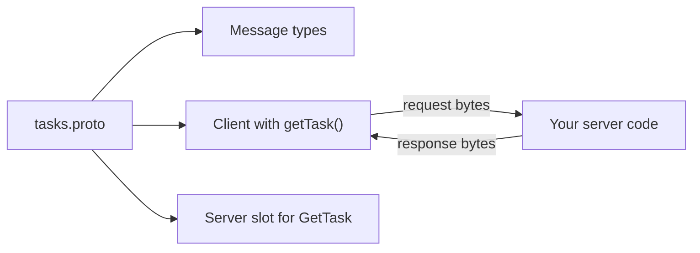

A task board loads one task from its backend and gets JSON back:

```json
{
  "id": 150,
  "title": "Read the DOM",
  "done": false
}
```

The frontend has a hand-written `Task` type with `id`, `title`, and `done`, and the template shows `task.title`. Then the backend renames `title` to `name`. The TypeScript type still says `title`, so the build passes, and the task list shows rows with no titles. Nothing told the frontend that the response changed shape.

That's the problem API description files solve. One file describes the API, tools generate code for both sides from it, and a change on one side shows up as a compile error on the other. In this area you'll run into three names, and most confusion comes from mixing them up:

- **OpenAPI** describes an HTTP endpoint: "`GET /tasks/{taskId}` returns this JSON."
- **Protobuf** describes the shape of a piece of data and how to turn it into compact bytes.
- **gRPC** describes a function you can call on another machine, with protobuf messages as its argument and its return value.

This article takes them one at a time using a single call, loading one task, and then follows that call from an Angular component to the server and back. By the end you'll know what the `title` rename does with protobuf and how to make it without breaking anyone.

You'll need to know what an HTTP request and a JSON response are; [HTTP from TCP to fetch](/dump/blog/http-from-tcp-to-fetch/) covers both. The `Task` shape is the one the task-board articles use, starting with [HTML, the DOM, and events](/dump/blog/html-dom-and-events/).

Code generators differ in the names they produce. The TypeScript examples use Connect for Web 2.2 (`@connectrpc/connect` and `@connectrpc/connect-web`), code generated by `protoc-gen-es` 2.16, and Angular 22.2.1. With another generator the ideas carry over, but function and type names differ.

## Contents

1. [Describing an HTTP endpoint with OpenAPI](#describing-an-http-endpoint-with-openapi)
2. [Describing data with protobuf](#describing-data-with-protobuf)
3. [Describing callable methods with gRPC](#describing-callable-methods-with-grpc)
4. [What the generated code does](#what-the-generated-code-does)
5. [Calling GetTask from Angular](#calling-gettask-from-angular)
6. [How the call gets from the browser to the server](#how-the-call-gets-from-the-browser-to-the-server)
7. [What travels over the network](#what-travels-over-the-network)
8. [Changing a message without breaking clients](#changing-a-message-without-breaking-clients)
9. [When "not sent" and "empty" look the same](#when-not-sent-and-empty-look-the-same)
10. [Errors and deadlines](#errors-and-deadlines)
11. [Streaming calls](#streaming-calls)
12. [Choosing between OpenAPI and gRPC](#choosing-between-openapi-and-grpc)
13. [Checklist for reading and editing `.proto` files](#checklist-for-reading-and-editing-proto-files)
14. [What happens to the rename](#what-happens-to-the-rename)

## Describing an HTTP endpoint with OpenAPI

OpenAPI is a format for describing an HTTP API in a JSON file or a YAML file, YAML being a text format like JSON that uses indentation instead of braces. The file says which URLs exist, which HTTP methods they accept, which parameters they take, and what the responses look like. Here's the part of an OpenAPI file that describes loading one task:

```yaml
paths:
  /tasks/{taskId}:
    get:
      operationId: getTask
      parameters:
        - name: taskId
          in: path
          required: true
          schema:
            type: integer
      responses:
        "200":
          description: The task
          content:
            application/json:
              schema:
                $ref: "#/components/schemas/Task"
        "404":
          description: No task with that id
```

What to notice:

- The URL and the method, `GET /tasks/{taskId}`, are the API. Everything else hangs off them.
- `{taskId}` is a path parameter: the client puts the id into the URL itself, as in `/tasks/150`.
- Responses are listed by HTTP status code: `200` with a task, or `404`.
- `$ref` points to a `Task` schema that's defined once, further down the same file, so other endpoints can reuse it.

```yaml
components:
  schemas:
    Task:
      type: object
      required: [id, title, done]
      properties:
        id:
          type: integer
        title:
          type: string
        done:
          type: boolean
```

The schema lists the JSON keys by name, so the rename from the opening is visible here: the backend's file would say `name` where the frontend expects `title`. A complete file also starts with an `openapi` version line and an `info` block, which are left out here.

Tools read this file and generate things from it: documentation pages, mock servers, and TypeScript clients. A generated client turns the operation into a function such as `getTask(taskId)`, which builds the URL, sends the request, and returns the parsed JSON typed as `Task`. If you regenerate it after the rename, every `task.title` in your code becomes a compile error. That's the point of generating code from a shared file.

OpenAPI doesn't require one particular API style. It can describe resource-style URLs such as `GET /tasks/150`, often called REST, and action-style ones such as `POST /completeTask` alike. Either way, what it describes is an HTTP request and its response.

## Describing data with protobuf

Protocol Buffers, usually called protobuf, describe structured data in a `.proto` file and define how to turn that data into compact bytes. Here's the task as a protobuf **message**, which is protobuf's word for a data type:

```proto
syntax = "proto3";

package tasks.v1;

message Task {
  int32 id = 1;
  string title = 2;
  bool done = 3;
}
```

What to notice:

- `syntax = "proto3"` picks the version of the language. Proto3 is the one you'll usually see.
- `package tasks.v1` names this group of definitions. The `v1` leaves room for an incompatible future version to live next to it as `tasks.v2`.
- `message Task` has three fields. `int32` is a 32-bit whole number, so it becomes `number` in TypeScript.
- Each field has a name and a number (`= 1`, `= 2`, `= 3`). The name is for people and for generated code. The number is what actually goes over the network, as [What travels over the network](#what-travels-over-the-network) shows.

A compiler called `protoc` reads the `.proto` file, and a plugin for your language generates code from it. For TypeScript you get a `Task` type plus functions that **serialize** a task, which means turning the in-memory object into bytes to send, like `JSON.stringify` does, and **parse** bytes back into an object, like `JSON.parse`.

Why use a schema and a compiler instead of `JSON.stringify`? Two reasons matter day to day. First, the frontend and the backend generate code from the same `.proto` file, so if the backend renames a field and you regenerate, your TypeScript stops compiling instead of quietly getting `undefined` at runtime. Second, field names aren't sent, so messages are smaller and faster to parse. That matters most between backend services exchanging millions of messages, and much less for a page making a few calls.

On its own, protobuf only describes data. You can store protobuf messages in files or send them through a message queue with no gRPC involved. gRPC is where you'll meet them most often, though.

## Describing callable methods with gRPC

gRPC is a framework for **remote procedure calls**, or RPC: your code calls a function, and that function actually runs on another machine. In your code it looks like an ordinary function call, but the argument travels over the network and the result comes back the same way.

You describe those functions in the same `.proto` file, using a `service` block. By convention the file lives in a folder that matches its package, so this one is `tasks/v1/tasks.proto`. Here's the complete file the rest of the article uses:

```proto
syntax = "proto3";

package tasks.v1;

service TaskService {
  rpc GetTask(GetTaskRequest) returns (GetTaskResponse);
}

message GetTaskRequest {
  int32 task_id = 1;
}

message GetTaskResponse {
  Task task = 1;
}

message Task {
  int32 id = 1;
  string title = 2;
  bool done = 3;
}
```

What to notice:

- `service TaskService` groups related methods. `rpc GetTask(...) returns (...)` declares one method: it takes a `GetTaskRequest` and returns a `GetTaskResponse`.
- Every method takes exactly one message and returns exactly one message. Even a single id gets wrapped in `GetTaskRequest`, which leaves room to add fields later without changing the method.
- `GetTaskResponse` contains a whole `Task`. Messages can contain other messages.

Compare that with OpenAPI. Both end with you calling something like `getTask(150)`. The difference is where they start. With OpenAPI, the URL `GET /tasks/{taskId}` is the real thing, and `getTask` is a convenience name for it. With gRPC, the method `TaskService.GetTask` is the real thing, and how it travels over HTTP is a detail the generated client handles.

## What the generated code does

From `tasks.proto`, a code generator produces the message types (`Task`, `GetTaskRequest`, `GetTaskResponse`) and a description of `TaskService`. A client library turns that description into an object with a `getTask` method, and a server library uses it to register your implementation of `GetTask`.



The generated files are ordinary TypeScript that a tool wrote for you. Their job is translating between the objects you work with and the bytes that go over the network. They're rebuilt from the `.proto` file every time it changes, so a hand edit gets overwritten on the next run. The workflow is always the same: change the `.proto` file, run the generator, then update the code that calls or implements the generated functions. If generated code looks wrong, look at the `.proto` file and the generator settings, not at the generated file.

When your code calls `getTask`, the generated client:

1. builds a `GetTaskRequest` from the plain object you pass in;
2. serializes it;
3. sends it to the server over HTTP;
4. parses the response bytes into a `GetTaskResponse`;
5. resolves its promise with that object, or rejects it with an error that carries a gRPC status code, covered in [Errors and deadlines](#errors-and-deadlines).

The server does the mirror image: it parses the request, calls your function with a typed `GetTaskRequest`, and serializes the `GetTaskResponse` your function returns.

## Calling GetTask from Angular

With Connect, the generator writes the types and the service description to `gen/tasks/v1/tasks_pb.ts`. You create the client once, in its own file:

```ts
// task-client.ts
import { createClient } from "@connectrpc/connect";
import { createGrpcWebTransport } from "@connectrpc/connect-web";
import { TaskService } from "./gen/tasks/v1/tasks_pb";

const transport = createGrpcWebTransport({
  baseUrl: "https://api.example.test",
});

export const taskClient = createClient(TaskService, transport);
```

What to notice:

- `TaskService` is generated. It describes the service's methods and their message types.
- The **transport** decides which protocol the client speaks over HTTP. This one speaks gRPC-Web, which the next section explains.
- `createClient` combines the two into an object with one method per `rpc` line: `taskClient.getTask(...)`.

A page component then reads the task id from the URL and calls the client:

```ts
// task-detail.ts
import { Component, inject, signal } from "@angular/core";
import { ActivatedRoute } from "@angular/router";
import type { Task } from "./gen/tasks/v1/tasks_pb";
import { taskClient } from "./task-client";

@Component({
  selector: "app-task-detail",
  template: `
    @if (task(); as task) {
      <h1>{{ task.title }}</h1>
      @if (task.done) {
        <p>Done</p>
      }
    } @else {
      <p>Loading…</p>
    }
  `,
})
export class TaskDetail {
  private readonly route = inject(ActivatedRoute);

  protected readonly task = signal<Task | undefined>(undefined);

  constructor() {
    void this.load();
  }

  private async load() {
    const taskId = Number(this.route.snapshot.paramMap.get("taskId"));
    const response = await taskClient.getTask({ taskId });
    this.task.set(response.task);
  }
}
```

What to notice:

- `getTask` takes a plain object. `task_id` in the `.proto` file becomes `taskId` here, because the generator converts snake_case field names, with words joined by underscores, to the camelCase names TypeScript code usually uses, where each later word starts with a capital letter.
- The route gives you the id as text from the URL, so `Number(...)` converts it to match the `int32` field.
- `response.task` has the type `Task | undefined`. A field that holds a message can be missing, so the generated type allows for it.
- The call returns a promise, so the component stores the result in a signal and the template reads the signal.

The component calls `getTask`, not `fetch("/tasks/150")`. There's no URL to build and no JSON to parse by hand. Exporting the client as a constant keeps the example short; in an app with tests you'd usually provide it through Angular's [dependency injection](/dump/blog/angular-dependency-injection/) so a test can swap in a fake.

If the server is also written in TypeScript with Connect, implementing the method looks like this:

```ts
// task-routes.ts
import { Code, ConnectError, type ConnectRouter } from "@connectrpc/connect";
import { TaskService } from "./gen/tasks/v1/tasks_pb";
import { findTask } from "./task-store";

export default function routes(router: ConnectRouter) {
  router.service(TaskService, {
    async getTask(request) {
      const task = await findTask(request.taskId);

      if (!task) {
        throw new ConnectError("task not found", Code.NotFound);
      }

      return { task };
    },
  });
}
```

The server receives a typed `GetTaskRequest` and has to return something that fits `GetTaskResponse`. Return a value of the wrong type, such as a number for `title`, and the server code doesn't compile. The thrown `ConnectError` becomes the call's status, which the client sees in [Errors and deadlines](#errors-and-deadlines).

## How the call gets from the browser to the server

Ordinary gRPC runs over HTTP/2, the version of HTTP that can carry many requests and responses over one connection at the same time, and it relies on two things browsers don't give JavaScript. First, gRPC sends each call's final status, either `OK` or an error code, in **trailers**: headers that arrive after the response body instead of before it. `fetch` gives you the response headers and the body, but no way to read trailers. Second, gRPC needs fine control over how HTTP/2 sends data in both directions, and no browser API offers that control. So a page can't speak gRPC directly, and frontend projects use one of these instead:

| Option           | How it works                                                                                      | What the backend needs                                                                                                              |
| ---------------- | ------------------------------------------------------------------------------------------------- | ----------------------------------------------------------------------------------------------------------------------------------- |
| gRPC-Web         | A variant of gRPC that moves the status into the response body, where `fetch` can read it.        | A proxy such as Envoy: a server in between that translates each gRPC-Web request into gRPC. Servers that speak gRPC-Web themselves, as Connect servers do, need no proxy.         |
| Connect protocol | A protocol from the Connect project. A call with one request and one response is a plain HTTP `POST` with a JSON or binary body. | A server that implements the Connect protocol. Connect servers also speak gRPC and gRPC-Web.                                        |
| JSON gateway     | The backend exposes ordinary JSON endpoints and translates them into gRPC calls internally.       | A gateway in front of the gRPC services. The frontend sees a normal JSON API, often described with OpenAPI.                         |

Switching between the first two only means swapping `createGrpcWebTransport` for `createConnectTransport` in `task-client.ts`, and the component still calls `taskClient.getTask`. A JSON gateway works differently. It exposes ordinary URLs such as `GET /tasks/150`, which a Connect client doesn't call, so the frontend uses an HTTP client instead, such as Angular's `HttpClient` or a client generated from OpenAPI. To keep the component's `getTask` call unchanged, you'd need an adapter: a small piece of code that offers the same method and makes the HTTP call underneath.

Three practical limits follow from running in a browser:

- **Streaming:** browsers don't consistently support sending a request body as a stream, so gRPC-Web and Connect in a browser support only calls that send one request: unary calls, with one response, and server-streaming calls, where the server sends a sequence of responses. [Streaming calls](#streaming-calls) explains those shapes.
- **CORS:** if the API is on a different origin than the page, meaning a different scheme, host, or port, the browser blocks the page from reading the response unless the server allows it. That rule is called CORS, and the server or proxy has to allow the extra headers gRPC-Web or Connect sends.
- **DevTools:** the gRPC-Web transport sends binary bodies, which the Network panel shows as unreadable bytes. Connect's own transport sends JSON by default, so you can read those requests directly.

## What travels over the network

Here's the same task, `{ id: 150, title: "Read the DOM", done: false }`, in both formats. As JSON text it's 46 bytes:

```json
{"id":150,"title":"Read the DOM","done":false}
```

As protobuf it's 17 bytes. Raw bytes are usually written in hexadecimal, base 16, with two digits per byte using `0`–`9` and then `a`–`f`, so `08` is 8, `0c` is 12, and `96` is 150:

```text
08 96 01 12 0c 52 65 61 64 20 74 68 65 20 44 4f 4d
```

| Bytes                                  | Meaning                                                  |
| -------------------------------------- | -------------------------------------------------------- |
| `08`                                   | A tag: field 1 (`id`), and its value is a varint.        |
| `96 01`                                | The number 150, written as a varint.                     |
| `12`                                   | A tag: field 2 (`title`), and a length comes next.       |
| `0c`                                   | The length: the next 12 bytes are the value.             |
| `52 65 61 64 20 74 68 65 20 44 4f 4d`  | The text `Read the DOM`, one byte per character.         |

A **varint** is protobuf's way of writing a whole number in as few bytes as it needs: small numbers take one byte, larger ones take more.

What to notice:

- Neither `id` nor `title` appears as text. The bytes only say "field 1" and "field 2", and the receiver needs the same `.proto` file to know that field 2 is `title`.
- `done` isn't there at all. It's `false`, the default for a `bool`, and proto3 doesn't send a plain field that holds its default value. The receiver fills in `false` for the missing field. [When "not sent" and "empty" look the same](#when-not-sent-and-empty-look-the-same) comes back to this.
- When a receiver meets a field number it doesn't know, it skips that field. That's what lets a newer server add fields without breaking older clients.

Because the numbers carry the meaning, a field number can never change its meaning. If a later version of `tasks.proto` used `2` for something else, every old client would read that something else as the title.

### Optional: decoding the first three bytes by hand

You don't need this to use gRPC, but it shows exactly where field numbers end up.

Every field starts with a tag that answers two questions: which field is this, and how should the next bytes be read? The second answer is called the **wire type**. Wire type `0` means "a varint follows", and wire type `2` means "a length follows, then that many bytes". Protobuf packs both answers into one number:

```text
tag = (field_number << 3) | wire_type
```

`<< 3` shifts the bits of the field number three places to the left, which is the same as multiplying by 8, and leaves the lowest three bits empty. `|` (bitwise OR) then puts the wire type into those three bits. For `id`, which is field 1 and an `int32`:

| Step         | Value                                      | Why                                                           |
| ------------ | ------------------------------------------ | ------------------------------------------------------------- |
| field number | `1`, binary `00000001`                     | `id = 1` in the `.proto` file.                                |
| shift left 3 | `1 << 3`, binary `00001000`                | Make room for the three wire-type bits at the end.            |
| wire type    | `0`, binary `000`                          | `int32` values are written as varints.                        |
| bitwise OR   | `00001000 \| 00000000` gives `00001000`    | Put the wire type into the lowest three bits.                 |
| tag byte     | binary `00001000`, decimal 8, hex `08`     | Small tags like this one fit in a single byte.                |

For `title`, field 2 with wire type 2, the same steps give 2 × 8 + 2 = 18, which is hex `12`.

The receiver runs this backwards: the lowest three bits of `08` give wire type `0`, the remaining bits give field number `1`, and the `.proto` file says field `1` is `id`.

Next comes the varint `96 01`. Each byte carries 7 bits of the number, and its top bit says whether another byte follows:

- `0x96` is binary `1001 0110`. The top bit is `1`, so more bytes follow. The low 7 bits, `001 0110`, are 22.
- `0x01` is binary `0000 0001`. The top bit is `0`, so this is the last byte. It's the second group of 7 bits, so its value 1 counts as 1 × 128.
- 22 + 128 = 150.

## Changing a message without breaking clients

During a deploy, old and new versions run side by side. The new server might already be live while someone still has the old frontend open in a tab, or the other way round. So every change to `tasks.proto` has to work in both directions.

Adding a field is usually safe:

```proto
message Task {
  int32 id = 1;
  string title = 2;
  bool done = 3;
  optional string notes = 4;
}
```

An old client reading binary protobuf receives field 4, doesn't know it, and skips it, and Connect's JSON reader skips unknown keys the same way. Protobuf's standard JSON parser is stricter: by default it rejects a message with a key it doesn't know. If some clients read JSON that way, give them the updated `.proto` file before the server starts sending the new field. A new client talking to an old server never receives it, and because the field is marked `optional`, the generated type is `notes?: string`, so the client can see that it's missing.

Reusing a number is not safe:

```proto
message Task {
  int32 id = 1;
  // BAD if field 2 used to be title.
  // Old clients will show the assignee as the task's title.
  string assignee = 2;
  bool done = 3;
}
```

When you delete a field, reserve its number and its name:

```proto
message Task {
  int32 id = 1;
  bool done = 3;

  reserved 2;
  reserved "title";
}
```

`reserved` makes `protoc` reject any later field that uses number 2 or the name `title`. The name matters because protobuf also has a JSON format, and that format uses field names. Connect's transport sends that JSON by default.

| Rule                                        | Why it matters                                                                              |
| ------------------------------------------- | ------------------------------------------------------------------------------------------- |
| Never reuse field numbers.                  | Old data and old clients read the new value as the old field.                               |
| Don't change what a field means.            | The same number now means something else, and nothing fails to tell you.                    |
| Reserve the numbers of deleted fields.      | `protoc` then stops anyone from reusing them by accident.                                   |
| Reserve the names of deleted fields.        | Protobuf's JSON format uses names, so an old name coming back means the old thing.          |
| Add new data as new fields.                 | Binary clients skip them, and with `optional` new clients can tell when they're missing.    |
| Name the zero value of an enum `UNSPECIFIED`. | A missing enum field reads as its zero value, so zero shouldn't mean a real state.        |

An **enum** in that last row is a fixed list of named values, such as `TASK_PRIORITY_UNSPECIFIED = 0; TASK_PRIORITY_HIGH = 1;`. Proto3 requires the first one to be `0`.

## When "not sent" and "empty" look the same

In JSON, `{}` and `{"done": false}` are different. In proto3, a plain field can't tell them apart: as [What travels over the network](#what-travels-over-the-network) showed, a field holding its default value isn't sent, so the receiver can't know whether the sender set it.

That matters for an update that changes only some fields. Suppose the task board can rename a task:

```proto
message UpdateTaskRequest {
  int32 task_id = 1;
  string title = 2;
  bool done = 3;
}
```

The rename dialog sends `{ taskId: 150, title: "Read the DOM again" }`. It leaves out `done`, because the person didn't touch the checkbox. The server receives `done` as `false`, which looks exactly like "mark this task as not done", so a finished task gets reopened.

Mark the fields `optional` to fix it:

```proto
message UpdateTaskRequest {
  int32 task_id = 1;
  optional string title = 2;
  optional bool done = 3;
}
```

The generated TypeScript type now has `title?: string` and `done?: boolean`. A field the client leaves out arrives as `undefined` instead of `""` or `false`, and the server can update only the fields that were actually sent.

Here's what a plain proto3 field gives you when nothing was sent:

| Type                     | Value when not sent | What to watch for                                                  |
| ------------------------ | ------------------- | ------------------------------------------------------------------ |
| `string`                 | `""`                | Can't tell "not sent" from an empty string unless it's `optional`. |
| `int32` and other numbers | `0`                | Can't tell "not sent" from zero unless it's `optional`.            |
| `bool`                   | `false`             | Can't tell "not sent" from `false` unless it's `optional`.         |
| enum                     | the zero value      | That's why the zero value should mean "unspecified".               |
| message                  | `undefined`         | Message fields always track whether they were sent.                |
| `repeated` (a list)      | `[]`                | No way to tell "not sent" from an empty list.                      |

Larger APIs sometimes send a field mask instead, which is a list of the field names to update. For a few fields, `optional` is the smallest fix.

## Errors and deadlines

Every gRPC call ends with a status: `OK` for success, or one of a fixed set of error codes. With Connect, a failed call rejects its promise with a `ConnectError`, and its `code` property holds the status. Here's the component's `load` method again, now handling a missing task and a slow server:

```ts
// task-detail.ts (load method)
private async load() {
  const taskId = Number(this.route.snapshot.paramMap.get("taskId"));

  try {
    const response = await taskClient.getTask({ taskId }, { timeoutMs: 5000 });
    this.task.set(response.task);
  } catch (error) {
    if (error instanceof ConnectError && error.code === Code.NotFound) {
      this.notFound.set(true);
      return;
    }

    throw error;
  }
}
```

What to notice:

- `Code.NotFound` is the status the server code set with `throw new ConnectError("task not found", Code.NotFound)`.
- `notFound` is a second signal, `signal(false)`, that the template can check to show a "task not found" message. `Code` and `ConnectError` are imported from `@connectrpc/connect`.
- `{ timeoutMs: 5000 }` sets a **deadline**: if the answer hasn't arrived after 5 seconds, the call stops and rejects with `Code.DeadlineExceeded`. Without one, a stuck server leaves the page showing "Loading…" for as long as the connection stays open. The timeout also travels to the server, so it can stop working on a call nobody's waiting for any more.
- Any other error is rethrown, so it isn't silently swallowed.

The codes you'll see most often, with the HTTP status that's closest in meaning:

| gRPC code             | When the server uses it                                          | Closest HTTP status |
| --------------------- | ---------------------------------------------------------------- | ------------------- |
| `INVALID_ARGUMENT`    | The request is wrong no matter what state the system is in.     | `400`               |
| `NOT_FOUND`           | The requested thing doesn't exist, or the caller can't see it.  | `404`               |
| `PERMISSION_DENIED`   | The server knows who the caller is, but they aren't allowed.    | `403`               |
| `UNAUTHENTICATED`     | The caller has no valid credentials.                            | `401`               |
| `FAILED_PRECONDITION` | The system has to be in a different state first.                | `400` or `409`      |
| `UNAVAILABLE`         | The service is down for now; retrying may work.                  | `503`               |
| `DEADLINE_EXCEEDED`   | The call took longer than the client was willing to wait.       | `504`               |
| `INTERNAL`            | Something the server assumed turned out false.                  | `500`               |

In TypeScript the names are camelCase members of `Code`, such as `Code.NotFound` and `Code.Unavailable`.

Besides messages, a call can carry **metadata**: key-value pairs sent like HTTP headers, often used for an auth token. The server can send metadata back before the response, as headers, and after it, as trailers.

## Streaming calls

Every call so far is **unary**: one request, one response. A `.proto` file can also mark the request, the response, or both with `stream`, meaning that side sends a sequence of messages instead of one:

| Shape                   | Example                                                          | What happens                                         | From a browser |
| ----------------------- | ---------------------------------------------------------------- | ---------------------------------------------------- | -------------- |
| Unary                   | `rpc GetTask(GetTaskRequest) returns (GetTaskResponse);`         | One request, one response.                           | Yes            |
| Server streaming        | `rpc WatchTasks(WatchTasksRequest) returns (stream TaskEvent);`  | One request, then the server sends updates over time. | Yes            |
| Client streaming        | `rpc ImportTasks(stream Task) returns (ImportTasksResponse);`    | The client sends many messages, the server answers once. | No         |
| Bidirectional streaming | `rpc SyncTasks(stream TaskChange) returns (stream TaskChange);`  | Both sides send messages whenever they like.         | No             |

With Connect, a server-streaming method returns something you read with `for await (const event of taskClient.watchTasks({}))`, one message per loop.

Most APIs are mostly unary calls, so learn unary well first: the request, the response, errors, deadlines, the generated client, and the server code. Streaming can wait until a `.proto` file you work with actually uses `stream`.

## Choosing between OpenAPI and gRPC

| Question                           | OpenAPI                                                         | gRPC with protobuf                                                                  |
| ---------------------------------- | --------------------------------------------------------------- | ----------------------------------------------------------------------------------- |
| What does the file describe?       | HTTP requests: URLs, methods, parameters, bodies, status codes. | Services, methods, and the messages they take and return.                           |
| What usually goes over the network? | JSON text.                                                     | Binary protobuf. Protobuf's JSON format is possible in some setups.                 |
| What does the generated client do? | Builds HTTP requests and parses JSON responses.                 | Serializes messages, speaks the RPC protocol, and turns statuses into errors.       |
| How are errors reported?           | HTTP status codes and response bodies.                          | gRPC status codes, a message, and optional details.                                 |
| What breaks compatibility?         | Changing URLs, methods, JSON key names, or required fields.     | Changing field numbers or types, or reusing numbers. Names matter for the JSON format. |
| Does a browser call it directly?   | Yes, with `fetch` or `HttpClient`.                              | No. It needs gRPC-Web, the Connect protocol, or a JSON gateway.                     |
| Can you try it by hand?            | Yes, with curl, Postman, or the browser's Network panel.        | Mostly through generated clients or gRPC-specific tools.                            |
| Is streaming built in?             | Not in the description itself; streaming uses separate browser features such as Server-Sent Events or WebSockets. | Yes: unary plus three streaming shapes.                             |
| Where does it fit best?            | Public APIs and browser-first APIs with many unknown consumers. | Calls between backend services, often written in several languages.                 |

gRPC earns its setup when many services in different languages share the same messages, when you want typed clients and server code from one file, or when you need streaming and deadlines built in. Protobuf can also reduce message size and parsing work, but that only counts once you've measured it in your own traffic. OpenAPI with JSON is usually the better fit for public APIs, for simple create-read-update-delete endpoints, and anywhere people need to call the API by hand without a generated client.

## Checklist for reading and editing `.proto` files

When reading a service:

- Find the `service` block first. It lists the methods you can call.
- For each `rpc` line, look at its request and response messages.
- Check for `stream`, which tells you whether the call is unary.
- Read the comments. Many generators copy them into the generated code, so they show up in your editor.

When editing a message:

- Give new fields new numbers, and never reuse a number.
- Mark a field `optional` when "not sent" has to mean something different from the default.
- Reserve the numbers and names of deleted fields.
- Don't change a field's type or meaning under the same number.
- Regenerate the code and update the calling and implementing code together.

When a call fails:

- Read the status code first: `NOT_FOUND`, `INVALID_ARGUMENT`, and `UNAVAILABLE` point in very different directions.
- Check the request object's field names. They're camelCase in TypeScript even when the `.proto` file uses snake_case.
- Check whether a deadline expired.
- From a browser, check the transport and the proxy, and look for CORS errors in the console.
- During a deploy, check whether old and new versions of the `.proto` file are talking to each other.

## What happens to the rename

Back to the opening: the backend renames `title` to `name`. With protobuf, the change looks like this:

```proto
message Task {
  int32 id = 1;
  string name = 2;
  bool done = 3;
}
```

The field number stays `2`, so the binary bytes don't change at all. A client using gRPC-Web's binary format keeps working without noticing; it still calls the field `title`. When you regenerate the frontend code, every `task.title` becomes a compile error, so you find each place to update before you ship, which is exactly what the hand-written `Task` type couldn't do.

Protobuf's JSON format is different, because it uses field names. A frontend using Connect's default JSON transport now receives `"name"` where it expects `"title"`. Connect ignores keys it doesn't know, so an old copy of the frontend still open in someone's tab shows tasks with empty titles, just like the JSON API from the opening. A client using protobuf's standard JSON parser fails instead, because that parser rejects the unknown `"name"` key.

So the safe way to rename is to keep both names for a while:

1. Add the new field next to the old one, as `string name = 4;`. Binary clients and Connect's JSON reader skip it, but clients that use protobuf's standard JSON parser need the updated `.proto` file before the server starts sending it.
2. Have the server fill both fields. Regenerate, update the frontend to read `name`, and ship it.
3. Once no deployed client reads `title` any more, delete it and add `reserved 2;` and `reserved "title";`.

What protobuf adds is that a shared `.proto` file and its generated code turn a mismatch into a compile error instead of blank task rows, and field numbers let the binary format survive a rename that would break JSON.

## Sources and further reading

- [Protocol Buffers overview](https://protobuf.dev/overview/)
- [Proto3 language guide](https://protobuf.dev/programming-guides/proto3/)
- [Protocol Buffers encoding guide](https://protobuf.dev/programming-guides/encoding/)
- [Protocol Buffers field presence](https://protobuf.dev/programming-guides/field_presence/)
- [gRPC introduction](https://grpc.io/docs/what-is-grpc/introduction/)
- [gRPC core concepts](https://grpc.io/docs/what-is-grpc/core-concepts/)
- [gRPC status codes](https://grpc.io/docs/guides/status-codes/)
- [gRPC-Web basics](https://grpc.io/docs/platforms/web/basics/)
- [gRPC-Web README: supported call types and proxies](https://github.com/grpc/grpc-web)
- [Connect for Web: using clients](https://connectrpc.com/docs/web/using-clients)
- [Connect for Web: choosing a protocol](https://connectrpc.com/docs/web/choosing-a-protocol)
- [Connect for Web: cancellation and timeouts](https://connectrpc.com/docs/web/cancellation-and-timeouts)
- [What is OpenAPI?](https://www.openapis.org/what-is-openapi)
- [OpenAPI Specification latest](https://spec.openapis.org/oas/latest.html)
