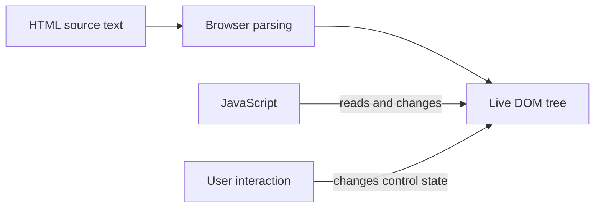

You add a click handler to a form's button. The handler runs, and then the whole page reloads anyway. A listener you put on the form fires when someone clicks the button inside it. DevTools shows the input with `value="Read the DOM"`, but the box on screen clearly says something else.

Each of these comes from a different layer of the browser: the HTML you wrote, the live objects the browser builds from it, and the events that travel through those objects. This article builds one small task form, first with plain HTML and JavaScript and then in Angular, and watches each layer at work. By the end, all three surprises have a plain explanation.

You'll need to recognize HTML tags and basic JavaScript (variables, functions, objects) to follow along. The [article on rendering strategies](/dump/blog/html-rendering-methods/) explains where a page's HTML comes from; this one starts once that HTML reaches the browser. There's no backend: the tasks exist only while the page is open.

The Angular example uses Angular 22.2. All the examples use ordinary nested elements; shadow DOM changes some of the event rules and isn't covered here.

## Contents

1. [Start with a plain HTML form](#start-with-a-plain-html-form)
2. [The browser builds a live object tree](#the-browser-builds-a-live-object-tree)
3. [Events report what happened](#events-report-what-happened)
4. [Events travel down and back up the tree](#events-travel-down-and-back-up-the-tree)
5. [Cancel the browser's default action](#cancel-the-browsers-default-action)
6. [Let the list handle clicks on its rows](#let-the-list-handle-clicks-on-its-rows)
7. [Stop an event from traveling further](#stop-an-event-from-traveling-further)
8. [The same form in Angular](#the-same-form-in-angular)
9. [Back to the three surprises](#back-to-the-three-surprises)

## Start with a plain HTML form

Make a new folder and save this as `index.html` inside it:

```html
<!doctype html>
<html lang="en">
  <head>
    <meta charset="utf-8" />
    <meta name="viewport" content="width=device-width, initial-scale=1" />
    <title>Task notes</title>
  </head>
  <body>
    <main>
      <h1>Task notes</h1>
      <form id="task-form" method="get">
        <label for="task-title">Task title</label>
        <input id="task-title" name="title" type="text" value="Read the DOM" required />
        <button id="add-task" type="submit">
          <span id="add-label">Add task</span>
        </button>
      </form>
      <ul id="task-list"></ul>
    </main>
  </body>
</html>
```

Then serve the folder with a small local web server. From inside the folder, run:

```sh
npx serve .
```

`npx` comes with Node.js. The first time, it asks to download the `serve` package (answer `y`), then prints the address to open, usually `http://localhost:3000`. If you have Python instead, `python3 -m http.server 8000` does the same job at `http://localhost:8000`. Keep the server running while you work through the article. Later examples load a JavaScript module, and the browser won't load modules from a page opened straight from disk, so it's easiest to serve the page from the start.

### Elements come with behavior

An **element** is one part of the document, such as the form or the input. Its **attributes** configure it: `type="text"`, `name="title"`, and `required` each do a different job. Elements can contain text and other elements. Here, the button contains a `span`, which contains the text "Add task".

Picking an element picks a behavior, not just a look:

- A link with an `href` takes you to another address when you activate it.
- A button can receive keyboard focus, and Enter or Space presses it.
- A form groups controls and knows how to send their values somewhere.
- A label names a control. Matching the label's `for` to the input's `id` connects them, so clicking "Task title" focuses the input.

The input has both an `id` and a `name`, and they're used by different things. `id` is how the page finds the element: the label's `for`, `querySelector` in JavaScript, and CSS selectors all use it. `name` is the key the browser uses when it sends the form's values. You can rename one without touching the other.

Now click Add task and watch the address bar. With `npx serve`, it goes from

```text
http://localhost:3000/
```

to

```text
http://localhost:3000/?title=Read+the+DOM
```

The form has no `action` attribute, so the browser sends it to the current page. With `method="get"`, the browser puts each named control's value into the address after a `?`. That part is the **query string**: `title` is the input's `name`, `Read+the+DOM` is its value (a space becomes `+`), and the browser loads the page again at that address. (With Python, the same thing happens on port 8000.) The input shows its starting value again because the page itself was reloaded.

Nothing here added a task to the list. The browser did what forms do by default: it submitted. Adding a list item is something you'll write yourself shortly.

Clear the input and try again. This time the browser refuses to submit and shows a message next to the field, because of `required`. Validation has a lot more to it, but the point here is that HTML gives you working behavior before you've written any JavaScript.

Build the same button out of a `<div>` and you lose all of it. A `<div>` doesn't take keyboard focus, Enter and Space don't press it, and clicking it doesn't submit the form. You'd have to write each of those yourself.

## The browser builds a live object tree

HTML arrives as text. The browser reads the tags, attributes, and nesting, and builds a tree of objects that JavaScript can read and change. That reading step is called **parsing**. The objects follow a standard called the **Document Object Model**, or **DOM**.

A **node** is one object in that tree. The document itself, each element, and each piece of text are all nodes.



A simplified part of the tree looks like this:

```text
document
└─ html
   └─ body
      └─ main
         ├─ h1
         │  └─ #text "Task notes"
         ├─ form
         │  ├─ label
         │  ├─ input
         │  └─ button
         │     └─ span
         │        └─ #text "Add task"
         └─ ul
```

The real tree also contains the head, the doctype, and text nodes for the whitespace between tags.

The form is the button's **parent**: the element directly around it. The input and the button are **siblings** because they share that parent. The span is a **child** of the button. The button, form, main, body, and html elements are the span's **ancestors**: start at the span and follow the parents upward to find them.

Open your browser's developer tools (**DevTools**, usually F12) and find the Console tab. It runs JavaScript against the page that's open. Change the heading:

```js
document.querySelector("h1").textContent = "Tasks for today";
```

`querySelector("h1")` finds the first `h1` element. A selector such as `"#task-title"` finds the element whose `id` is `task-title`. Setting `textContent` replaces the element's text in the live tree, and the page updates.

Your `index.html` still says "Task notes". The DOM is the browser's working copy of the page: View Source shows the HTML file as it was downloaded, and the Elements panel in DevTools shows the current tree. They can also differ when the browser repairs invalid nesting while parsing.

### Attributes and properties hold different state

An **attribute** is written in the markup, such as `value="Read the DOM"`. A **property** is a value on the JavaScript object, read or written with syntax such as `input.value`. The names match, but for a text input they hold different things.

Try this in the console:

```js
const titleInput = document.querySelector("#task-title");

titleInput.value = "Inspect event propagation";

console.log(titleInput.getAttribute("value")); // "Read the DOM"
console.log(titleInput.value); // "Inspect event propagation"
```

For a text input:

- The `value` **attribute** is the starting value, the one the input shows when the page loads.
- The `.value` **property** is what's in the box right now.

Typing changes the property and leaves the attribute alone. So if you read the attribute to find out what the user typed, you get the starting value instead. That's the third surprise from the opening: the Elements panel shows attributes, and the box shows the property.

One wrinkle: on a fresh input the two look linked. Reload, then run `document.querySelector("#task-title").setAttribute("value", "x")`, and the box shows "x". But once the user edits the field, or code sets `.value`, the link breaks: setting the attribute changes only the starting value, and the box keeps its text. So read `.value` for what's in the box, and treat the attribute as the default.

Also, setting `.value` from JavaScript doesn't fire an `input` event. Changing a value and announcing that it changed are separate things, and the next section is about the announcing.

## Events report what happened

When something happens on the page, such as a click or an edit to an input, the browser creates an **event object** describing it.

An **event listener** is a function you hand to the browser, asking it to call that function when a particular type of event reaches a particular element. `addEventListener` registers one:

```js
document.querySelector("#task-title").addEventListener("input", (event) => {
  console.log(event.type, event.currentTarget.value);
});
```

Paste that into the console and type in the field. Each keystroke logs `input` and the box's current text.

`(event) => { ... }` is an **arrow function**: a short way to write a function. The part in parentheses is its parameter, and the part in braces is its body. You don't call it yourself. The browser calls it every time an `input` event arrives and passes the event object in as `event`. `event.currentTarget` is the element you attached the listener to, here the input. A later section shows why that's worth naming.

Three event types matter for the task form:

- **`click`** fires when the button is activated. That includes a mouse click, a tap, and pressing Enter or Space while the button has focus.
- **`input`** fires when the user changes the input's text, by typing, pasting, or deleting.
- **`submit`** fires on the form when the browser is about to submit it. It comes after the browser's built-in checks, such as `required`, have passed. Those checks are called **native constraint validation**.

### Listen for the form's submit event

"Add this task" is something the form does, and there's more than one way to start it: clicking Add task, pressing Enter in the text field, or code calling `form.requestSubmit()`. The `submit` event fires on the form for all of them.

`submit` also waits for the browser's checks. If the field is empty, `required` blocks the submission and `submit` never fires. A click listener on the button runs on every click, including the ones where the field is empty and nothing gets submitted. So the code that adds a task belongs in a `submit` listener.

(`form.submit()` also exists, but it skips the `submit` event and the validation checks. Use `requestSubmit()` when you want the normal path.)

Adding a listener doesn't stop the browser from submitting. Paste this, then click Add task:

```js
document.querySelector("#task-form").addEventListener("submit", (event) => {
  console.log("Submitting", event.type);
});
```

The message flashes in the console and the page reloads anyway. That's the first surprise from the opening. To keep console messages across a reload, turn on "Preserve log" in the Console settings. A reload also removes every listener you added from the console, which is handy: reload between experiments so old listeners don't pile up.

## Events travel down and back up the tree

Say you click the "Add task" text. That text is inside the span, so the span is the **target**: the element the click happened on.

The span has ancestors around it: the button, form, main, body, and html elements, then the document. Those objects form a path from the document down to the span. The browser already knows the target, so it doesn't search the tree for it. It just walks that path.

It walks the path **down to the span, then back up**:

1. **Down the tree, the capturing phase.** Starting at the document, the browser visits `html`, `body`, `main`, `form`, and `button`, in that order. At each one, it runs the listeners registered for the way down.
2. **At the span, the target phase.** The browser reaches the clicked element and runs its listeners.
3. **Back up the tree, the bubbling phase.** `click` events bubble, so the browser visits `button`, `form`, `main`, `body`, `html`, and finally the document, running the listeners registered for the way up.

```text
Down:  document → html → body → main → form → button
                                                   ↓
Target:                                          span
                                                   ↑
Up:    document ← html ← body ← main ← form ← button
```

This walk is called **event propagation**. Only the objects on the path take part: the input next to the button and the task list are never visited. An object is still on the path even if nothing is listening on it.

It's one click, making both trips, and its target stays the span the whole time. The form and the button don't create clicks of their own. That's the second surprise from the opening: a listener on the form runs for a click on the button because the form is on the click's path. "Capture" here just names the trip down; it doesn't mean catching or stopping the click. "Bubble" names the trip up.

The full path starts one step earlier, at `window`, the object that represents the browser tab around the document. Its capture listeners run before the document's, and its bubbling listeners run last.

### Choose which trip a listener joins

When you add a listener to an ancestor, you choose when it runs:

- Pass `{ capture: true }` and it runs **on the way down**, before the target's listeners.
- Leave that option out and it runs **on the way up**, after the target's listeners (for events that bubble).

Each listener runs once per event, on the trip it joined. If you want to hear the event both ways, add two listeners.

Most events bubble, but not all. `focus` doesn't, for example. A capture listener on an ancestor still hears it, because the trip down happens either way.

### Watch one click go down and back up

So far you've pasted code into the console. For the longer examples, put the code in a file. Create `app.js` next to `index.html`, and add this line just before `</body>`:

```html
<script type="module" src="./app.js"></script>
```

`type="module"` loads `app.js` as a JavaScript module. A module script runs after the browser has parsed the whole page, so the elements already exist when your code looks them up. Browsers fetch modules with stricter security checks than regular scripts, and in Chrome a page opened from a `file://` address fails those checks and the module never loads. That's why you're serving the folder.

Put this in `app.js`, then reload the page:

```js
const span = document.querySelector("#add-label");
const form = document.querySelector("#task-form");

document.addEventListener(
  "click",
  () => {
    console.log("document: capture — on the way down");
  },
  { capture: true },
);

span.addEventListener("click", () => {
  console.log("span: target — reached the clicked element");
});

document.addEventListener("click", () => {
  console.log("document: bubble — back at the document");
});

// Keep the page open; cancellation is explained later in the article.
form.addEventListener("submit", (event) => {
  event.preventDefault();
});
```

Click the button's text, which is inside the span. You should see:

```text
document: capture — on the way down
span: target — reached the clicked element
document: bubble — back at the document
```

The document's first listener runs before the span's because it joined the trip down. Its second listener runs after the span's because it joined the trip up. Both see the same click, at different points along the path. The `submit` listener at the bottom stops the page from reloading so you can read the log; the section on default actions explains how.

### Add listeners along the path

Now replace `app.js` with this longer version, which adds listeners on the form and the button so you can see more of the route.

One detail at the target: the span's own capture listeners run first, then its other listeners. Both groups run in the target phase. Within each group, listeners run in the order you added them.

```js
const form = document.querySelector("#task-form");
const button = document.querySelector("#add-task");
const label = document.querySelector("#add-label");

function logEvent(location, event) {
  console.log(location, {
    phase: event.eventPhase,
    target: event.target.id,
    currentTarget: event.currentTarget.id,
  });
}

form.addEventListener(
  "click",
  (event) => {
    logEvent("form capture", event);
  },
  { capture: true },
);

button.addEventListener(
  "click",
  (event) => {
    logEvent("button capture", event);
  },
  { capture: true },
);

label.addEventListener(
  "click",
  (event) => {
    logEvent("span capture", event);
  },
  { capture: true },
);

label.addEventListener("click", (event) => {
  logEvent("span non-capture", event);
});

button.addEventListener("click", (event) => {
  logEvent("button bubble", event);
});

form.addEventListener("click", (event) => {
  logEvent("form bubble", event);
});

// Keep the page open while inspecting clicks.
form.addEventListener("submit", (event) => {
  event.preventDefault();
});
```

Reload and click the button's **text**, not the padding around it. The logs, laid out as a table, are:

```text
location          phase  target      currentTarget
form capture      1      add-label   task-form
button capture    1      add-label   add-task
span capture      2      add-label   add-label
span non-capture  2      add-label   add-label
button bubble     3      add-label   add-task
form bubble       3      add-label   task-form
```

`eventPhase` is `1` on the way down, `2` at the target, and `3` on the way up. If you click the button's padding instead, the button becomes the target and the span's listeners don't run at all.

### Two different targets

The log shows two properties that are easy to mix up:

- **`target`** is the element the click happened on. It's the span in every row.
- **`currentTarget`** is the element whose listener is running right now. Inside the form's listeners it's the form; inside the button's, the button.

Use `currentTarget` when you want the element you attached the listener to. Use `target` when a listener on an ancestor needs to know which element inside it was clicked. That second case is what the task list needs, a couple of sections from now.

## Cancel the browser's default action

You've now seen the two halves of the first surprise. The click handler ran, and then the browser did what forms do: it submitted, which reloaded the page. That built-in response is the event's **default action**. Following a link and submitting a form are both default actions.

Replace `app.js` with a script that adds tasks instead:

```js
const form = document.querySelector("#task-form");
const input = document.querySelector("#task-title");
const list = document.querySelector("#task-list");

form.addEventListener("submit", (event) => {
  event.preventDefault();

  const title = input.value.trim();
  if (title === "") {
    return;
  }

  const item = document.createElement("li");
  item.textContent = title;

  const removeButton = document.createElement("button");
  removeButton.type = "button";
  removeButton.textContent = "Remove";
  item.append(" ", removeButton);

  list.append(item);

  input.value = "";
});
```

Reload and add a few tasks. Each one shows up in the list with a Remove button, the field clears, and the page stays put. (The Remove buttons don't do anything yet; the next section wires them up.)

Here's what the listener does, in order:

1. `event.preventDefault()` tells the browser to skip the default action for this event. For a `submit` event, that means the form isn't sent and the page doesn't reload.
2. `input.value.trim()` reads what's in the box and removes spaces from both ends. If nothing's left, the listener stops. `required` alone would accept a title made of spaces.
3. `document.createElement("li")` makes a new list item, `textContent` puts the title in it, and `append` adds a space and a `type="button"` button after the title. `type="button"` matters: a button's default type inside a form is `submit`.
4. `list.append(item)` adds the item to the end of the list, and the last line clears the field.

The script sets `textContent` rather than `innerHTML` because a task title is text. If someone types `<strong>Read</strong>`, they should see those characters, not bold text. `innerHTML` would turn the title into elements.

`preventDefault()` only cancels the default action. The `submit` event still travels its full path, so a listener on an ancestor still hears it. `event.cancelable` tells you whether the browser lets you cancel this event's default action, and `event.defaultPrevented` tells you whether a listener already has.

The click and the submit are separate events. Cancelling the button's click would also stop that click from submitting the form, but `form.requestSubmit()` from code doesn't click anything and would still submit. Clicking the button, pressing Enter in the field, and `requestSubmit()` all fire the `submit` event, so that's where to cancel it. (`form.submit()` is the exception from earlier: it skips `submit` entirely, so no listener can cancel it.)

Reloading the page still clears the list. The script changes the live DOM, not your `index.html` and not a database.

## Let the list handle clicks on its rows

Each new row gets a Remove button. You could add a click listener to every button as you create it. Or you can add one listener to the list and let clicks bubble up to it. A listener on a parent that handles events from its descendants is called **event delegation**.

Add this to the end of `app.js`:

```js
list.addEventListener("click", (event) => {
  const removeButton = event.target.closest("button");
  if (removeButton === null) {
    return;
  }

  removeButton.closest("li").remove();
});
```

Reload, add two or three tasks, and remove one. Every row's button works, including rows that didn't exist when this listener was added. That's the payoff of delegation: a click on any Remove button bubbles up to the list, wherever and whenever that button was created.

The listener runs for every click inside the list, so it checks what was clicked first:

- `event.target` is the element the click happened on. That might be the Remove button, or it might be the `li` if you clicked the title text.
- `closest("button")` checks that element, then its parents, and returns the first one that matches the selector. If the click landed on the button, or on something inside the button (such as an icon added later), you get the button. If it landed on the title, there's no button on the way up, so you get `null` and the listener stops.
- `removeButton.closest("li")` finds the button's row, and `remove()` takes it out of the tree.

Delegation relies on the trip up, so it works with events that bubble, such as `click`, `input`, and `submit`.

## Stop an event from traveling further

`event.stopPropagation()` ends the event's trip: no listeners on the rest of the path run. The other listeners on the element that's currently handling the event still run. `event.stopImmediatePropagation()` stops those too.

It's tempting to reach for `stopPropagation()` when a click does something unexpected. So test whether it would have stopped the page reload from the opening. Replace `app.js` with this experiment:

```js
const button = document.querySelector("#add-task");
const form = document.querySelector("#task-form");

button.addEventListener("click", (event) => {
  console.log("A");
  event.stopPropagation();
});

button.addEventListener("click", () => {
  console.log("B");
});

form.addEventListener("click", () => {
  console.log("C");
});

form.addEventListener("submit", (event) => {
  console.log("submit still happened");
  event.preventDefault();
});
```

Reload, make sure the input isn't empty, and click Add task:

```text
A
B
submit still happened
```

A stopped the click from reaching the form, so C never ran. B still ran, because it's on the same button as A.

Now change `stopPropagation()` to `stopImmediatePropagation()` and try again:

```text
A
submit still happened
```

This time B is skipped too. But in both versions, the form was still submitted. The button press starts submission as its default action, and the browser then fires a separate event, `submit`, at the form. Stopping the click's trip doesn't cancel that. Only the `submit` listener's `preventDefault()` keeps the page open here. Delete that listener and the page reloads in both versions.

(One detail if you ever stop propagation at the target: the target's capture listeners and its other listeners run as two separate groups. `stopPropagation()` in one of the span's capture listeners lets the rest of its capture listeners run, but skips its other listeners and everything on the way back up.)

If you catch yourself adding `stopPropagation()` to make a bug go away, check two things first: which element the listener is on, and whether you meant `preventDefault()`. Usually that's the real fix.

## The same form in Angular

Angular builds the same kind of DOM and uses the browser's own events. What changes is how you describe the page: instead of creating and appending elements yourself, you keep the data in the component and let Angular keep the elements in sync with it.

This example keeps that data in two **signals**. A signal is an Angular object that holds one value:

- `signal("Read the DOM")` creates one with a starting value.
- Calling it, such as `draft()`, reads its current value.
- `draft.set("")` replaces the value.
- `tasks.update(...)` calls a function with the current value and stores whatever it returns.

When a signal used by the template gets a new value, Angular updates the parts of the page that depend on it.

The template uses a few pieces of syntax, and each one maps to something you've already done by hand:

- **`(submit)="addTask($event)"`** adds a listener for the form's native `submit` event, like `addEventListener("submit", ...)`.
- **`$event`** is the browser's event object, passed to `addTask`.
- **`[value]="draft()"`** sets the input's `.value` property, not its `value` attribute, from the signal.
- **`(input)="..."`** listens for the native `input` event and copies the box's text into the signal.
- **`#titleInput`** names the input element so the template can read `titleInput.value` directly.
- **`@for`** repeats the `li` for each task. Angular creates and removes the list items, like `createElement` and `remove()` did earlier. `track task.id` tells Angular which item belongs to which task.

Here's the component:

```ts
import { Component, signal } from "@angular/core";

type Task = {
  id: number;
  title: string;
};

@Component({
  selector: "task-notes",
  template: `
    <h1>Task notes</h1>
    <form (submit)="addTask($event)">
      <label for="task-title">Task title</label>
      <input
        #titleInput
        id="task-title"
        name="title"
        type="text"
        required
        [value]="draft()"
        (input)="draft.set(titleInput.value)"
      />
      <button type="submit"><span>Add task</span></button>
    </form>
    <ul>
      @for (task of tasks(); track task.id) {
        <li>{{ task.title }}</li>
      }
    </ul>
  `,
})
export class TaskNotes {
  readonly draft = signal("Read the DOM");
  readonly tasks = signal<Task[]>([]);

  private nextId = 1;

  addTask(event: Event): void {
    event.preventDefault();

    const title = this.draft().trim();
    if (title === "") {
      return;
    }

    const task: Task = { id: this.nextId, title };
    this.nextId += 1;

    this.tasks.update((tasks) => [...tasks, task]);
    this.draft.set("");
  }
}
```

`addTask` follows the same steps as the plain script: cancel the submission, trim the title, then add the task. `[...tasks, task]` creates a new array containing the existing tasks followed by the new one, and `update` stores that array in the signal. Angular then adds the matching `li`.

To try it, add `TaskNotes` to the `imports` array of a component in an existing Angular project (such as the root component that `ng new` generates) and put `<task-notes />` in that component's template. The example doesn't use Angular's forms package on purpose, so you can see the native events directly.

Notice that `addTask` still calls `preventDefault()`. Writing `(submit)` adds a listener, the same as `addEventListener` did, and a listener alone doesn't cancel the default action. Without that line, the page would reload just like before.

The browser rules still apply underneath. Clicking the span still sends a native click down to the span and back up through the button, the form, and the component's **host element** (the `<task-notes>` element Angular renders the template into). The `required` check still runs before `submit` fires, because nothing replaced it.

How Angular decides when to update the page after a signal changes is its own topic, covered in the [change detection article](/dump/blog/angular-change-detection/).

### Native events and component outputs

`(click)` on a button listens for the browser's click event. A component can also define its own events, called **outputs**, such as "a task was added". A parent listens with the same parentheses, for example `(taskAdded)="save($event)"`, but there `$event` is whatever value the component sent, not a browser `Event` object.

The syntax matches, but outputs don't travel through the DOM. Only the parent that bound `(taskAdded)` on that component hears it; there's no capture or bubbling. The [component composition article](/dump/blog/angular-component-composition/) covers designing inputs and outputs.

## Back to the three surprises

Here are the three surprises from the opening, now with their causes:

- **The page reloaded even though the click handler ran.** Your handler ran, and then the browser did its default action for a submit button: it submitted the form. Calling `stopPropagation()` doesn't change that. Call `preventDefault()` on the form's `submit` event.
- **A listener on the form ran for a click on the button.** The form is an ancestor of the button, so it's on the click's path. The click bubbles up through it after reaching the button. `event.target` tells you what was actually clicked.
- **DevTools showed `value="Read the DOM"` while the box showed something else.** The Elements panel shows the `value` attribute, which is the starting value. The box shows the `.value` property, which is what the user typed.

Check yourself:

1. A listener on the button calls `stopPropagation()`. With a valid title in the field, does a click on the button still submit the form?
2. You click the "Add task" text. What are `target` and `currentTarget` inside a listener on the form?
3. A task row is added after the list's click listener was registered. Does the listener handle clicks on that row's Remove button?
4. You type a new title. Does `getAttribute("value")` return it?

Answers:

1. Yes. Stopping propagation only stops other listeners from hearing the click. Submission is the default action, and only `preventDefault()` cancels it.
2. `target` is the span, because that's where the click happened. `currentTarget` is the form, because that's where the running listener is.
3. Yes. The click bubbles from the new button up to the list, wherever the button came from.
4. No. Typing changes the `.value` property. The attribute keeps the starting value.

## Sources and further reading

- [WHATWG HTML: form submission and implicit submission](https://html.spec.whatwg.org/multipage/form-control-infrastructure.html#form-submission)
- [WHATWG HTML: the input element and its value](https://html.spec.whatwg.org/multipage/input.html#the-input-element)
- [WHATWG DOM: dispatching events and invoking listeners](https://dom.spec.whatwg.org/#dispatching-events)
- [WHATWG DOM: `preventDefault`, `stopPropagation`, and `stopImmediatePropagation`](https://dom.spec.whatwg.org/#interface-event)
- [MDN: JavaScript modules](https://developer.mozilla.org/en-US/docs/Web/JavaScript/Guide/Modules)
- [Angular: signals](https://angular.dev/guide/signals)
- [Angular: template event listeners](https://angular.dev/guide/templates/event-listeners)
- [Angular: component outputs](https://angular.dev/guide/components/outputs)
