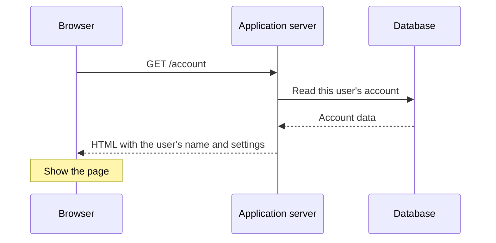
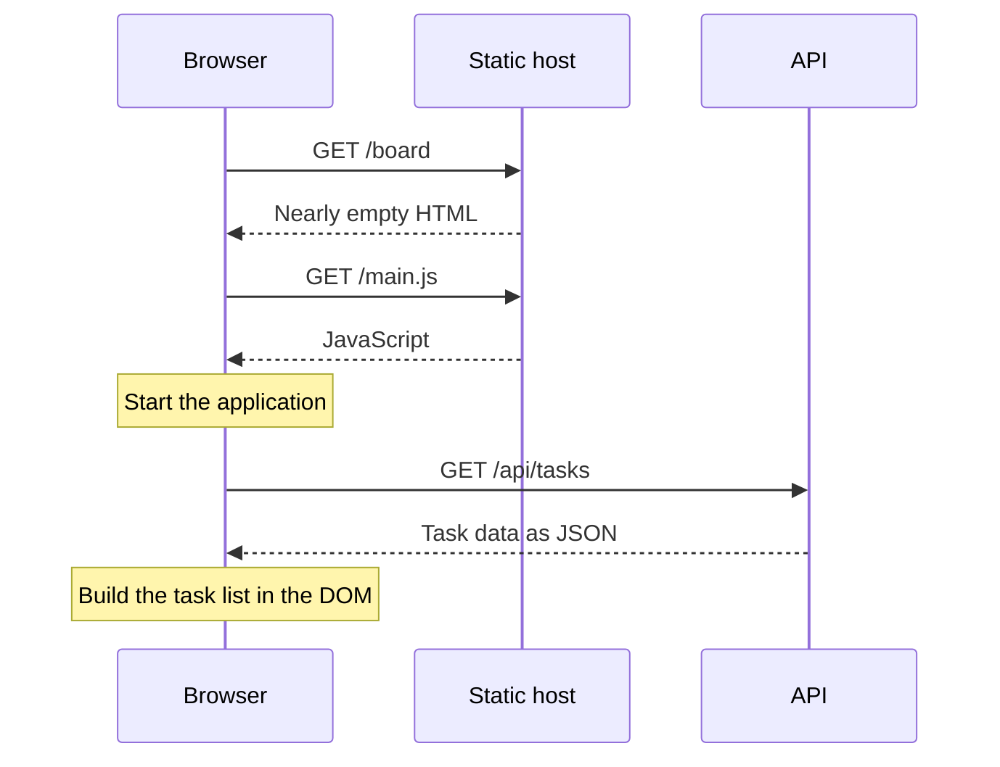
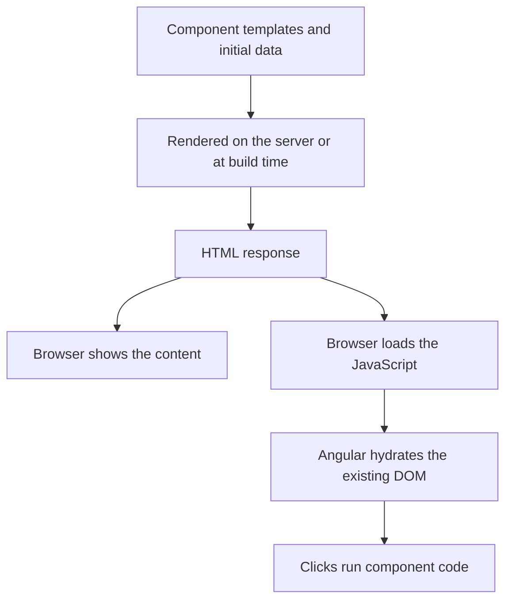
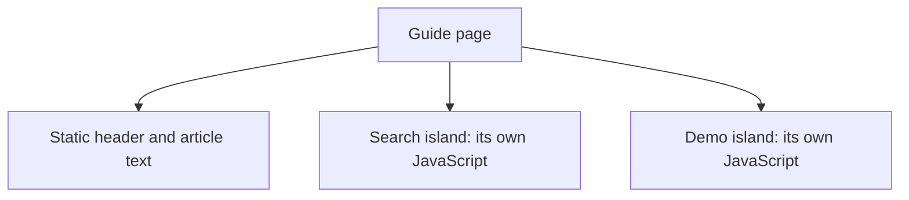

Open an Angular app that was built without server rendering, right-click the page, and choose **View Page Source**. You'll see almost nothing: an `<app-root>` tag, a few `<script>` tags, and no actual content. Now do the same on this blog, and the whole article is right there in the source.

Both pages look complete once they've loaded, but their HTML was made in different places. The blog's HTML was written out before you asked for it. The Angular app's visible content was built by JavaScript, inside your browser, after the page arrived.

That's what a **rendering strategy** is: a decision about where and when a page's HTML gets made, and what's left for the browser to do after it arrives. This article walks through the main strategies using one example site, then shows how to pick one per page.

You'll need to know what an HTML element is. The first section covers how a browser gets a page, so you don't need to know that yet. The Angular examples use Angular 22.2.

## Contents

1. [How a page gets to the browser](#how-a-page-gets-to-the-browser)
2. [Static pages built ahead of time](#static-pages-built-ahead-of-time)
3. [HTML built on the server for each request](#html-built-on-the-server-for-each-request)
4. [HTML built in the browser](#html-built-in-the-browser)
5. [Server HTML that JavaScript takes over: hydration](#server-html-that-javascript-takes-over-hydration)
6. [What hydration costs](#what-hydration-costs)
7. [Hydrating only part of a page](#hydrating-only-part-of-a-page)
8. [Choosing per route in Angular](#choosing-per-route-in-angular)
9. [Comparing the strategies](#comparing-the-strategies)
10. [Check what your page actually sends](#check-what-your-page-actually-sends)

## How a page gets to the browser

Every page starts the same way. You type an address, or click a link, and the browser sends a **request** for that URL to a **server**, a program on another machine whose job is to answer requests. The server sends back a **response**, and for a page, the body of that response is HTML: plain text that the browser reads and turns into the page you see.

```text
Browser                                Server
   |  request: GET /guide/shortcuts      |
   | ----------------------------------> |
   |                                     |  find or make the HTML
   |  response: <html>…</html>           |
   | <---------------------------------- |
   |
   builds the page from that text
```

So "where does the HTML come from?" really asks what the server does in the middle step. It can send a file that already exists, or it can run code to produce the HTML right then. Or it can send a nearly empty page, and JavaScript running in the browser fills it in afterwards.

The word "rendering" gets used for two separate jobs, so it's worth keeping them apart. **Application rendering** turns your data and templates into HTML or DOM elements, and that's what this article is about. **Browser rendering** turns the finished HTML and CSS into pixels on screen. The browser does its part no matter where the HTML came from.

### The example site

The examples in this article all come from one site: a task board app with three kinds of page.

| Route        | What it shows                                                        |
| ------------ | -------------------------------------------------------------------- |
| `/guide/...` | Public help articles, such as `/guide/shortcuts`. Same for everyone. |
| `/account`   | The signed-in user's name and settings. Different for each user.     |
| `/board`     | The task board itself: add, check off, and remove tasks.             |

A **route** is a URL path the site responds to. The three routes have different needs, and that turns out to be the main thing that decides how each one should be rendered.

## Static pages built ahead of time

The simplest answer is a file that already exists before anyone asks for it. Here's what the server sends for `/guide/shortcuts`:

```html
<!doctype html>
<html lang="en">
  <head>
    <meta charset="utf-8" />
    <title>Keyboard shortcuts</title>
  </head>
  <body>
    <main>
      <h1>Keyboard shortcuts</h1>
      <p>Press N to add a task.</p>
    </main>
  </body>
</html>
```

The server finds the file and sends it as it is. The browser gets the text in the very first response, so it can show it without running any JavaScript.

Writing hundreds of these files by hand would be tedious, so a build step does it. **Static site generation (SSG)** means a program runs once, before the site is deployed, and turns your sources, such as Markdown files and page templates, into finished HTML files. Angular calls this **prerendering**: rendering the page ahead of time, at build time.


A **static host** is a server that only sends existing files. A **CDN**, or content delivery network, is a set of servers spread around the world that keep copies of those files, so each visitor gets them from somewhere nearby.

This blog works this way. Its Markdown articles become HTML files when the site is built with Astro, and a static host serves them. Small scripts add extras like the theme switch and diagrams, but the article text doesn't depend on them.

### What static pages are good at

- The server does no work per request beyond sending a file, so it's fast and cheap.
- The same files can be copied to a CDN, because they're the same for every visitor.
- The content is there even if a script fails to load.

That makes SSG a good fit for `/guide`: everyone sees the same help article, and it only changes when someone publishes an update.

A static page can still have JavaScript. It can call an API after it loads, or submit a form somewhere. "Static" describes the first HTML only: it was made before the request, so it's the same for every visitor.

### Where static pages fall short

Changes only show up after a rebuild and deploy. That's fine for help articles. It doesn't work for `/account`, because the build can't know who's going to sign in, and it gets slow if the site has hundreds of thousands of pages to regenerate on every change.

## HTML built on the server for each request

For `/account`, the HTML has to be made when the request arrives, because only then does the server know who's asking. That's **server-side rendering (SSR)**: the server runs code for each request, reads the data it needs, and fills a template with it.



This is the oldest way to build dynamic sites. PHP, Ruby on Rails, Django, and ASP.NET all work like this. What makes it SSR is that the HTML gets made during the request; the language doesn't matter.

### Forms and links already work

A server-rendered page doesn't need any JavaScript for its basic interactions. The browser already knows how to follow links and submit forms. Here's the settings form on `/account`:

```html
<form action="/account" method="post">
  <label>
    Display name
    <input name="displayName" value="Ada" />
  </label>
  <button type="submit">Save</button>
</form>
```

When you click Save, the browser sends the form fields to `/account` and shows whatever HTML the server sends back. (The server still has to check who's signed in and whether the input is valid.) JavaScript can improve this, for example by saving without reloading the page, but the form works without it.

### The cost is work on every request

SSR puts the user's content in the very first response, and it can be different for every user. In exchange:

- You run a server application, not just a file host.
- Every request waits for that server's data. If the database takes two seconds, the browser sees nothing for two seconds. **Time to first byte**, how long until the first piece of the response arrives, measures exactly this delay.
- You have to decide what's safe to cache.

Caching deserves a closer look. If a page looks the same for everyone, the server can render it once and reuse the HTML for the next visitors. That's safe for a public page. It's dangerous for `/account`: cache it the same way, and the next visitor could see the previous visitor's account. So every route that's rendered on the server needs an explicit decision about whether it may be cached, and for whom.

## HTML built in the browser

`/board` is different again. People keep it open for a long time and click constantly: add a task, check one off, filter the list. The page changes after every click, so most of the work happens in the browser anyway.

With **client-side rendering (CSR)**, the server sends almost empty HTML, and JavaScript running in the browser builds the content:

```html
<!doctype html>
<html lang="en">
  <head>
    <meta charset="utf-8" />
    <title>Task board</title>
  </head>
  <body>
    <app-root>Loading board…</app-root>
    <script type="module" src="/main.js"></script>
  </body>
</html>
```

This is the page you saw in View Page Source at the start. `<app-root>` is an empty spot that the application fills in, and `main.js` is the application's **bundle**: the JavaScript files the build produced from your source code.

Here's the sequence:



Browsers and build tools can overlap some of these steps, for example by starting to download `main.js` before the HTML has finished arriving. But the order of dependencies stays the same: the JavaScript has to download and run before it can build the content, because it's the only thing that knows what the content is.

### SPAs and what happens when you click a link

A **single-page application (SPA)** is an app where clicking an internal link doesn't load a new page from the server. JavaScript catches the click, changes the URL, and swaps the content in place. An Angular app with its router works this way.

People often ask "SSR or SPA?", but the two terms answer different questions. SSR is about where the *first* HTML comes from. SPA is about what happens when you click a link *afterwards*. An Angular app can render its first page on the server and then behave like an SPA from there, so it can be both.

### Why client rendering suits `/board`

After the first load, the code is already in the browser, so each click only needs a small piece of data from the API, not a whole new page. For an app people use for an hour at a time, that's a good trade. It works especially well behind a login, where search engines don't need to read the pages anyway.

### What it costs

The browser has to download, read, and run the JavaScript before any content appears. On a fast laptop that takes a moment, but on a cheap phone with a weak connection it can take several seconds.

It also fails in more ways:

- If `main.js` fails to load, the user sees "Loading board…" and nothing else.
- If the API request fails, the page has a frame but no tasks.
- A **crawler**, a program that downloads pages to index them for search engines or to build link previews, may not run JavaScript. Google's crawler does run it, but many link-preview bots, like the ones that build previews in chat apps, don't. Content that's already in the HTML works for all of them.
- Deep links need a server rule. If someone opens `/board` directly, no file called `board` exists on the host. The host has to be set up to answer unknown page URLs with the app's `index.html`, so the app can read the URL and show the board. That same rule mustn't answer a missing `/main.js` with HTML, or the browser tries to run an HTML page as JavaScript.

## Server HTML that JavaScript takes over: hydration

Suppose the board loads too slowly with client rendering, and you want the tasks on screen right away. You can render `/board` on the server too, so the first response already contains the task list, and then let Angular take over in the browser.

Angular can produce that first HTML on the server for each request (SSR), or at build time (prerendering), from the same components it runs in the browser. Then the browser loads the JavaScript, and the app starts running on top of HTML that's already on screen. Connecting the running app to that existing HTML is called **hydration**.

Here's what happens to one button on `/board`. The component's template contains:

```html
<button type="button" (click)="addTask()">Add task</button>
```

1. **The server runs the component** and turns its template into HTML text. The response contains `<button type="button">Add task</button>`. HTML text can't carry a JavaScript function, so the `(click)` handler isn't in it.
2. **The browser shows the HTML.** The button is visible and looks finished, but clicking it does nothing yet, because no listener is attached.
3. **The JavaScript downloads and Angular starts.** Without hydration, Angular would throw the server's HTML away and build every element again from scratch.
4. **Angular hydrates.** It walks the existing DOM alongside its own template, recognizes that `<button>` as the one from the template, and keeps it. Then it attaches the `(click)` listener to that existing button.
5. **The button works.** Clicking it now runs `addTask()`.



Between steps 2 and 5, the button is visible but does nothing when clicked. Angular can record clicks that happen during that gap and replay them once hydration is done, a feature called **event replay**. Links and plain HTML forms already work during the gap, because the browser handles them itself.

So "the page loaded" actually means four separate moments:

1. The response starts arriving.
2. Useful content becomes visible.
3. The JavaScript the page needs has downloaded.
4. The page's own interactions, like Add task, actually work.

SSR moves moment 2 earlier. It doesn't remove the work needed for moment 4.

After hydration, the app can behave like an SPA, with clicks on internal links handled by the router. Hydration only covers how the first page comes to life.

## What hydration costs

With hydration, the same component code runs in two places: once on the server to make the HTML, and once in the browser to take it over. Code that's fine in one place can break in the other:

- **Browser-only APIs.** `window`, `localStorage`, and measuring an element's size don't exist on the server. A component that reads `localStorage` while it's created throws during server rendering.
- **Fetching data twice.** If the server fetches the tasks to render them, and the browser fetches them again when the app starts, the page makes the same request twice. Angular's `HttpClient` can pass the server's responses along in the HTML, so the browser reuses them instead.
- **Secrets.** Everything in the HTML, including data embedded in it for hydration, is visible to the user in View Page Source. Rendering on the server doesn't make data private.
- **Data shared between requests.** One server process handles many users' requests. A module-level variable like `let currentUser` is shared by all of them, so one user's request can end up showing another user's data.
- **HTML that doesn't match.** Hydration only works if the browser's DOM matches what Angular expects from the template.

### A timestamp that doesn't match

The last point is the easiest to trip over. Say the board's header shows "Last updated" with the current time, and the component reads the clock when it's created.

The server renders at `10:00:00` and sends that. The browser starts the app at `10:00:01`, and the component reads the clock again. Now the HTML on screen says one thing and the component says another. Angular keeps the server's text and then updates it, so the time visibly jumps as soon as Angular takes over. The same happens if a value decides which `@if` branch shows: the content changes right after hydration, and the page can shift around.

Random values and dates formatted in different time zones cause the same kind of jump. The fix is to make the first render produce the same output in both places: send the value from the server instead of computing it twice, format dates the same way in both places, and wait until the app is running in the browser before doing anything browser-only.

A mismatch in the HTML's *structure* is worse. Hydration walks the DOM expecting exactly the elements the template produced, so if elements are missing, added, or moved, Angular can't line them up. Hydration fails with a DOM mismatch error, such as `NG0500`, instead of quietly fixing it. Three things cause this:

- **Components that change the DOM directly** with browser APIs like `appendChild`, or by setting `innerHTML`, instead of through their templates. Angular's hydration guide names this as the most common cause.
- **Invalid HTML that the browser repairs while reading it.** A `<div>` inside a `<p>` is one example: the browser closes the `<p>` early, so the DOM no longer has the shape the template described.
- **Anything that edits the server's HTML before Angular starts**, such as a script that inserts elements, or a CDN that strips HTML comments. Angular leaves comments in the HTML to mark its own structure, so removing them breaks hydration too.

The fix is to change the component so the server and the browser produce the same elements. Angular also has an `ngSkipHydration` attribute that makes one component throw away its server HTML and render from scratch, but its documentation calls that a last resort.

## Hydrating only part of a page

Hydration as described so far wakes up the whole page at once. But most of a `/guide` article is plain text that never needs JavaScript. Say the page has two interactive parts: a search box at the top, and a small "try it" demo of a keyboard shortcut. Loading and hydrating a whole application for two widgets is a lot of work for very little.

One answer is an **islands architecture**: the page is static HTML, with a few separate interactive "islands" that each load and start their own JavaScript.



Astro, the tool this blog is built with, works this way. A component only gets JavaScript in the browser if you mark it with a client directive, such as `client:visible` to start it once it scrolls into view.

The catch is that each island is its own small app. If the search box and the demo need to share something, like the selected theme, you wire that up yourself. So islands are worth it when the interactive pieces really are independent, and not worth it for splitting one small script into several.

Angular has its own version of this idea, called **incremental hydration**. You wrap part of a template in a `@defer` block with a `hydrate` trigger. The server still renders that part to HTML, so it's visible straight away, but Angular only downloads its code and hydrates it when the trigger fires:

```html
@defer (hydrate on viewport) {
  <shortcut-demo />
}
```

Here the demo shows up as server-rendered HTML, and Angular hydrates it once it scrolls into view. Other triggers include `hydrate on interaction`, which waits for a click or key press on it, and `hydrate never`, which leaves it as static HTML. Since Angular 22, incremental hydration is on by default when you enable hydration with `provideClientHydration()`.

Whichever tool you use, the question is the same: which parts of this page actually need JavaScript, and how soon?

## Choosing per route in Angular

The three routes have different needs, and nothing forces them to share one strategy:

| Route        | What it needs                                    | Strategy                                              |
| ------------ | ------------------------------------------------ | ----------------------------------------------------- |
| `/guide/...` | Same for everyone, changes when published        | Static generation                                     |
| `/account`   | Different for each user, always current          | Server rendering, never cached for other users        |
| `/board`     | Behind a login, used for a long time, many clicks | Client rendering, or SSR with hydration if startup is too slow |

In Angular, you set this up with the `@angular/ssr` package. Running `ng add @angular/ssr` in an existing project, or `ng new --ssr` for a new one, creates a file called `src/app/app.routes.server.ts`. That file lists a rendering mode for each route.

```ts
import { RenderMode, ServerRoute } from "@angular/ssr";

export const serverRoutes: ServerRoute[] = [
  {
    path: "guide/:slug",
    renderMode: RenderMode.Prerender,
    async getPrerenderParams() {
      return [{ slug: "getting-started" }, { slug: "shortcuts" }];
    },
  },
  {
    path: "account",
    renderMode: RenderMode.Server,
  },
  {
    path: "board",
    renderMode: RenderMode.Client,
  },
  {
    path: "**",
    renderMode: RenderMode.Server,
  },
];
```

Each `RenderMode` value maps to one of the strategies in this article:

- **`RenderMode.Prerender`** is static generation: Angular renders the page to an HTML file during the build.
- **`RenderMode.Server`** is server-side rendering: Angular renders the page on the server for each request.
- **`RenderMode.Client`** is client-side rendering: the server sends the nearly empty page, and the browser builds the content.

Here's what else to notice:

- `guide/:slug` has a parameter, `:slug`, so the build can't guess which pages exist. `getPrerenderParams` returns the list of values to build, one HTML file each.
- `**` matches every path not listed above, so any other route is rendered on the server.
- The paths here must match routes in your normal Angular route configuration, `app.routes.ts`. This file only adds a rendering mode to each of them.
- The CLI also creates `app.config.server.ts`, which registers this list with `provideServerRendering(withRoutes(serverRoutes))`. You don't need to change it.

The CLI also adds `provideClientHydration()` to `app.config.ts`, so pages rendered with `Prerender` or `Server` get hydrated in the browser. Angular's SSR guide covers the rest of the setup, including how to deploy the server.

Other frameworks, such as Next.js, Nuxt, and Analog, also let you mix strategies per route. Decide what each route needs first, and then check what your framework supports.

## Comparing the strategies

Here's the whole article in one table:

| Strategy                    | When the HTML is made                         | Task board route         | What the browser still does                   | Main cost                                                  |
| --------------------------- | --------------------------------------------- | ------------------------ | --------------------------------------------- | ---------------------------------------------------------- |
| Static generation (SSG)     | At build time, before any request             | `/guide/...`             | Shows the HTML; runs any small scripts        | Changes need a rebuild; can't be personal                  |
| Server-side rendering (SSR) | On the server, for each request               | `/account`               | Shows the HTML; forms and links work natively | A server to run; slow data delays the page; careful caching |
| Client-side rendering (CSR) | In the browser, after the JavaScript runs     | `/board`                 | Downloads and runs the app, fetches data, builds the page | Slow start on weak devices; nothing shows if the JavaScript fails |
| SSR or SSG with hydration   | On the server or at build time, then taken over in the browser | `/board`, if startup matters | Downloads the app and hydrates the existing HTML | Code must work in two places; visible before it's usable |

A few points from the table are worth keeping:

- Static generation and SSR differ in *when* the HTML is made: before any request, or during each one.
- Client rendering moves the work of building the first content onto the user's device.
- SSR and SPA navigation answer different questions, and one app can use both.
- Hydration keeps the server's HTML but still needs the full JavaScript, and the two environments have to agree.
- A page doesn't need a framework to be interactive. Links, forms, and small scripts go a long way.

So pick the simplest strategy that gives each route what it needs.

## Check what your page actually sends

A framework's feature list can't tell you how one of your pages behaves. The browser can. For any page:

1. **Look at the response.** Use View Page Source, or the Network panel in DevTools and the response for the page itself. Is the content in the HTML, or only an empty `<app-root>` and a loading message?
2. **Reload with JavaScript turned off.** In Chrome's DevTools, open the command menu with Ctrl+Shift+P, or Cmd+Shift+P on a Mac, and run "Disable JavaScript". What content is left, and do links and forms still work?
3. **Open a deep link directly.** Paste a URL like `/board` into a new tab. Do you get the right page and a `200` status, without visiting the home page first?
4. **Slow everything down.** DevTools can throttle the network and CPU. How long is the gap between seeing the content and being able to use it?
5. **Watch the data requests.** If the page was rendered on the server, does the browser fetch the same data again right after loading?
6. **Check the cache rules.** Public pages can be cached for everyone. Pages with one user's data must never be served to anyone else.

Getting the text into the HTML is only one part of **SEO**, search engine optimization, the work of making pages easy for search engines to find and rank. URLs, status codes, page titles, and links matter too. And showing a loading spinner early doesn't help much if the real content and buttons arrive much later.

Now go back to the two View Page Source results from the start. The blog's source is full because its HTML was generated at build time. The Angular app's source is empty because its HTML is built in your browser, after the JavaScript runs. Every strategy in this article is a different answer to where and when that HTML gets made. Once the HTML reaches the browser, the [DOM and events article](/dump/blog/html-dom-and-events/) picks up what happens next.

## Sources and further reading

- [Angular: server-side and hybrid rendering](https://angular.dev/guide/ssr)
- [Angular: hydration, constraints, and event replay](https://angular.dev/guide/hydration)
- [Angular: incremental hydration](https://angular.dev/guide/incremental-hydration)
- [Astro: islands architecture](https://docs.astro.build/en/concepts/islands/)
