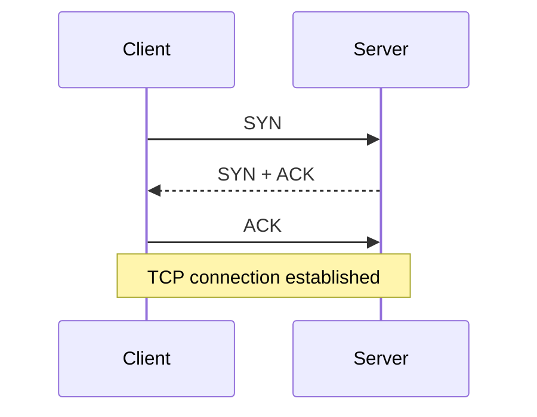
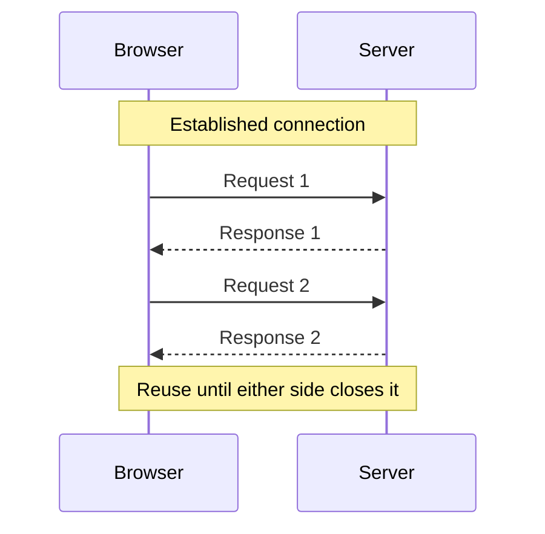
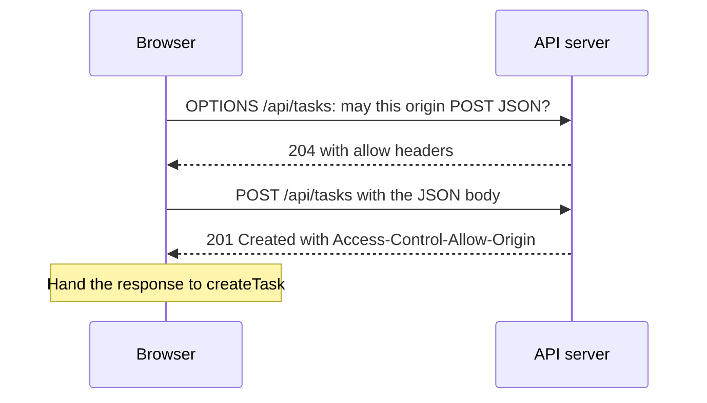

You click Save on the task board and the console says the request failed. That one line can hide four different problems:

1. The browser never connected to the server.
2. The server answered, but with an error status such as `500`.
3. The server answered `201 Created`, but the browser wouldn't hand the response to your JavaScript. That's a CORS error.
4. The response arrived, but `response.json()` couldn't parse its body.

Each one needs a different fix, so the first job is working out which layer broke. This article climbs those layers in order: how bytes travel between two machines, how HTTP turns those bytes into requests and responses, and what the browser adds on top when you call `fetch`.

One request runs through the whole article: the task board at `https://app.example.com` saves a new task to an API at `https://api.example.com`. The `Task` shape (`id`, `title`, `done`) is the one the task-board articles use, starting with [HTML, the DOM, and events](/dump/blog/html-dom-and-events/).

You'll need to have called `fetch` with `async` and `await` to follow the code. The raw messages use HTTP/1.1 because its text format is easy to read. Connection limits and DevTools layouts vary between browsers, so the Network panel in your browser's DevTools is the place to confirm what actually happened.

## Contents

1. [Bytes between two machines](#bytes-between-two-machines)
2. [HTTP messages](#http-messages)
3. [Methods and status codes](#methods-and-status-codes)
4. [Headers](#headers)
5. [Connections, HTTP/2, and HTTP/3](#connections-http2-and-http3)
6. [From fetch to HTTP](#from-fetch-to-http)
7. [Why browsers limit cross-origin responses](#why-browsers-limit-cross-origin-responses)
8. [CORS without preflight](#cors-without-preflight)
9. [CORS with preflight](#cors-with-preflight)
10. [Credentials and exposed headers](#credentials-and-exposed-headers)
11. [A debugging checklist](#a-debugging-checklist)

## Bytes between two machines

Networks move data in small chunks called **packets**. Along the way, packets can get lost, duplicated, or arrive out of order. **TCP** (Transmission Control Protocol) hides that from programs: it numbers the bytes, resends what goes missing, and hands the receiving program one ordered stream of bytes. If it can't recover, it reports that the connection failed.

To connect, a program needs two numbers for the other side. An **IP address** picks the machine. A **port** picks the program on that machine. HTTPS servers usually listen on port `443`. Your side gets a port too, which the operating system picks for the length of the connection, so a connection looks like this:

```text
client:  192.0.2.10:54321
server:  198.51.100.20:443
```

These addresses come from ranges reserved for documentation, so they don't point at real machines.

Before connecting, the browser usually needs **DNS** (Domain Name System) to turn a name such as `api.example.com` into an IP address. Then TCP opens the connection with a three-message exchange called the handshake:



For an `https` URL, one more step follows. **TLS** (Transport Layer Security) encrypts the connection and lets the browser check that the server really is `api.example.com`. Only then does HTTP data flow. A cached DNS answer or an already-open connection lets the browser skip some of these steps.

Once the connection is open, either side can send bytes. But TCP only promises order. It doesn't know where one HTTP request ends and the next begins. If the sender writes two pieces of data, the receiver might get them in one read or in three; only the order is guaranteed. So HTTP has to mark its own message boundaries, and that's the next layer.

## HTTP messages

An HTTP/1.1 message is text with four parts: a start line, header lines, a blank line, and an optional body.

### A request

When the task board loads its tasks, the browser sends something like this:

```http
GET /api/tasks HTTP/1.1
Host: api.example.com
Accept: application/json

```

The first line holds three things:

- the method, `GET`, which says what you want done;
- the path, `/api/tasks`, which says what you want it done to;
- the protocol version, `HTTP/1.1`.

`Host` names the site you're asking for, and HTTP/1.1 requires it. One IP address can serve many sites, so the address alone isn't enough to pick one.

The lines in these examples end with plain line breaks for readability. On the wire, HTTP/1.1 ends each line with two characters, a carriage return and a line feed (CRLF). The empty line ends the headers, even when no body follows.

### The running request: saving a task

Saving a new task sends a body:

```http
POST /api/tasks HTTP/1.1
Host: api.example.com
Content-Type: application/json
Content-Length: 47

{"title":"Write the HTTP article","done":false}
```

`Content-Type` says the body is JSON. `Content-Length` says how many bytes to read after the blank line: here, exactly the 47 bytes of the JSON, with no trailing newline.

That count is in **bytes**, not JavaScript string characters. The two match for basic English letters, digits, and punctuation, but not beyond them. In UTF-8, the usual text encoding on the web, `é` takes two bytes:

```js
"é".length;                           // 1 character
new TextEncoder().encode("é").length; // 2 bytes in UTF-8
```

The headers only describe the body. They don't make its contents valid, so the server still has to check the task and decide whether this caller may create it.

### The response

If the server accepts the task, it answers:

```http
HTTP/1.1 201 Created
Content-Type: application/json
Content-Length: 55

{"id":42,"title":"Write the HTTP article","done":false}
```

The first line holds the version, the status code `201`, and a short text called the reason phrase. Code should check the number; the phrase is only for people reading the message.

### Where a message ends

One connection can carry many messages, so the receiver has to know where each body stops. HTTP/1.1 does it in one of two common ways.

With **`Content-Length`**, the receiver reads exactly that many bytes, as in the examples above.

With **chunked transfer coding**, the sender doesn't need to know the length up front. It sends the body in pieces, each prefixed with its size in hexadecimal, and finishes with a zero-size piece:

```http
HTTP/1.1 200 OK
Content-Type: text/plain
Transfer-Encoding: chunked

5
hello
0

```

Some responses never have a body at all: anything answering a `HEAD` request, a `204 No Content`, or a `304 Not Modified`. A message also must never carry both `Content-Length` and `Transfer-Encoding`. If a **proxy** (a server that sits in between and forwards requests) trusts one and the server behind it trusts the other, they disagree about where one request ends and the next begins, and attackers exploit exactly that. You won't run into this from `fetch`, because the browser writes these headers itself.

## Methods and status codes

The method says what the request is meant to do. Here are the ones you'll see most:

| Method  | What it asks for                                                            |
| ------- | --------------------------------------------------------------------------- |
| GET     | Read the data at this URL without changing anything                         |
| HEAD    | Same as GET, but send back only the headers                                 |
| POST    | Process the request body; often "create a new item", but it can be anything |
| PUT     | Replace the thing at this URL with the request body                         |
| PATCH   | Change part of the thing at this URL                                        |
| DELETE  | Delete the thing at this URL                                                |
| OPTIONS | Ask what's allowed at this URL; browsers use it for CORS preflight          |

Two properties matter when you decide whether a failed request is safe to retry:

- **Safe** methods only read. GET and HEAD are safe; the server may still write a log line, but the request doesn't ask for a change.
- **Idempotent** methods have the same effect whether you send them once or five times. PUT and DELETE are idempotent: replacing task 42 with the same data twice leaves the same task, and deleting it twice still leaves it deleted. The second DELETE might answer `404` instead of `204`, but the end state is the same.

POST isn't idempotent. Sending the save request twice can create two tasks. Keep that in mind for the CORS section, where a request can succeed on the server even though your code sees an error.

`fetch` refuses to send a body with GET or HEAD, so don't design an API that expects one.

### Status families

The first digit of the status code tells you the family:

| Family | Meaning                                      | Examples                                  |
| ------ | -------------------------------------------- | ----------------------------------------- |
| 1xx    | Informational, sent before the real answer   | `100 Continue`                            |
| 2xx    | It worked                                    | `200 OK`, `201 Created`, `204 No Content` |
| 3xx    | Look elsewhere, or use what you already have | `301`, `302`, `304 Not Modified`          |
| 4xx    | Something is wrong with the request          | `400`, `401`, `403`, `404`                |
| 5xx    | The server failed                            | `500`, `502`, `503`                       |

Not every 3xx sends you to another URL. `304` tells the browser its cached copy is still good; the [caching article](/dump/blog/caching-static-files-and-requests/) covers how that works. `401` means the request lacks valid authentication credentials. `403` means the server understood the request but refuses it; missing permissions are one possible reason.

## Headers

Headers are easier to read when you group them by the question they answer:

| Group                | Examples                                 | Question answered                                              |
| -------------------- | ---------------------------------------- | -------------------------------------------------------------- |
| Body description     | `Content-Type`, `Content-Encoding`       | What is this body and how is it encoded?                       |
| Negotiation          | `Accept`, `Accept-Encoding`              | Which formats or encodings can the client handle?              |
| Framing              | `Content-Length`, `Transfer-Encoding`    | Where does this HTTP/1.1 body end?                             |
| Caching              | `Cache-Control`, `ETag`, `If-None-Match` | Can a stored response be reused or rechecked?                  |
| Identity             | `Authorization`, `Cookie`, `Set-Cookie`  | Who is making this request, and what session is it part of?    |
| Cross-origin sharing | `Origin`, `Access-Control-*`             | May browser JavaScript read this response from another origin? |

Two pairs get mixed up often. `Accept: application/json` asks for a JSON response, while `Content-Type: application/json` describes the body of the message that carries it. And `Content-Encoding: gzip` means the body is compressed, while `Transfer-Encoding: chunked` describes how it's split for sending. A response can be both.

## Connections, HTTP/2, and HTTP/3

Opening a connection costs a DNS lookup, a TCP handshake, and a TLS setup. So HTTP/1.1 keeps connections open by default and sends the next request over the same one:



You don't need a `Connection: keep-alive` header for this; it's the HTTP/1.1 default. A `Connection: close` header says the connection will close after this response.

Don't count on a connection staying open, though. Servers close idle connections after a few seconds, and proxies drop them under load. The browser simply opens a new one when it needs to.

### Why HTTP/1.1 can't interleave responses

On one HTTP/1.1 connection, responses come back one at a time, in request order. A slow response holds up everything behind it. So browsers open several connections to the same server and spread requests across them. You'll often hear "six connections per host"; that's what browsers commonly do, but it's a browser choice, and the exact limits vary.

HTTP/2 fixes this with **multiplexing**: it splits each request and response into small binary frames, labels each frame with the exchange it belongs to, and interleaves frames from many exchanges on one connection. A slow response no longer blocks the others.

HTTP/2 still runs on TCP, though. If one packet goes missing, TCP holds back every byte after it until the resend arrives, so all the interleaved exchanges wait together.

HTTP/3 replaces TCP with **QUIC**, a transport built on UDP (a simpler protocol that sends packets without ordering or resending them). QUIC builds in TLS encryption and tracks each exchange's bytes separately, so one exchange doesn't wait for another exchange's missing bytes. A single packet can carry data for several exchanges, though, so losing it delays every exchange whose data it carried, and all exchanges still share the connection's limits on how fast it may send.

| Version  | Runs on     | How exchanges share a connection                                               |
| -------- | ----------- | ------------------------------------------------------------------------------ |
| HTTP/1.1 | TCP         | One response at a time, in order                                               |
| HTTP/2   | TCP         | Interleaved, but a lost packet stalls all of them                              |
| HTTP/3   | QUIC on UDP | Interleaved, and a lost packet stalls only the exchanges whose data it carried |

All three keep the same methods, status codes, and headers. Your `fetch` call doesn't change either: the browser and server pick a version they both support. To see which one a request used, turn on the Protocol column in the Network panel. The text messages in this article are HTTP/1.1; an HTTP/2 or HTTP/3 capture looks different on the wire even though it means the same thing.

## From fetch to HTTP

Here's the save request from the task board:

```js
async function createTask(title) {
  const response = await fetch("https://api.example.com/api/tasks", {
    method: "POST",
    headers: {
      "Content-Type": "application/json",
      Accept: "application/json",
    },
    body: JSON.stringify({ title, done: false }),
  });

  if (!response.ok) {
    throw new Error(`Saving the task failed: ${response.status}`);
  }

  return response.json();
}
```

Each part of the call ends up in the message you saw earlier:

- the URL supplies the host and the path, `/api/tasks`;
- `method` becomes the method on the first line;
- `headers` adds the headers you're allowed to set;
- `body` becomes the body.

The browser adds the rest. Your code can't set `Host`, `Content-Length`, or `Cookie` itself; the browser writes those. It also picks HTTP/1.1, HTTP/2, or HTTP/3 and handles connections and caching.

This function expects a successful response to have a JSON body. An API that answers `204 No Content` needs a different success path, because parsing an empty body as JSON throws.

### When the fetch promise resolves

`fetch` resolves as soon as the status and headers arrive, often before the whole body has. `response.json()` then reads the rest of the body and parses it, so it's asynchronous too, and it can fail on its own: that's failure 4 from the opening.

`response.ok` is `true` for statuses `200` to `299`. A `404` or a `500` still **resolves** the promise; the server answered, so it's up to your code to check the status. The promise **rejects** when there's no usable response at all: a failed connection or a failed CORS check rejects with a `TypeError`, and a request you cancelled with an `AbortController` rejects with an `AbortError`.

The body arrives in pieces, so it can only be read once. Calling `response.json()` and then `response.text()` on the same response fails on the second call. If two pieces of code really need the body, call `response.clone()` before reading.

### Angular's HttpClient

Angular's `HttpClient` sits on the same mechanics. In current Angular it uses `fetch` by default, so everything in this article applies to it. The difference is how errors arrive: `HttpClient` sends both a `500` and a rejected request down the observable's error channel as an `HttpErrorResponse`. A server error keeps its status, such as `500`. A connection or CORS failure has status `0`, because no readable response ever reached your code.

## Why browsers limit cross-origin responses

Here's the problem the browser is guarding against. You're logged in to your bank in one tab. In another tab you open some random site, and its JavaScript calls `fetch("https://bank.example/api/balance")`. Your browser holds the bank's **cookies**: small values a server asks the browser to store and send back automatically on later requests, which is how the bank remembers you're logged in. If the browser attached them and handed the response to that site's code, the site could read your balance.

So browsers enforce the **same-origin policy**: a page's JavaScript can freely read responses from its own origin, but by default it can't read responses from other origins.

An **origin** is the scheme, host, and port of a URL together:

```text
https://app.example.com
https://app.example.com:443    → same origin as above (443 is the https default)
http://app.example.com         → different scheme
https://api.example.com        → different host
https://app.example.com:8443   → different port
```

The path doesn't matter: `/api/tasks` and `/settings` on the same origin are the same origin.

The task board at `https://app.example.com` and its API at `https://api.example.com` have different hosts, so they're different origins. **CORS** (Cross-Origin Resource Sharing) is how the API relaxes the policy for the task board: it adds response headers that say "`https://app.example.com` may read this".

The check happens inside the browser. curl, Postman, and other servers ignore it entirely. That's why CORS doesn't protect your API: anyone outside a browser can still call it, so the API still needs its own authentication.

Embedding works differently from reading. A page can show an image from another origin in an `` tag without any CORS headers, but its JavaScript still can't read the image's bytes. So "it displays in an `` tag" doesn't mean `fetch` can read the same URL. The [browser rendering article](/dump/blog/browser-rendering-and-performance/) covers how a page loads its other resources.

## CORS without preflight

Some cross-origin requests go out right away. These are often called **simple requests**: GET, HEAD, or POST with only a few allowed headers, and if there's a body, a `Content-Type` of `text/plain`, `application/x-www-form-urlencoded`, or `multipart/form-data`. (The standard has a few more rules about header values, but that's the core of it.)

Loading the task list is one:

```js
const response = await fetch("https://api.example.com/api/tasks");
```

The browser sends the GET straight away and adds an `Origin` header saying where the request came from:

```http
GET /api/tasks HTTP/1.1
Host: api.example.com
Origin: https://app.example.com

```

To let the task board read the response, the API includes:

```http
Access-Control-Allow-Origin: https://app.example.com
Vary: Origin
```

`Vary: Origin` tells caches that the response depends on the `Origin` header, so a copy made for one origin isn't reused for another. The API should only send back an origin after checking it against its own list of allowed origins. Copying whatever `Origin` arrives into the response allows every site.

A public response that any site may read, without cookies, can use a wildcard instead:

```http
Access-Control-Allow-Origin: *
```

Now the part that surprises people. If the server leaves out `Access-Control-Allow-Origin`, the GET still happened. The server received it, ran its code, and sent back a `200` with the task list, and the browser received that too. It just won't give it to your code: the `fetch` promise rejects with a `TypeError`, and the console shows a CORS error. A CORS error doesn't mean the server never saw your request.

The same goes for a POST that qualifies as a simple request. If the task board sent the new task as `text/plain`, the browser would send it without asking first, the server would create the task, and only then would the browser hide the response. That's why CORS isn't a full defense against **CSRF** (cross-site request forgery: another site making your browser send a state-changing request with your cookies). The browser blocks the read, not the send.

## CORS with preflight

`createTask` sends `Content-Type: application/json`, and that isn't one of the simple content types. Methods such as PUT and PATCH, and headers such as `Authorization`, also take a request out of the simple category.

For these requests, the browser asks permission before sending anything. This question is called the **preflight**, and it uses the OPTIONS method on the same path:

```http
OPTIONS /api/tasks HTTP/1.1
Host: api.example.com
Origin: https://app.example.com
Access-Control-Request-Method: POST
Access-Control-Request-Headers: content-type

```

Notice what's listed: the method `createTask` wants to use, and the one header that isn't on the browser's simple list. `Accept` is on that list, so it doesn't appear.

The API grants permission with:

```http
HTTP/1.1 204 No Content
Access-Control-Allow-Origin: https://app.example.com
Access-Control-Allow-Methods: POST
Access-Control-Allow-Headers: Content-Type
Access-Control-Max-Age: 600
Vary: Origin

```

Then the browser sends the real POST from earlier. Its response needs its **own** `Access-Control-Allow-Origin` header; permission on the OPTIONS response doesn't make the POST response readable.



That gives two different ways to fail:

- **The preflight fails:** the browser never sends the POST. No task is created.
- **The POST response lacks `Access-Control-Allow-Origin`:** the server already created the task, but `createTask` sees a rejected promise.

Both look the same in your code: a `TypeError`. That second case is why you shouldn't blindly retry a failed POST. The first attempt may have worked, and a retry creates a second copy of the task.

`Access-Control-Max-Age: 600` lets the browser cache the permission for up to 600 seconds, and browsers apply their own upper limits. So don't expect an OPTIONS request before every save. The preflight never carries cookies either, so an API that requires a logged-in session to answer OPTIONS blocks the real request from ever being sent.

## Credentials and exposed headers

If the API knows who's logged in through a cookie, the task board's requests have to carry it. By default, `fetch` only sends cookies to its own origin. To send them along with a cross-origin request, ask for it:

```js
const response = await fetch("https://api.example.com/api/tasks", {
  credentials: "include",
});
```

This only allows the browser to send cookies it would have sent anyway. The cookie's own settings still apply: a cookie marked `SameSite=Lax` or `SameSite=Strict` isn't sent when a `fetch` comes from a different **site** (roughly, a different registered domain such as `example.com`). `app.example.com` and `api.example.com` are different origins but the same site, so `SameSite` doesn't block them. Browsers also restrict third-party cookies, meaning cookies for a site other than the one in the address bar.

For a request with `credentials: "include"`, the API has to name the origin explicitly and opt in to credentials:

```http
Access-Control-Allow-Origin: https://app.example.com
Access-Control-Allow-Credentials: true
Vary: Origin
```

The `*` wildcard isn't allowed here, even if no cookie happened to be sent. When a credentialed request needs a preflight, the preflight response needs `Access-Control-Allow-Credentials: true` too.

A token you put in an `Authorization` header yourself is a separate thing. `credentials: "include"` doesn't attach it; your code does. Because `Authorization` triggers a preflight, the API has to allow it in `Access-Control-Allow-Headers`, and it must be listed explicitly. The Fetch standard excludes `Authorization` from `*`, regardless of credentials mode, even though some browsers still accept the wildcard for it. For a JSON request carrying a token, the preflight response needs:

```http
Access-Control-Allow-Headers: Authorization, Content-Type
```

### Which response headers can JavaScript read?

Even when CORS allows the response, your code can only read a short list of response headers by default, such as `Content-Type` and `Content-Length`. If the API sends a custom header, for example a cursor for the next page of tasks, it has to expose it:

```http
Access-Control-Expose-Headers: X-Next-Cursor
X-Next-Cursor: page-2
```

Then your code can read it:

```js
const nextCursor = response.headers.get("X-Next-Cursor");
```

`Set-Cookie` is never readable from JavaScript, even if the API lists it. The browser handles cookies itself.

### Why no-cors doesn't help

`mode: "no-cors"` sounds like a way to switch CORS off, but it does the opposite. It limits what the request may contain and returns an **opaque** response: status `0`, no readable headers, and no readable body. For an API call that needs JSON, it's useless.

The real fixes are to configure the API's CORS headers, or to make the request same-origin by putting a proxy on your own origin that forwards to the API. Angular's dev server is a common example of that proxy. A `src/proxy.conf.json` like this one, referenced from the `proxyConfig` option of the `serve` target in `angular.json`, forwards `/api` requests:

```json
{
  "/api/**": {
    "target": "http://localhost:3000",
    "secure": false
  }
}
```

The task board then calls `/api/tasks` on its own origin, `http://localhost:4200`, and the dev server passes the request on to `http://localhost:3000`. The browser only ever talks to one origin, so CORS never comes up. That only covers development; in production, a server or proxy on the same origin has to do the same job, or the API needs real CORS headers.

## A debugging checklist

Back to the console line from the opening. Work from the outside in, and each step points at one of the four failures:

1. **Did a request happen at all?** *(Failure 1: never connected.)* Check the URL, DNS, the connection, TLS, and whether the request was cancelled. A cache or a service worker can also answer without touching the network.
2. **Was there a preflight, and did it pass?** *(Failure 3.)* If the OPTIONS request failed, fix its status and allow headers first. The POST never happened.
3. **Did the real request reach the server?** Check the server logs. A CORS error doesn't prove the server did nothing.
4. **What was the status?** *(Failure 2: an error status.)* `fetch` resolves for `4xx` and `5xx`, so look at `response.status`.
5. **Could your code read the response?** *(Failure 3: CORS.)* Compare the origin, the credentials mode, and the `Access-Control-*` headers, including on error responses.
6. **Was the body what the reader expected?** *(Failure 4: parsing.)* Look for an empty body, an HTML error page, malformed JSON, or a body that was already read.
7. **Where did the time go?** The timing view in the Network panel separates waiting for a connection, waiting for the server, and downloading. A slow request isn't automatically slow JavaScript, and a fast response doesn't mean the UI handled it quickly.

If curl succeeds while the browser fails, you've learned the server works, not that its CORS headers are right. curl doesn't apply CORS or the browser's cookie rules.

So when Save fails, "the request failed" stops being the whole story. The Network panel tells you whether the request went out and which status came back, the console tells you whether CORS blocked the read, and `response.json()` tells you whether the body was usable. Find the layer that broke, and the fix belongs to that layer.

## Sources and further reading

- [RFC 9110: HTTP semantics](https://www.rfc-editor.org/rfc/rfc9110.html)
- [RFC 9112: HTTP/1.1 message syntax, framing, and connections](https://www.rfc-editor.org/rfc/rfc9112.html)
- [RFC 9113: HTTP/2](https://www.rfc-editor.org/rfc/rfc9113.html)
- [RFC 9114: HTTP/3](https://www.rfc-editor.org/rfc/rfc9114.html)
- [Fetch standard: CORS protocol](https://fetch.spec.whatwg.org/#http-cors-protocol)
- [Fetch standard: credentials](https://fetch.spec.whatwg.org/#credentials)
- [MDN: Cross-Origin Resource Sharing](https://developer.mozilla.org/en-US/docs/Web/HTTP/Guides/CORS)
- [MDN: Same-origin policy](https://developer.mozilla.org/en-US/docs/Web/Security/Defenses/Same-origin_policy)
- [Angular: setting up HttpClient](https://angular.dev/guide/http/setup)
- [Angular: proxying to a backend server](https://angular.dev/tools/cli/serve)
