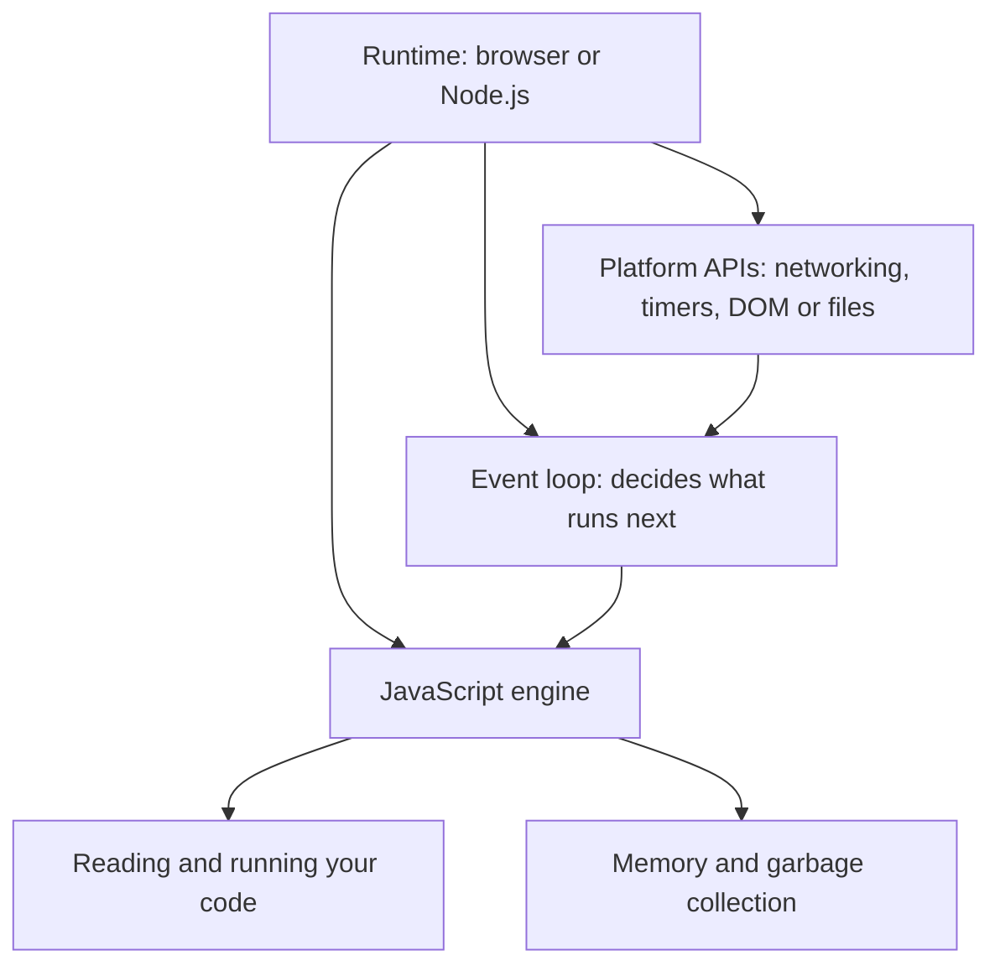

You've probably heard that JavaScript is single-threaded and asynchronous. Both are true, but neither explains three things you'll run into eventually:

1. A promise callback runs before a `setTimeout(…, 0)` callback, even when the timer was set up first.
2. Marking a function `async` doesn't stop it from freezing the page.
3. An object you stopped using can still take up memory.

To answer them, you need to pull apart two things usually lumped together as "JavaScript". The **engine** runs your code and manages its memory. The **runtime**, which is the browser or Node.js, wraps the engine and provides everything else: timers, `fetch`, the DOM, and the loop that decides what runs next.

You'll need to have written a promise with `.then` and an `async` function with `await`. This article explains what happens underneath them, not how to use them. To try a JavaScript example, paste it into the Console tab of your browser's DevTools. The scheduling rules described here are the browser's; Node.js has its own event loop with different steps, although the examples print the same output there. Engine internals such as compiler names and garbage-collection strategies change between engines and versions, so the article sticks to the parts that hold across them. The Angular example uses Angular 22.2.1.

## Contents

1. [Engine versus runtime](#engine-versus-runtime)
2. [The call stack](#the-call-stack)
3. [Memory and garbage collection](#memory-and-garbage-collection)
4. [Tasks, microtasks, and rendering](#tasks-microtasks-and-rendering)
5. [What async and await actually do](#what-async-and-await-actually-do)
6. [Does Promise.all run things in parallel?](#does-promiseall-run-things-in-parallel)
7. [Optional: why JavaScript runs fast anyway](#optional-why-javascript-runs-fast-anyway)
8. [The Angular connection](#the-angular-connection)
9. [A practical performance checklist](#a-practical-performance-checklist)
10. [The three questions, answered](#the-three-questions-answered)

## Engine versus runtime

A JavaScript engine reads your source code, turns it into instructions it can run, runs them, and manages the memory your objects use. Common engines include:

| Engine         | Environments that use it |
| -------------- | ------------------------ |
| V8             | Chrome, Edge, Node.js, Deno |
| SpiderMonkey   | Firefox                  |
| JavaScriptCore | Safari, Bun              |

The engine only knows the language itself: `Promise`, arrays, objects, functions. `setTimeout`, `fetch`, `document`, and file system APIs come from the runtime around it. That's why two runtimes can use the same engine, as Chrome and Node.js both use V8, and still offer different APIs and schedule work differently.



That split explains a familiar error:

```js
// Works in a browser page. In a plain Node.js script it throws
// "ReferenceError: document is not defined".
const button = document.querySelector("button");
```

Node.js understands this JavaScript perfectly well. It just doesn't provide a `document`, because there's no web page for one to describe.

## The call stack

In a browser tab, your JavaScript runs on one **thread**, a single sequence of steps the processor works through, called the **main thread**. So it does one thing at a time. When a function calls another function, the engine has to remember where to come back to. It keeps a stack of functions in progress, called the **call stack**: calling a function pushes it on top, returning pops it off, and execution continues in whatever is now on top.

```js
function multiply(a, b) {
  return a * b;
}

function square(value) {
  return multiply(value, value);
}

function printSquare(value) {
  const result = square(value);
  console.log(result);
}

printSquare(4);
```

While `multiply` is running, the stack looks like this:

```text
multiply(4, 4)     ← currently running
square(4)
printSquare(4)
the script itself
```

`multiply` returns `16` and is popped off. `square` is on top again, so it returns that value and is popped too. Then `printSquare` logs `16` and returns.

The stack also explains a **stack overflow**. A function that calls itself with no stopping condition keeps pushing new calls until the engine's stack limit is reached, and the engine throws an error, such as Chrome's `RangeError: Maximum call stack size exceeded`. There's no fixed number of calls that's allowed; the limit depends on the engine, the platform, and how much each call stores.

## Memory and garbage collection

The call stack only tracks function calls that are still running. Objects need to last longer than that: an object created inside a function can still be in use after that function returns and is popped off the stack. So the engine keeps objects in a separate area of memory, called the **heap**, where they stay until nothing needs them any more. You never free that memory yourself. The engine's **garbage collector** finds objects nothing needs and reuses their memory.

The garbage collector's rule is simple: if your code could still get to a value, it stays. If nothing can reach it any more, it can be thrown away. "Could still get to" starts from a few fixed places, called **roots**: global variables, the local variables of functions currently running, and things the browser itself holds, such as the DOM tree, registered event listeners, and pending timers. The collector follows every reference from those roots, then every reference from the objects it found, and so on. Anything it never reaches is garbage, even two objects that point at each other.

That rule cuts both ways. An object you consider unused but that's still reachable stays in memory, and the collector can't know you're done with it.

### A timer can keep data alive

```js
function startReporting(data) {
  const timer = setInterval(() => {
    console.log(data.length);
  }, 1000);

  return function stopReporting() {
    clearInterval(timer);
  };
}

const stopReporting = startReporting(new Array(1_000_000).fill("x"));

// Call this when the feature that started the timer is finished.
stopReporting();
```

The arrow function passed to `setInterval` uses `data`, a variable from `startReporting`. JavaScript keeps that variable available to the arrow function even after `startReporting` has returned. A function that keeps access to variables from the place where it was created is called a **closure**. The [values and identity article](/dump/blog/values-references-and-identity/) covers closures in more detail.

Follow the references from a root: the browser holds the pending timer, the timer holds the arrow function, and the arrow function holds `data`. So the million-item array stays reachable for as long as the timer runs, even though no other code will ever use it. That's the third question from the opening: an object you stopped using is still reachable, so it isn't garbage.

Calling `stopReporting` clears the timer, which removes that path. The array becomes collectable once nothing else reaches it, but the collector decides when to actually reclaim it.

The same thing happens with:

- an array that still holds DOM elements after they're removed from the page;
- an event listener on `window` or `document` whose callback uses data from a component that's gone;
- a cache that only ever grows;
- a subscription a component starts and never ends when the component is destroyed.

Removing a DOM element from the page isn't enough if a variable somewhere still points at it. The reverse holds too: a listener attached to an element that becomes unreachable is collected along with the element, so not every listener needs removing.

V8 and other engines collect young objects separately from long-lived ones, because most objects are short-lived, and they do much of the work in small steps or on other threads to keep pauses short. You can't rely on exactly when collection happens, so the practical questions are:

1. How much does this feature allocate?
2. What's still reachable after the feature closes?
3. Which chain of references keeps it reachable?

A heap snapshot in the DevTools Memory panel answers the last two: it lists what's in memory and, for each object, the chain of references from a root that keeps it alive.

## Tasks, microtasks, and rendering

"Single-threaded" describes your JavaScript, not the whole browser. The browser does networking, image decoding, and parts of garbage collection on other threads, and a **Web Worker**, a script the page starts on a thread of its own, runs JavaScript separately from the page. What's true is narrower: on the main thread, only one piece of your JavaScript runs at a time, and nothing else can start halfway through it.

So if your click handler spends a long time computing, a second click, a timer, and the next screen update all have to wait until that handler finishes. Something has to decide what runs next once it does. That's the **event loop**.

The browser keeps a to-do list of callbacks waiting to run. Each entry is a **task**: running a timer callback, dispatching a click event, and many other kinds of work are tasks. The browser also keeps a second, higher-priority list. Each entry there is a **microtask**: promise callbacks such as the function you pass to `.then`, and callbacks passed to `queueMicrotask`, are microtasks.

Here's the loop, simplified:

1. Take one task and run its JavaScript to completion.
2. Run every waiting microtask, including microtasks added while running microtasks, until the list is empty.
3. If it's time for a screen update, work out the page's layout and **paint** it, which means drawing its pixels.
4. Go back to step 1.

The browser actually keeps several task lists, for example one for user input and one for timers, and chooses between them, so tasks don't always run in the order they were added. And a screen update doesn't happen after every task, only when the browser decides it's time for a new **frame**, the next updated picture of the page on screen. You may also see tasks called "macrotasks"; the HTML standard just calls them tasks.

### Predict the output

```js
console.log("1: sync");

setTimeout(() => {
  console.log("2: timeout");
}, 0);

Promise.resolve()
  .then(() => {
    console.log("3: promise");
  })
  .then(() => {
    console.log("4: promise 2");
  });

queueMicrotask(() => {
  console.log("5: microtask");
});

console.log("6: sync end");
```

Run as a script on its own, this prints:

```text
1: sync
6: sync end
3: promise
5: microtask
4: promise 2
2: timeout
```

Step by step:

- The whole script is one task, so `1` and `6` print first. Nothing else can run in the middle of it.
- During the script, the timer callback is handed to the browser's timer, the first `.then` callback becomes a microtask because the promise is already resolved, and `queueMicrotask` adds a second microtask.
- When the script finishes, the microtask list runs: `3`, then `5`.
- The second `.then` callback only becomes a microtask once the first `.then` callback finishes, so it joins the list behind `5` and prints next.
- The microtask list is empty now, so the loop takes the next task: the timer callback, `2`.

That's the first question from the opening. Promise callbacks are microtasks, and the browser empties the microtask list before it takes the next task. A timer callback is a task, so it waits, even with a delay of `0`. A zero delay means "run in a later task as soon as possible", and the browser can push it later still: it enforces a minimum delay for deeply nested timers, and it slows timers in background tabs.

### Microtasks can block the page

Because step 2 empties the microtask list completely, a microtask that keeps adding another microtask never lets the loop reach step 3. Tasks and screen updates wait for as long as that continues.

That's also why awaiting an already-resolved promise doesn't give the browser a chance to paint. The `await` pauses your function, but the rest of it runs as a microtask, before the browser gets to step 3.

For visual updates, `requestAnimationFrame(callback)` runs `callback` right before the browser's next paint. It runs once, so an animation calls it again from inside the callback for the following frame. Slow work inside that callback still delays the frame.

A 60 Hz screen draws a frame about every 16.7 ms. The browser's own work, such as layout and paint, shares that time with your JavaScript, and faster screens shorten it. The [rendering and performance article](/dump/blog/browser-rendering-and-performance/) covers what happens during a screen update.

## What async and await actually do

An `async` function always returns a promise. When you call it, its body starts running immediately, synchronously, until it reaches the first `await`.

```js
async function showOrder() {
  console.log("A");
  await Promise.resolve();
  console.log("B");
}

console.log("C");
showOrder();
console.log("D");
```

Output:

```text
C
A
D
B
```

`showOrder` prints `A` straight away. At `await`, the function pauses and returns its promise to the caller, so `D` prints. When the awaited promise is resolved, the rest of `showOrder` is queued as a microtask, which runs after the current script finishes, and `B` prints. `await` pauses one function call, not the whole page.

### Async doesn't move work off the main thread

```js
async function sumUpTo(limit) {
  let total = 0;

  for (let value = 0; value < limit; value += 1) {
    total += value;
  }

  return total;
}
```

This function has no `await`, so calling it runs the whole loop synchronously before it returns its promise. With a large `limit`, the page can't respond to clicks or paint until the loop ends. The `async` keyword only changes what the function returns; it doesn't create a thread or make the loop interruptible. That's the second question from the opening.

### Splitting long work into chunks

Work that has to stay on the main thread can be split into chunks, giving the browser a turn between them. Suppose the task board has to prepare lowercase search text for a very long list of tasks:

```js
const CHUNK_SIZE = 1000;

function yieldToBrowser() {
  return new Promise((resolve) => {
    setTimeout(resolve, 0);
  });
}

async function buildSearchText(tasks) {
  const searchText = [];

  for (let start = 0; start < tasks.length; start += CHUNK_SIZE) {
    const end = Math.min(start + CHUNK_SIZE, tasks.length);

    for (let index = start; index < end; index += 1) {
      searchText.push(tasks[index].title.toLowerCase());
    }

    await yieldToBrowser();
  }

  return searchText;
}
```

What to notice:

- `await yieldToBrowser()` pauses `buildSearchText`, so the current task ends and the event loop takes over. Until the timer fires, the browser can run other tasks, such as a waiting click, and update the screen. The browser decides which waiting task runs next, so a click isn't guaranteed to run before the timer.
- When the timer's task runs, its callback resolves the promise, and the rest of `buildSearchText` resumes as a microtask right after that callback.
- Awaiting `Promise.resolve()` instead wouldn't help: the function would resume as a microtask, before the browser gets a turn.
- The timer doesn't guarantee a paint between chunks. It only gives the browser the chance.
- Each chunk should be small enough to finish quickly. A thousand short strings is fine; a thousand expensive calculations may not be.

For heavy computation that doesn't need the DOM, a Web Worker runs it on another thread, so the main thread stays free the whole time.

## Does Promise.all run things in parallel?

Awaiting one request after another is right when the second needs the first one's result. When the requests are independent, it makes the second wait for no reason:

```js
async function loadJson(url) {
  const response = await fetch(url);

  if (!response.ok) {
    throw new Error(`Request failed: ${response.status}`);
  }

  return response.json();
}

async function loadTaskBoard() {
  const [tasks, notifications] = await Promise.all([
    loadJson("/api/tasks"),
    loadJson("/api/notifications"),
  ]);

  return { tasks, notifications };
}
```

Both `loadJson` calls start before `loadTaskBoard` waits for either. The browser handles the two network requests at the same time, but your JavaScript doesn't run in parallel: each response's callback still runs on the main thread, one at a time, through the event loop.

`Promise.all` waits for promises you've already started. It doesn't create threads, and it doesn't get around the browser's limits on connections. If one promise rejects, `Promise.all` rejects too, but the other request keeps going; nothing cancels it automatically.

For two or three independent requests, `Promise.all` is the right tool. For thousands, send them in batches so you don't overwhelm the server.

## Optional: why JavaScript runs fast anyway

You don't need this section to answer the three questions, but it explains why the engine sometimes gets faster or slower at running the same code.

Your computer's processor runs **machine code**, instructions specific to that kind of processor. An engine starts by turning your source into **bytecode**, a simpler instruction format that its **interpreter**, the part of the engine that runs bytecode one instruction at a time, can start on straight away. While that code runs, the engine records what it sees: which types a function receives, which object layouts a property read meets. For functions that run often, a **just-in-time compiler**, or JIT, uses those observations to produce machine code specialized for them.

```js
function add(a, b) {
  return a + b;
}

console.log(add(1, 2)); // 3
console.log(add("hello", " world")); // "hello world"
```

If `add` has only ever seen numbers, its compiled version may assume numbers. When a string arrives, that assumption no longer holds, so the engine throws the specialized version away and goes back to slower general code. That's called **deoptimization**. It keeps your program correct; it's not a penalty for mixing types.

The same idea speeds up property reads. Objects created the same way, such as tasks that all have `id`, `title`, and `done` added in the same order, can share an internal layout description, which V8 calls a hidden class. A place in your code like `task.title` can then remember where `title` is stored for that layout and read it directly instead of looking it up by name each time.

You may have read advice like "never use `delete`, it slows objects down". Following it blindly changes what your code does, because a property set to `undefined` still exists:

```js
const task = { id: 1, title: "Read the DOM", done: false };

task.done = undefined;
console.log(Object.hasOwn(task, "done")); // true

delete task.done;
console.log(Object.hasOwn(task, "done")); // false
```

Code that checks `Object.hasOwn`, `in`, or `Object.keys` sees a difference.

None of this should change how you write everyday code. Engines don't optimize after a fixed number of calls, mixing types doesn't always cause deoptimization, and one deoptimization almost never explains a slow app. When a profile, a recording from the DevTools Performance panel, shows one function taking most of the time, that's when this knowledge earns its keep.

## The Angular connection

Angular has to know when your data might have changed so it can update the page. That process of re-reading your component data and updating the DOM is called **change detection**.

In Zone.js-based Angular apps, a library called Zone.js wraps browser functions like `setTimeout`, `addEventListener`, and promise callbacks when the app starts. When one of those callbacks finishes, Zone.js tells Angular "some async work just completed". Angular then checks your components, because that callback might have changed data. Angular doesn't know what changed, only that something might have.

Signals tell Angular exactly what changed:

```ts
import { computed, signal } from "@angular/core";

const count = signal(0);
const doubled = computed(() => count() * 2);

count.set(1);
console.log(doubled()); // 2
```

When a template reads a signal and the signal changes, Angular knows that view needs updating. Angular's current documentation states that zoneless change detection, without Zone.js, is the default from v21. Either way, Angular runs inside the event loop like any other JavaScript: setting a signal doesn't update or paint the page immediately. Angular schedules a check, runs it when the browser gets to that callback, and the browser paints after that.

So the two models fit together:

- Angular decides which views need updating.
- The browser decides when JavaScript and screen updates get to run.

The [change detection article](/dump/blog/angular-change-detection/) covers the rest, including how Zone.js and zoneless apps schedule their checks.

## A practical performance checklist

Start with what users notice:

1. **Profile the actual interaction.** Find out whether the time goes into the network, JavaScript, layout, or memory before changing code.
2. **Break up long work.** `async` alone doesn't help. Split the work into chunks that yield through a timer, or move it to a Web Worker.
3. **Start independent requests together.** Use `Promise.all` for independent requests, keep dependent ones sequential, and send very large numbers in batches.
4. **End what you start.** Clear timers, remove listeners on long-lived targets, end subscriptions when their component is destroyed, and limit how big caches can grow.
5. **Leave engine tuning for last.** Keep object layouts and types consistent where a profile shows a hot function, not everywhere.

## The three questions, answered

The opening asked three questions. Each one has the same root: the engine runs your code, and the runtime decides when it runs and what stays reachable.

- **Why does a promise callback run before a zero-delay timer?** Promise callbacks are microtasks, and the browser empties the microtask list before taking the next task. A timer callback is a task, so it waits.
- **Why can an `async` function still freeze the page?** `async` changes what the function returns, not where it runs. Until the first `await`, its body runs on the main thread like any other function, and nothing else runs in the meantime.
- **Why does an unused object still take memory?** The garbage collector keeps whatever is reachable from a root. A running timer, a listener, or a cache can keep an object reachable long after your code stopped using it.

## Sources and further reading

- [HTML standard: event loops](https://html.spec.whatwg.org/multipage/webappapis.html#event-loops)
- [MDN: In depth: Microtasks and the JavaScript runtime environment](https://developer.mozilla.org/en-US/docs/Web/API/HTML_DOM_API/Microtask_guide/In_depth)
- [V8: garbage collection and reachability](https://v8.dev/blog/trash-talk)
- [V8: Maglev and execution tiers](https://v8.dev/blog/maglev)
- [V8: fast properties and hidden classes](https://v8.dev/blog/fast-properties)
- [Angular: zoneless change detection](https://angular.dev/guide/zoneless)
