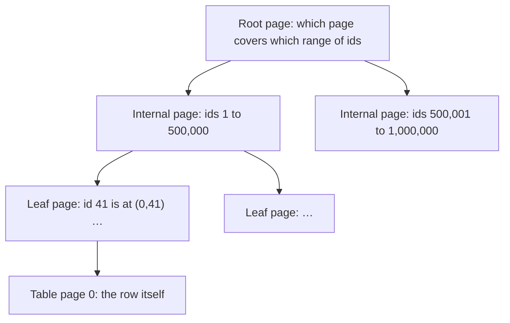

The task board's tasks table has a foreign key from `assignee_id` to the users table, so every task points at a real person. The API's "my open tasks" endpoint runs this query:

```sql
select id, title, due_on
from tasks
where assignee_id = 7 and not done
order by due_on
limit 20;
```

With a handful of test rows it's instant. With a million tasks it takes about 30 milliseconds, and to return those 20 rows PostgreSQL reads every one of the table's 10,205 pages. Add one line,

```sql
create index on tasks (assignee_id, due_on);
```

and the same query takes 0.08 milliseconds and reads 119 pages. The foreign key was there the whole time, so what did the database do differently, and how could you have seen the problem before production? That's what this article works through: how PostgreSQL stores and finds rows, what an index actually is, how to read the plan PostgreSQL makes for a query, and, at the end, how your C# code should send values so that a search box can't run SQL of its own.

You'll need C# and the minimal API basics from [From bytes to your handler](/dump/blog/aspnet-core-request-pipeline/). [Who creates your services](/dump/blog/aspnet-core-dependency-injection/) explains why the database connection source is a singleton, and [Waiting without blocking](/dump/blog/aspnet-core-async-and-the-thread-pool/) explains the `CancellationToken` passed to every query. [One task, different models](/dump/blog/api-responses-to-ui-models/) is where foreign keys and the difference between an instant and a calendar day first came up. You don't need to know any SQL.

## Contents

1. [Set up the example](#set-up-the-example)
2. [Tables, rows, and the first queries](#tables-rows-and-the-first-queries)
3. [Primary keys, identity columns, and foreign keys](#primary-keys-identity-columns-and-foreign-keys)
4. [Joins](#joins)
5. [How PostgreSQL stores rows, and the first plan](#how-postgresql-stores-rows-and-the-first-plan)
6. [How a B-tree index finds rows](#how-a-b-tree-index-finds-rows)
7. [Indexes with more than one column](#indexes-with-more-than-one-column)
8. [Reading a query plan](#reading-a-query-plan)
9. [When the planner doesn't use your index](#when-the-planner-doesnt-use-your-index)
10. [LIMIT and the cost of indexes](#limit-and-the-cost-of-indexes)
11. [Queries from C#](#queries-from-c)
12. [SQL injection and what parameters fix](#sql-injection-and-what-parameters-fix)
13. [Back to the slow list](#back-to-the-slow-list)

## Set up the example

The examples use PostgreSQL 18.6, the .NET 10 SDK, and the Npgsql 10.0.3 data provider. The query plans need PostgreSQL 18: earlier versions print them differently and lack one feature the article shows. The numbers come from one laptop with the whole database in memory, so yours will differ, but the proportions between them should hold. Transactions, schema changes on live tables, EF Core, and database tuning are outside this article's scope.

Run PostgreSQL in Docker. [Docker behind the scenes](/dump/blog/docker-behind-the-scenes/) explains containers if you haven't used them:

```bash
docker run --name taskboard-db -e POSTGRES_HOST_AUTH_METHOD=trust -e POSTGRES_DB=taskboard -p 127.0.0.1:55460:5432 -d postgres:18.6-trixie
```

`POSTGRES_HOST_AUTH_METHOD=trust` lets connections in without a password. That's acceptable only because `127.0.0.1` makes the port reachable from your machine alone. Port 55460 keeps clear of a PostgreSQL you may already run on its default port, 5432.

The container has no volume, so the data disappears when you remove it. That's fine here, because a script creates all of it. Save the script below as `seed.sql` and load it; it takes about seven seconds:

```bash
docker exec -i taskboard-db psql -U postgres -d taskboard < seed.sql
```

<details>
<summary>The complete <code>seed.sql</code></summary>

```sql
drop table if exists tasks;
drop table if exists users;

create table users (
    id integer generated always as identity primary key,
    name text not null,
    email text not null unique,
    active boolean not null default true
);

create table tasks (
    id integer generated always as identity primary key,
    title text not null,
    done boolean not null default false,
    assignee_id integer references users (id),
    due_on date,
    created_at timestamptz not null default now()
);

select setseed(0.42);

insert into users (name, email, active)
select 'User ' || n, 'user' || n || '@example.com', n % 10 <> 0
from generate_series(1, 1000) as n;

insert into tasks (title, done, assignee_id, due_on, created_at)
select
    (array['Review', 'Fix', 'Write', 'Plan', 'Test', 'Update', 'Document', 'Refactor'])[1 + floor(random() * 8)::int]
        || ' the '
        || (array['CSS layout', 'login form', 'task list', 'search page', 'API docs', 'release notes', 'database backup', 'error messages', 'date picker', 'settings page'])[1 + floor(random() * 10)::int]
        || ' #' || n,
    random() < 0.8,
    case when random() < 0.1 then null else 1 + floor(random() * 1000)::integer end,
    date '2026-01-01' + floor(random() * 900)::integer,
    timestamptz '2026-01-01 00:00:00+00' + random() * interval '650 days'
from generate_series(1, 1000000) as n;

update tasks set title = 'Audit keyboard accessibility #' || id where id % 50000 = 7;

vacuum analyze users;
vacuum analyze tasks;
```

</details>

It creates 1,000 users, a tenth of them inactive, and 1,000,000 tasks: about 10% unassigned, 80% done, with due dates and creation times spread over two years. Twenty tasks have a rare word, "Audit", in their title.

Open a SQL prompt with **psql**, PostgreSQL's command-line client, and run the article's queries there:

```bash
docker exec -it taskboard-db psql -U postgres -d taskboard
```

## Tables, rows, and the first queries

A **table** holds rows that all have the same columns, and every column has a type. Here's the tasks table from `seed.sql`:

```sql
create table tasks (
    id integer generated always as identity primary key,
    title text not null,
    done boolean not null default false,
    assignee_id integer references users (id),
    due_on date,
    created_at timestamptz not null default now()
);
```

What to notice:

- `integer`, `text`, `boolean`, `date`, and `timestamptz` are the column types. A `date` is a calendar day; a `timestamptz` is an instant in time.
- `not null` means every row must have a value in that column. The other columns may hold **null**, which means "no value". An unassigned task has a null `assignee_id`.
- `default` gives the value used when an insert doesn't provide one.

Reading rows is a `select`. It names the columns you want, `where` keeps the rows that match a condition, `order by` sorts them, and `limit` keeps the first few:

```sql
select id, title, due_on
from tasks
where assignee_id = 7 and not done
order by due_on
limit 3;
```

One rule about null catches everyone once: `assignee_id = null` is never true, not even for unassigned tasks, because comparing anything with "no value" gives "unknown". To find unassigned tasks, write `where assignee_id is null`.

**SQL Server and MySQL:** SQL Server has no `limit`; it uses `select top 3 …` or `offset 0 rows fetch next 3 rows only`. The `ilike` operator used later for case-insensitive matching exists only in PostgreSQL.

## Primary keys, identity columns, and foreign keys

A common belief is that a primary key is just a column whose values happen to be unique. It's more specific than that. A **primary key** is the column, or columns, that identify each row: its values must be unique and never null, and a table can have only one. When another table refers to this one, it refers to the primary key by default.

`generated always as identity` makes PostgreSQL hand out the ids itself, counting up, so an insert doesn't provide one. **SQL Server** writes this as `IDENTITY`, and **MySQL** as `AUTO_INCREMENT`.

To enforce uniqueness quickly, PostgreSQL creates an index for every primary key and every `unique` constraint. You'll see what an index is shortly; for now, list them with `\di`, a psql command:

```text
 public | tasks_pkey      | index | postgres | tasks | ...
 public | users_email_key | index | postgres | users | ...
 public | users_pkey      | index | postgres | users | ...
```

`users_email_key` comes from `email text not null unique`.

A **foreign key** says that a column's value must exist in another table's key. `assignee_id integer references users (id)` means every non-null `assignee_id` must be the id of a real user. PostgreSQL enforces that on every write. Try to assign a task to a user who doesn't exist:

```sql
insert into tasks (title, assignee_id) values ('Ghost task', 99999);
```

```text
ERROR:  insert or update on table "tasks" violates foreign key constraint "tasks_assignee_id_fkey"
DETAIL:  Key (assignee_id)=(99999) is not present in table "users".
```

And it works in the other direction: you can't delete a user who still has tasks.

```sql
delete from users where id = 7;
```

```text
ERROR:  update or delete on table "users" violates foreign key constraint "tasks_assignee_id_fkey" on table "tasks"
DETAIL:  Key (id)=(7) is still referenced from table "tasks".
```

Many developers assume that declaring a foreign key also creates an index on it. In PostgreSQL it doesn't. `\d tasks` describes the table:

```text
Indexes:
    "tasks_pkey" PRIMARY KEY, btree (id)
Foreign-key constraints:
    "tasks_assignee_id_fkey" FOREIGN KEY (assignee_id) REFERENCES users(id)
```

There's an index on `id`, and none on `assignee_id`. **SQL Server** doesn't create one either. **MySQL** with its default InnoDB storage engine does create one when no suitable index exists. That missing index is the whole story of the opening, and it also matters for the delete you just tried, as you'll see.

## Joins

Tasks store an assignee id, but the board shows names. A **join** combines rows from two tables. This one pairs each task with its assignee's row:

```sql
select t.id, t.title, u.name
from tasks t
join users u on u.id = t.assignee_id;
```

`t` and `u` are short names for the tables, and `on` says which rows belong together. This query returns 900,174 rows, not 1,000,000: a plain `join`, also called an **inner join**, keeps only tasks that found a matching user, so the unassigned tasks disappear.

A **left join** keeps every row from the left table, the tasks, and fills the user's columns with null where there's no match:

```sql
select t.id, t.title, u.name
from tasks t
left join users u on u.id = t.assignee_id;
```

That returns all 1,000,000 tasks. Now the trap. Suppose the board should hide names of inactive users, and you add a condition:

```sql
select t.id, t.title, u.name
from tasks t
left join users u on u.id = t.assignee_id
where u.active;
```

This returns 810,190 rows. The unassigned tasks are gone again, and so are the tasks of inactive users. Put `explain` in front of the query to see what PostgreSQL plans to do, and it says `Hash Join`, not `Hash Left Join`: PostgreSQL turned your left join into an inner join.

The reason is the order things happen in. Conditions in `on` decide which rows match during the join. Conditions in `where` filter the joined result afterwards, keeping only rows where the condition is true. For an unassigned task, `u.active` is null, so the `where` throws the row away, and PostgreSQL, seeing that no null-filled row could survive, simply plans an inner join.

The fix depends on what you meant:

- **Keep every task, but show no name for inactive users:** move the condition into the join, `left join users u on u.id = t.assignee_id and u.active`. That returns all 1,000,000 rows.
- **Hide tasks of inactive users, but keep unassigned ones:** say exactly that, `where t.assignee_id is null or u.active`. That returns 910,016 rows.

## How PostgreSQL stores rows, and the first plan

To understand why the opening query reads every page, you need to know where rows live.

PostgreSQL stores a table's rows in a file divided into **pages** of 8 kB each. A page holds as many rows as fit, here about a hundred, and rows aren't kept in any particular order; a new row goes wherever there's room. This layout is called a **heap**. The tasks table is 80 MB in 10,205 pages. Every row has a hidden column, `ctid`, with its location:

```sql
select ctid, id, title from tasks order by id limit 3;
```

```text
 ctid  | id |           title
-------+----+----------------------------
 (0,1) |  1 | Update the search page #1
 (0,2) |  2 | Plan the search page #2
 (0,3) |  3 | Document the login form #3
```

`(0,1)` means page 0, slot 1.

Without an index on `assignee_id`, PostgreSQL has only one way to find user 7's tasks: read every page and check every row. That's a **sequential scan**. You can see it happen with `explain analyze`, which runs the query and reports what PostgreSQL did. PostgreSQL normally splits a big scan across several processes; turn that off for a moment so the first plan is simpler:

```sql
set max_parallel_workers_per_gather = 0;

explain analyze
select id, title, due_on
from tasks
where assignee_id = 7 and not done
order by due_on
limit 20;
```

```text
 Limit  (cost=22709.90..22709.95 rows=20 width=38) (actual time=54.936..54.939 rows=20.00 loops=1)
   Buffers: shared hit=10205
   ->  Sort  (cost=22709.90..22710.36 rows=184 width=38) (actual time=54.935..54.936 rows=20.00 loops=1)
         Sort Key: due_on
         Sort Method: top-N heapsort  Memory: 27kB
         Buffers: shared hit=10205
         ->  Seq Scan on tasks  (cost=0.00..22705.00 rows=184 width=38) (actual time=0.275..54.891 rows=160.00 loops=1)
               Filter: ((NOT done) AND (assignee_id = 7))
               Rows Removed by Filter: 999840
               Buffers: shared hit=10205
 Planning Time: 0.058 ms
 Execution Time: 54.955 ms
```

The [Reading a query plan](#reading-a-query-plan) section goes through every number. For now, read it from the bottom up:

- **`Seq Scan on tasks`** read the table. `Rows Removed by Filter: 999840` says it looked at a million rows and kept 160. `Buffers: shared hit=10205` says it touched all 10,205 pages.
- **`Sort`** sorted those 160 rows by `due_on`.
- **`Limit`** kept the first 20.

Now turn parallel scanning back on with `reset max_parallel_workers_per_gather;` and run the same `explain analyze`:

```text
 Limit  (actual time=29.780..32.015 rows=20.00 loops=1)
   ->  Sort  (actual time=29.779..32.012 rows=20.00 loops=1)
         ->  Gather  (actual time=0.440..31.951 rows=160.00 loops=1)
               Workers Planned: 2
               Workers Launched: 2
               ->  Parallel Seq Scan on tasks  (actual time=0.815..27.285 rows=53.33 loops=3)
                     Rows Removed by Filter: 333280
                     Buffers: shared hit=10205
 Execution Time: 32.035 ms
```

(Cost estimates trimmed.) `loops=3` means three processes each scanned a third of the table, and `rows=53.33` is the average per process. `Gather` collected their results. It's faster, 32 ms instead of 55, but it's the same amount of work, all 10,205 pages, split three ways. The rest of the article uses the default parallel setting.

**SQL Server and MySQL:** both usually store a table's rows inside its primary key's index instead of in a heap. That's called a **clustered index**: SQL Server's primary key gets one by default, and MySQL's InnoDB always stores tables this way. The ideas below about finding rows through an index still apply.

## How a B-tree index finds rows

An **index** is a separate structure that keeps a copy of one or more columns, sorted, with each value pointing to the row's location in the table. PostgreSQL's default kind is a **B-tree**: the sorted entries are stored in pages, and above them sit a few levels of pages that work like a table of contents, each entry saying which page below covers which range of values.



The diagram is simplified: real index pages each hold hundreds of entries, which is why few levels are needed. The primary key's index on a million tasks has three levels. To find task 41, PostgreSQL reads the root page, follows it to the right page on the next level, then to the leaf page that holds 41 and its location, and finally reads that one table page:

```sql
explain analyze select id, title, done from tasks where id = 41;
```

```text
 Index Scan using tasks_pkey on tasks  (cost=0.42..8.44 rows=1 width=35) (actual time=0.006..0.006 rows=1.00 loops=1)
   Index Cond: (id = 41)
   Index Searches: 1
   Buffers: shared hit=4
 Execution Time: 0.012 ms
```

Four pages instead of 10,205: three index levels and one table page. Because the entries are sorted, the same walk works for equality (`id = 41`), ranges (`id between 100 and 200`: find the first, then read along the leaf pages), and ordering (`order by id`: the leaf pages are already in order).

Now create an index on `assignee_id` and run the opening query again:

```sql
create index tasks_assignee_id_idx on tasks (assignee_id);
```

```text
 Limit  (actual time=0.859..0.862 rows=20.00 loops=1)
   ->  Sort  (actual time=0.859..0.860 rows=20.00 loops=1)
         Sort Key: due_on
         ->  Bitmap Heap Scan on tasks  (actual time=0.285..0.830 rows=160.00 loops=1)
               Recheck Cond: (assignee_id = 7)
               Filter: (NOT done)
               Rows Removed by Filter: 728
               Heap Blocks: exact=856
               Buffers: shared hit=860
               ->  Bitmap Index Scan on tasks_assignee_id_idx  (actual time=0.194..0.195 rows=888.00 loops=1)
                     Index Cond: (assignee_id = 7)
 Execution Time: 0.872 ms
```

What to notice:

- **`Bitmap Index Scan`** found all 888 of user 7's tasks in the index, and collected their locations.
- **`Bitmap Heap Scan`** then read the 856 table pages those rows are on, each page once and in page order, which is cheaper than jumping around the table row by row.
- **`Filter: (NOT done)` with `Rows Removed by Filter: 728`**: the index only knows `assignee_id`, so `not done` still had to be checked on each row.
- It's still sorting 160 rows to keep 20. That's what the next section fixes.

## Indexes with more than one column

An index can cover several columns. An index on `(assignee_id, due_on)` is sorted by `assignee_id`, and within each assignee, by `due_on`, like a phone book sorted by last name, then first name. Replace the single-column index with it:

```sql
create index tasks_assignee_id_due_on_idx on tasks (assignee_id, due_on);
drop index tasks_assignee_id_idx;
```

```text
 Limit  (actual time=0.022..0.070 rows=20.00 loops=1)
   Buffers: shared hit=119
   ->  Index Scan using tasks_assignee_id_due_on_idx on tasks  (actual time=0.022..0.068 rows=20.00 loops=1)
         Index Cond: (assignee_id = 7)
         Filter: (NOT done)
         Rows Removed by Filter: 96
         Index Searches: 1
         Buffers: shared hit=119
 Execution Time: 0.080 ms
```

There's no `Sort` anymore. User 7's entries are already in due-date order in the index, so PostgreSQL walks them from the earliest date, skips the done ones, and stops as soon as it has 20 rows. That's the opening's 0.08 ms and 119 pages.

The column order follows from how the index is sorted. Put the columns you compare with `=` first, then the column you sort or compare by range. An index on `(due_on, assignee_id)` would be sorted by date first, with user 7's tasks scattered all through it. And because `(assignee_id, due_on)` starts with `assignee_id`, it also serves queries on `assignee_id` alone, which is why the single-column index could go.

You'll often read that a two-column index is useless unless the query filters on its first column. PostgreSQL 18 can still use it, with a technique called **skip scan**:

```sql
explain analyze select id, title from tasks where due_on = '2026-03-01';
```

```text
 Bitmap Heap Scan on tasks  (actual time=1.907..2.645 rows=1104.00 loops=1)
   Recheck Cond: (due_on = '2026-03-01'::date)
   ->  Bitmap Index Scan on tasks_assignee_id_due_on_idx  (actual time=1.804..1.804 rows=1104.00 loops=1)
         Index Cond: (due_on = '2026-03-01'::date)
         Index Searches: 1002
 Execution Time: 2.701 ms
```

`Index Searches: 1002` shows how: PostgreSQL searched the index roughly once per distinct `assignee_id`, about a thousand of them, looking for that date within each. That's only worthwhile because there are just a thousand distinct assignees. With a million distinct values in the first column it would be a million searches, so still choose the column order for the queries you actually run. **MySQL 8.4** has a skip scan too.

Sometimes the index alone holds every column a query needs:

```sql
explain analyze select due_on from tasks where assignee_id = 7;
```

```text
 Index Only Scan using tasks_assignee_id_due_on_idx on tasks  (actual time=0.013..0.115 rows=888.00 loops=1)
   Index Cond: (assignee_id = 7)
   Heap Fetches: 82
```

An **index-only scan** reads `due_on` straight from the index. `Heap Fetches: 82` says it still visited the table for 82 rows: PostgreSQL keeps a map of which table pages are known to hold only rows every transaction can see, and the index can only be trusted on its own for those pages. `VACUUM`, which PostgreSQL also runs automatically in the background, keeps that map up to date.

## Reading a query plan

Before running a query, PostgreSQL's **planner** considers different ways to execute it and picks the one it estimates is cheapest. `explain` shows that plan; `explain analyze` also runs the query and adds what actually happened. A plan is a tree: each indented node gets rows from the nodes under it, so read it from the innermost node outward.

On each node:

- **`cost=0.42..8.44`** is the planner's estimate in arbitrary units: the cost before the first row comes out, then the cost for all rows. It's only useful for comparing plans for the same query.
- **`rows=184`** inside the first parentheses is the planner's estimate of how many rows the node returns. **`actual … rows=160.00`** is what really came out.
- **`loops`** is how many times the node ran. With parallel workers or some joins, `rows` is the average per loop.
- **`Buffers: shared hit=…`** counts pages read from PostgreSQL's memory; `read=…` means pages that had to come from disk or the operating system. PostgreSQL 18 shows buffers by default.
- **`Rows Removed by Filter`** counts rows that were read and then thrown away. A big number here, next to a small result, is the classic sign of a missing index.
- **`Planning Time`** and **`Execution Time`** at the bottom are wall-clock times on the server.

Two warnings. `explain analyze` really runs the statement, so for an `update` or `delete`, wrap it in a transaction you throw away:

```sql
begin;
explain analyze delete from tasks where id = 41;
rollback;
```

And in the plan, `~~*` is how PostgreSQL prints `ilike`.

### When the estimate is wrong

The planner's estimates come from **statistics**: samples of each column's values, collected by the `analyze` command. PostgreSQL runs `analyze` automatically in the background, but not instantly. Import 300,000 tasks for user 7 and ask right away:

```sql
begin;
insert into tasks (title, assignee_id, due_on)
select 'Imported task #' || n, 7, date '2026-06-01' from generate_series(1, 300000) as n;

explain analyze select id, title, due_on from tasks where assignee_id = 7;
```

```text
 Bitmap Heap Scan on tasks  (cost=21.27..3459.41 rows=1141 width=38) (actual time=6.345..41.732 rows=300888.00 loops=1)
```

The planner expected 1,141 rows and got 300,888, because its statistics still describe the table before the import. Run `analyze tasks;` and the estimate becomes `rows=304417`. Here the plan happened to stay the same, but a wrong estimate is how the planner ends up choosing a plan that's slow for the real data. When estimated and actual rows differ by orders of magnitude, suspect stale statistics, and run `analyze` yourself after a bulk import. End the experiment with `rollback;`.

**SQL Server and MySQL:** SQL Server Management Studio shows the same information as the actual execution plan; MySQL has `explain analyze` too, with a different output format.

## When the planner doesn't use your index

It's natural to expect that an index always makes a query faster, and that PostgreSQL will always use one when it exists. Neither is true, and the planner is usually right to skip it.

**Tiny tables.** Create a table of tags with three rows:

```sql
create table tags (id integer generated always as identity primary key, name text not null);
insert into tags (name) values ('frontend'), ('backend'), ('bug');
analyze tags;
```

It fits in one page. Even with its primary key index, `select * from tags where id = 3` gets a `Seq Scan`: reading one page is cheaper than walking an index to find the same page.

**Conditions that match most rows.** 80% of tasks are done. Add an index with `create index on tasks (done);`, and `select id from tasks where done` still gets a `Seq Scan`, taking 96 ms. You can forbid sequential scans as an experiment with `set enable_seqscan = off`, and the forced index plan takes 117 ms. When a query needs most of the table, reading the table straight through beats jumping between the index and the table. Use `enable_seqscan` only to experiment, never to fix a query.

**A function on the indexed column.** Add an index with `create index on tasks (created_at);`. Finding the tasks created on one day like this ignores it:

```sql
select id, title from tasks where created_at::date = '2026-03-01';
```

```text
 Parallel Seq Scan on tasks
   Filter: ((created_at)::date = '2026-03-01'::date)
   Rows Removed by Filter: 332828
 Execution Time: 69.468 ms
```

The index is sorted by `created_at`, not by `created_at::date`, so it can't answer a question about the converted value. Ask about the column itself, with a range:

```sql
select id, title from tasks
where created_at >= '2026-03-01T00:00:00Z' and created_at < '2026-03-02T00:00:00Z';
```

```text
 Bitmap Heap Scan on tasks
   ->  Bitmap Index Scan on tasks_created_at_idx
 Execution Time: 1.566 ms
```

You might try indexing the converted value instead, with `create index on tasks ((created_at::date))`. PostgreSQL refuses: `functions in index expression must be marked IMMUTABLE`. Which calendar day an instant falls on depends on the session's time zone, so the same row could give different answers, and an index can't store an answer that changes. The range above gives its boundaries as instants, with `Z` meaning UTC, so it doesn't depend on the session's time zone, which is why it's the right fix here. For functions that always give the same result, such as `lower(email)`, an index on the expression, `create index on users (lower(email))`, works.

**A wildcard at the start of a pattern.** `title ilike '%login%'` can match anywhere in the title, so the sorted order of a B-tree index on `title` doesn't help find it. The `pg_trgm` extension adds index types that can; they're outside this article's scope.

## LIMIT and the cost of indexes

A common belief is that `limit` makes a query cheap, because it returns only a few rows. What it costs depends on how many rows PostgreSQL has to look at to find those few.

The newest 20 tasks, with no index on `created_at`:

```sql
select id, title from tasks order by created_at desc limit 20;
```

PostgreSQL has to read all 1,000,000 rows to know which 20 are the newest: 77 to 85 ms. With an index on `created_at`, it reads the index from the end, `Index Scan Backward`, and stops after 20 entries: 0.03 ms.

The title search is more surprising. With `limit 20` and `order by id`, PostgreSQL walks the primary key in id order and checks each title until it has 20 matches:

| Search term | Rows it had to look at | Time |
|---|---|---|
| `login`, in about 1 title in 10 | 214 | 0.22 ms |
| `audit`, in 20 titles | all 1,000,000 | 440 ms |

Same query, same `limit`, and a two-thousand-fold difference, decided only by how common the word is.

### What indexes cost

Every index makes some reads faster and every write slower, because each insert, update, and delete has to update every index on the table too. Inserting 100,000 rows into a copy of the tasks table:

| Indexes on the table | Insert time |
|---|---|
| Primary key only | about 0.2 s |
| Plus `(assignee_id, due_on)` and `created_at` | about 0.47 s |
| Plus one on `title` as well | about 1.1 s |

They also take space: the `(assignee_id, due_on)` index on a million tasks is 18 MB, next to a table of 80 MB.

But some indexes pay off on writes too. Remember the delete that the foreign key refused? Once a user's tasks are gone, deleting the user still makes PostgreSQL check that no task refers to them. That check is a search of `tasks` by `assignee_id`. `explain analyze` reports it on a separate line:

```sql
begin;
delete from tasks where assignee_id = 13;
explain analyze delete from users where id = 13;
rollback;
```

```text
 Trigger for constraint tasks_assignee_id_fkey: time=61.341 calls=1
```

61 ms without an index on `assignee_id`, because the check read the whole tasks table. With the `(assignee_id, due_on)` index, the same line says 0.7 ms.

So index the queries your API actually runs, including the foreign key columns you join on or delete through, and don't add indexes "just in case": each one has to earn back what it costs on every write.

## Queries from C#

Now the API. Create a project and add Npgsql's package for dependency injection, which brings Npgsql itself along:

```bash
dotnet new web -o TaskBoard
cd TaskBoard
dotnet add package Npgsql.DependencyInjection --version 10.0.3
```

Register a **data source**, Npgsql's object that holds the connection string and a pool of open connections:

```csharp
using Npgsql;

var builder = WebApplication.CreateBuilder(args);
builder.Services.AddNpgsqlDataSource("Host=localhost;Port=55460;Username=postgres;Database=taskboard");

var app = builder.Build();
```

`AddNpgsqlDataSource` registers it as a singleton. It's safe to share between concurrent requests, and sharing it is the point: each command borrows an open connection from its pool and gives it back, so requests don't pay for a new connection every time. A real app reads the connection string from configuration rather than writing the password into the code.

`TaskItem` is the record from the earlier articles, `public record TaskItem(int Id, string Title, bool Done);`. Here's the endpoint for one task:

```csharp
app.MapGet("/tasks/{id:int}", async (int id, NpgsqlDataSource db, CancellationToken cancellationToken) =>
{
    await using var command = db.CreateCommand("select id, title, done from tasks where id = $1");
    command.Parameters.Add(new() { Value = id });

    await using var reader = await command.ExecuteReaderAsync(cancellationToken);
    if (!await reader.ReadAsync(cancellationToken))
    {
        return Results.NotFound();
    }

    var task = new TaskItem(reader.GetInt32(0), reader.GetString(1), reader.GetBoolean(2));
    return Results.Ok(task);
});
```

What to notice:

- **`$1`** is a **parameter**: a placeholder for a value that's sent separately from the SQL text. `Parameters.Add` supplies the value for it. `$1` is PostgreSQL's own placeholder syntax and the one Npgsql recommends; Npgsql also accepts named ones like `@id`, which it rewrites to `$1` before sending.
- **`ExecuteReaderAsync`** sends the query and returns a reader. Each `ReadAsync` moves to the next row and returns `false` when there are none. `GetInt32(0)` reads the first column of the current row.
- **`await using`** returns the command and the reader's connection to the pool when the handler finishes.
- **`cancellationToken`** is the request's token, passed to every call that accepts one.

```bash
curl http://localhost:5000/tasks/41
```

```text
{"id":41,"title":"Write the API docs #41","done":false}
```

The token matters more with a database than anywhere else, because a database query keeps working on the server even after nobody is waiting for its answer. Here's a deliberately slow report; `pg_sleep(5)` makes PostgreSQL wait five seconds:

```csharp
app.MapGet("/tasks/report", async (NpgsqlDataSource db, CancellationToken cancellationToken) =>
{
    await using var command = db.CreateCommand("select pg_sleep(5)");
    await command.ExecuteNonQueryAsync(cancellationToken);
    return "report ready\n";
});
```

Ask for it, but give up after one second with `curl --max-time 1 http://localhost:5000/tasks/report`. When the client disconnects, the token fires, and Npgsql asks PostgreSQL to cancel the running statement. PostgreSQL's log, which you can see with `docker logs taskboard-db`, shows it:

```text
ERROR:  canceling statement due to user request
STATEMENT:  select pg_sleep(5)
```

The server stopped working after one second instead of five. Without the token, it would have finished the full five seconds for a client that was already gone.

## SQL injection and what parameters fix

Here's a search endpoint written the obvious way, by gluing the search term into the SQL text:

```csharp
app.MapGet("/tasks/search", async (string term, NpgsqlDataSource db, CancellationToken cancellationToken) =>
{
    var sql = "select id, title, done from tasks where title ilike '%" + term + "%' order by id limit 20";
    await using var command = db.CreateCommand(sql);
    return await ReadTasksAsync(command, cancellationToken);
});
```

`ReadTasksAsync` is a small helper that runs the command and reads every row into a `List<TaskItem>`, the same way the single-task endpoint reads one.

<details>
<summary>The <code>ReadTasksAsync</code> helper</summary>

```csharp
static async Task<List<TaskItem>> ReadTasksAsync(NpgsqlCommand command, CancellationToken cancellationToken)
{
    var tasks = new List<TaskItem>();
    await using var reader = await command.ExecuteReaderAsync(cancellationToken);
    while (await reader.ReadAsync(cancellationToken))
    {
        tasks.Add(new TaskItem(reader.GetInt32(0), reader.GetString(1), reader.GetBoolean(2)));
    }

    return tasks;
}
```

</details>

Searching for `audit` works. Now search for this, using `curl -G --data-urlencode` so the quotes and spaces survive the URL:

```bash
curl -G --data-urlencode "term=zzz' union select id, email, true from users --" http://localhost:5000/tasks/search
```

The response has 1,000 entries, and they aren't tasks:

```text
[{"id":1,"title":"user1@example.com","done":true},{"id":2,"title":"user2@example.com","done":true}, …
```

Every user's email address. The SQL that ran explains why:

```sql
select id, title, done from tasks where title ilike '%zzz' union select id, email, true from users --%' order by id limit 20
```

The `'` in the term closed the string early. Everything after it became SQL: `union` appends the results of a second query, this one reading every email, and `--` starts a comment, which hides the rest of the original query, `limit` included. This is **SQL injection**: input that changes what the SQL means.

It can do more than read. A term ending in `'; delete from tasks; --` adds a second statement, and Npgsql, given a command text with several statements separated by semicolons, runs them all.

### Parameters keep values out of the SQL

The fix is the same parameter as in the single-task endpoint:

```csharp
app.MapGet("/tasks/search", async (string term, NpgsqlDataSource db, CancellationToken cancellationToken) =>
{
    await using var command = db.CreateCommand(
        "select id, title, done from tasks where title ilike '%' || $1 || '%' order by id limit 20");
    command.Parameters.Add(new() { Value = term });
    return await ReadTasksAsync(command, cancellationToken);
});
```

`||` joins strings in SQL, so the pattern is built on the server from `'%'`, the parameter, and `'%'`. The same attack now returns `[]`: no task has that strange text in its title.

To see why, turn on statement logging, which records every statement PostgreSQL runs:

```bash
docker exec taskboard-db psql -U postgres -c "alter system set log_statement = 'all'" -c "select pg_reload_conf()"
```

`docker logs taskboard-db` then shows the attack arriving:

```text
LOG:  execute <unnamed>: select id, title, done from tasks where title ilike '%' || $1 || '%' order by id limit 20
DETAIL:  Parameters: $1 = 'zzz'' union select id, email, true from users --'
```

The SQL text and the value arrive separately. Npgsql sends them to PostgreSQL in different messages: one carries the SQL with `$1` in it, which PostgreSQL parses, and a later one carries the values. By the time the value arrives, the SQL has already been parsed, so the value can't change its meaning; it can only ever be compared with titles. The quotes around the value in the log are added for display.

It's tempting to think escaping is enough: double every `'` in the input before gluing it in. That only protects one place in a query, the inside of a quoted string, and only if you get every rule right for that particular database. **MySQL**, for example, also treats a backslash as an escape character by default, so a correctly doubled quote can still be broken out of. Escaping does nothing for a value that isn't in quotes, like a number or a column name. The OWASP guidance on SQL injection calls escaping a last resort and strongly discourages it. Parameters avoid the whole problem by never putting values into the SQL text.

### Parameters can't replace names

The search should also sort by a column the client chooses. Making that a parameter looks natural:

```csharp
"select id, title, done from tasks where title ilike '%' || $1 || '%' order by $2 limit 5"
```

It runs without an error, and it doesn't sort. Asking with `sort=title` and with `sort=due_on` returns exactly the same five tasks in the same order. A parameter is always a value, so `order by $2` sorts by the text `'title'`, which is the same for every row. Where SQL needs a name, such as a table or column, a parameter either means something different, as here, or is a syntax error, as in `from $1`.

Since the client's text can't safely become SQL, map it to SQL you wrote yourself, and reject everything else:

```csharp
app.MapGet("/tasks/search", async (string term, string? sort, NpgsqlDataSource db, CancellationToken cancellationToken) =>
{
    var orderBy = sort switch
    {
        null or "id" => "id",
        "title" => "title",
        "due" => "due_on",
        _ => null,
    };
    if (orderBy is null)
    {
        return Results.BadRequest("sort must be id, title, or due");
    }

    await using var command = db.CreateCommand(
        $"select id, title, done from tasks where title ilike '%' || $1 || '%' order by {orderBy} limit 5");
    command.Parameters.Add(new() { Value = term });
    return Results.Ok(await ReadTasksAsync(command, cancellationToken));
});
```

This is called an **allow-list**: only the column names in the `switch`, all written in the code, can ever reach the SQL. `sort=id; drop table users` gets `400 Bad Request`, and the value never goes near the database.

One last detail: a parameter stops the value from becoming SQL, but inside an `ilike` pattern, `%` and `_` are still wildcards. Searching for `_` matches every title. If a search should treat them literally, put a backslash in front of each `%`, `_`, and backslash in the term before passing it.

## Back to the slow list

The foreign key in the opening made sure every `assignee_id` pointed at a real user, and that's all it did. It created no index, so the only way to find user 7's tasks was a sequential scan through all 10,205 pages, followed by a sort, to return 20 rows. The plan showed it plainly: `Seq Scan`, `Rows Removed by Filter: 999840`. The index on `(assignee_id, due_on)` stored user 7's tasks together and in due-date order, so PostgreSQL could start at the earliest and stop after 20, reading 119 pages. The same index made deleting a user a thousand times cheaper, too.

You can see this before production by running `explain analyze` on the queries your API sends, against realistic amounts of data:

1. **Look for a sequential scan that removes almost every row it reads.** That's a missing index.
2. **Compare estimated and actual rows.** Far apart means stale statistics; run `analyze`.
3. **Index the columns your `where` and `order by` use**, equality columns first, and the foreign keys you join or delete through.
4. **Keep functions off indexed columns**; rewrite the condition as a range on the column itself.
5. **Pass every value as a parameter**, and allow-list anything that has to be a name.

## Check your understanding

1. **Tasks reference users with a foreign key, but there's no index on `assignee_id`. Why is deleting a user slow, even after their tasks are gone?** PostgreSQL has to check that no task still refers to the user, which means searching `tasks` by `assignee_id`. Without an index, that's a sequential scan of the whole table. An index on `assignee_id`, alone or as the first column of another index, fixes it.
2. **With an index on `(assignee_id, due_on)`, which can stop after 20 rows: user 7's tasks by due date, all tasks by due date, or user 7's tasks by title?** Only user 7's tasks by due date. The index keeps each assignee's entries in due-date order, so that query can read them in order and stop. All tasks by due date would need entries sorted by due date across every assignee, and user 7's tasks by title need a sort, because the index isn't ordered by title.
3. **A plan estimates 1,141 rows and finds 300,888. What probably happened, and what do you run?** The table changed a lot since its statistics were last collected, for example after a bulk import. Run `analyze` on the table so the planner's estimates match the data again.
4. **Why doesn't `order by $1` sort, and what do you do instead?** A parameter is always a value, never a column name, so the query sorts every row by the same constant text. Map the client's choice to column names written in your code with an allow-list, and reject anything else.

## Sources and further reading

- PostgreSQL 18 documentation: [constraints](https://www.postgresql.org/docs/18/ddl-constraints.html), [identity columns](https://www.postgresql.org/docs/18/ddl-identity-columns.html), [joined tables](https://www.postgresql.org/docs/18/queries-table-expressions.html), [page layout](https://www.postgresql.org/docs/18/storage-page-layout.html).
- PostgreSQL 18 documentation on indexes: [introduction](https://www.postgresql.org/docs/18/indexes-intro.html), [index types](https://www.postgresql.org/docs/18/indexes-types.html), [multicolumn indexes and skip scan](https://www.postgresql.org/docs/18/indexes-multicolumn.html), [indexes and ORDER BY](https://www.postgresql.org/docs/18/indexes-ordering.html), [indexes on expressions](https://www.postgresql.org/docs/18/indexes-expressional.html), [index-only scans](https://www.postgresql.org/docs/18/indexes-index-only-scans.html).
- PostgreSQL 18 documentation: [using EXPLAIN](https://www.postgresql.org/docs/18/using-explain.html) and [statistics used by the planner](https://www.postgresql.org/docs/18/planner-stats.html).
- [Npgsql basic usage](https://www.npgsql.org/doc/basic-usage.html): data sources, parameters, and SQL injection.
- [OWASP SQL Injection Prevention Cheat Sheet](https://cheatsheetseries.owasp.org/cheatsheets/SQL_Injection_Prevention_Cheat_Sheet.html).
- SQL Server: [clustered and nonclustered indexes](https://learn.microsoft.com/en-us/sql/relational-databases/indexes/clustered-and-nonclustered-indexes-described?view=sql-server-ver17). MySQL 8.4: [foreign keys](https://dev.mysql.com/doc/refman/8.4/en/create-table-foreign-keys.html) and [string literals](https://dev.mysql.com/doc/refman/8.4/en/string-literals.html).
